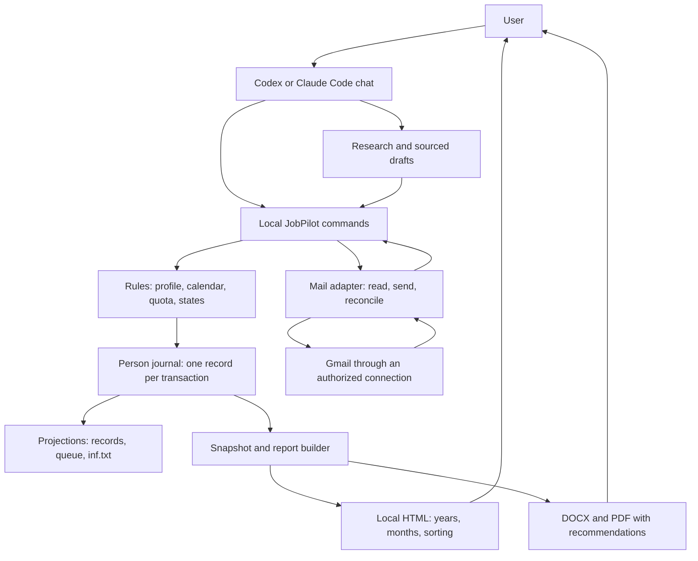

# HomenS.AI JobPilot — Architecture 1.2

[English](ARCHITECTURE.md) | [Русский](docs/ru/ARCHITECTURE.md)

7 October 2026 · Concept and project author: Serhii Khomenko / HomenS.AI · https://homensai.com/ · Documentation: CC BY-NC 4.0.

Status: design. The commands and modules described here still need to be implemented independently. This document supplements AI_BUILD_SPEC.md and DATA_CONTRACT.md. Servers, Docker and SQL are not required.

## 1. Core decision

The system consists of an agent, a small set of local tools and a data folder. The agent researches, interprets information, writes text and talks to the user. The tools validate formats, record operations, calculate quotas and schedules, and build reports. Each tool starts on demand, completes its work and exits. No persistent process or listening network port is needed.

The first local implementation will use original Python modules and the standard library. Setup selects an available runtime and records its path locally. DOCX/PDF processing and email use separate adapters for available tools; their capabilities are checked, and dependencies are not installed automatically. The statistics page uses original HTML/CSS/JavaScript without external libraries.



This diagram describes the future implementation. HTML does not invoke commands; data updates begin with an agent run.

## 2. Modules and responsibilities

| Module | Input → output | Responsibility |
|---|---|---|
| `entrypoint` | Root + JSON command → JSON result | Version, permitted root, person/profile selection and routing |
| `domain` | Current state + command → new events | State transitions, sending conditions, the 44 quota and profile boundaries |
| `storage` | Transaction → durable journal record | Single writer, revisions, command deduplication and recovery |
| `profile` | Documents/questionnaire → proposed facts → confirmed version | Sources for every fact and independent language settings |
| `discovery` | Agent research → target records | Duplicates, freshness, radius and route verification |
| `documents` | Requirements + confirmed facts → package and manifest | Versions, hashes, fact references and visual QA status |
| `planning` | Packages + permitted workdays → queue | Even distribution, reservations, rescheduling and overdue entries |
| `mail` | Mail observations / accepted package → events | Full threads, send evidence, DSN handling and replies |
| `reporting` | Fixed revision + period → DOCX/PDF/HTML | Consistent counters, late replies and the market appendix |
| `adapters` | Standard request → specific tool | Gmail, search, routes, rendering and capability discovery |

These modules belong to one local package. Shared domain/storage code does not import Codex, Claude, Gmail or HTML. Adapters return results to commands rather than editing the journal directly. The agent proposes recommendation text and mail classifications; tools perform exact counting, deduplication and state transitions.

Proposed source structure for the future implementation:

```text
jobpilot.py                   # short-lived entry point
jobpilot/
  commands.py                 # command handling and results
  domain/                     # rules without filesystem or network access
  storage/                    # journal, locks, projections, recovery
  workflows/                  # prepare, plan, check_mail, close_month
  adapters/                   # mail, rendering, source import
  reporting/                  # shared calculations, DOCX/PDF/HTML
schemas/                      # versioned formats
dashboard_template/           # clean display-only HTML
tests/fixtures/               # synthetic cases
```

This is a proposed layout; the executable files listed above do not exist yet.

## 3. The accounting unit is a person

`person_id` groups one person's search directions. Each direction has its own profile_id, document languages, account, documents and consents. Quota accounting and repeat-application checks are shared by person_id. Different people have separate journals.

```text
Локальные_данные/
  workspace.json                    # workspace_id, format, active person/profile
  runtime.json                      # discovered tool paths; no secrets
  persons/<person_id>/
    journal/transactions.jsonl       # sole authoritative operational journal
    journal/writer.lock              # one writer per person
    state/person.json               # person and profile-list projection
    state/quota.json                # monthly reservation/consumption projection
    state/checkpoint.json           # state snapshot verified through sequence
    outbox/<attempt_id>/            # immutable prepared send package
  profiles/<profile_id>/
    profile.json                    # current confirmed configuration projection
    registry.json                   # companies, vacancies, applications, queue
    inbox/                          # unconfirmed imports and proposals
    source_documents/               # personal originals
    versions/                       # profile/document versions; hashes in events
    runs/                           # cycle plans, results and questions
    reports/<YYYY-MM>/              # report revisions and manifests
    <YYYY>/<MM_Month>/<NNN_Company_City_Role>/
  dashboard/
    index.html                      # local entry page linking to profiles
    profiles/<profile_id>/
      summary.json                  # this profile plus the person's shared quota
      index.html                    # the same snapshot embedded in HTML
```

The `Локальные_данные` directory name is a shared technical path in both language versions.

Every event carries person_id and, where applicable, its profile; the shared quota has person scope. Commands verify that the profile belongs to the person and account. Isolation prevents application-level routing mistakes; a different profile_id does not itself create an OS-level access boundary for the same computer user.

## 4. One record per local transaction

Version 1.1 proposed separate authoritative quota and profile journals. Version 1.2 combines them: quota reservation, send start and application changes are stored in one JSONL transaction object. Recovery no longer has to reconcile two primary files.

A transaction contains:

- schema_version, transaction_id, person_id, sequence and previous_record_hash;
- command_id, request_hash and expected_revision;
- recorded_at and an events array with unique event_id values;
- the saved command result, sufficient to return on a retry;
- record_hash of the canonical UTF-8 JSON record, excluding record_hash itself.

A record is accepted only after a complete LF-terminated line, format/hash validation and durable writing. JSON canonicalization is consistent: sorted keys, compact separators, no NaN/Infinity or ambiguous floating-point representations in monetary/count fields. Sequence increases by exactly 1. The hash chain detects corruption; it does not replace digital signatures or OS permissions.

Command order: acquire the exclusive lock → reload the tail → check command_id first → check expected_revision and domain conditions → append one transaction → flush/fsync → release the lock → build projections. The same command_id and request_hash return the previous result. Reusing an ID for a different request produces IDEMPOTENCY_CONFLICT. A new command with an outdated revision produces REVISION_CONFLICT. Two agents cannot silently overwrite each other's decisions.

The lock is held only during the local commit. Research, text generation, rendering and email waiting happen outside it. Lock creation must be exclusive; checking whether a file exists is insufficient. An abandoned owner or damaged record requires recovery, not automatic timer-based removal.

Document packages are first created and checked in a temporary directory. They are then placed as a new immutable version, after which the journal registers paths and hashes. A crash before that event leaves an orphan version that is ineligible for sending. Accepted application documents are not replaced in place.

## 5. A command contract for any agent

The future entry point accepts JSON from a file inside the root or from stdin. It does not accept free-text instructions or interpolate user fields into shell commands. Every modifying command has command_id, expected_revision, person_id and, where needed, profile_id. The root is supplied separately and canonicalized once.

| Command | Result |
|---|---|
| `workspace.inspect` | Inventory, format, available capabilities, selected person/profile |
| `run.resume` | Unfinished operations, next actions, questions and revision |
| `profile.propose` / `profile.confirm` | Proposed facts / a confirmed version |
| `target.import` | Sourced target records or a conflict list |
| `package.register` | Document version, hashes, QA and review status |
| `queue.plan` | Specific slots and quota availability as a preview |
| `queue.commit` | A committed plan and reservations after acceptance |
| `send.preflight` | Eligible/blocked decision and exact reasons; no external effect |
| `send.execute` | One authorized transport call and a recorded outcome |
| `mail.ingest` / `mail.classify` | Stored observations / confirmed classification |
| `mail.reconcile` | Evidence reconciliation without resending |
| `projection.rebuild` | Records, inf.txt and queue rebuilt from the journal |
| `report.build` / `dashboard.build` | Artifacts using the same source_revision |
| `workspace.backup` / `workspace.restore_check` | Consistent backup / isolated restore verification |

`queue.plan` previews a calculation. Reservations become active only after queue.commit; journal records determine the actual remaining quota. `send.preflight` is not a permanent authorization token: send.execute rechecks the current revision, time, consent and hashes.

A command response includes status (`ok / needs_input / conflict / blocked / failed`), code, command_id, source_revision, artifacts, facts and next_action. Error codes remain stable, such as ACCOUNT_MISMATCH, QUOTA_EXHAUSTED, SEND_UNCERTAIN, CAPABILITY_MISSING, JOURNAL_DAMAGED and PACKAGE_CHANGED. The agent explains them to the user in ordinary language and gives a concrete next action.

Request shape: [examples/command.example.json](examples/command.example.json). This is a synthetic example, not an active task.

## 6. Sending and the outbox

The outbox is an immutable local package for one attempt: recipient, subject/body, files/hashes, account_id, application_id, attempt_id and consent_ref. It contains no secrets. It is not a separate server or an autonomous mail sender.

1. Prepare the outbox and verify package_hash.
2. In one local transaction, record send_started and reserve quota, or convert an existing planned reservation to in-flight. Assign exactly one executor to attempt_id.
3. Release the lock. Only that executor calls the transport once. A repeated run finds the existing attempt and reconciles it.
4. For a verified send, record sent_verified and convert reserved to consumed in one transaction. For a proven non-send, record failed_before_send and release the reservation. Otherwise retain the reservation and mark send_uncertain.
5. Projections and reports may be rebuilt later. Losing HTML or registry.json does not trigger a second email.

The external call and the local record are not atomic. If the executor dies after send_started, the system cannot assume whether the service was called. Consent revoked before send_started blocks sending; after a committed start, an external effect may already be underway and must be reconciled rather than promised cancelled. Failure to find SENT during an incomplete check does not prove non-submission.

Thank-you deduplication key: account_id + incoming gmail_message_id + action_type. The single period-question key is account_id + thread_id + action_type. Check these keys in the same action-start transaction to prevent two concurrent chats from replying twice.

## 7. Adapters and capability discovery

Codex and Claude Code use the same workflow. Tool invocation and authentication belong to adapters, not to quota/report rules.

Environment checks record capabilities independently: filesystem, web_search, route_lookup, mail_read, full_thread_read, mail_send, sent_evidence, docx_render, pdf_render and scheduled_wakeup. Each stores available/unavailable/unknown, checked_at and a non-secret tool version. A configuration entry is not evidence of a working capability.

| Unavailable capability | Work that can continue |
|---|---|
| Gmail | Research, profile work and local packages; mail statistics remain marked unverified |
| Sending or SENT verification | Drafts and reading; automatic external actions stay disabled |
| Routes | Keep the target as route_unverified; do not claim it meets travel requirements |
| Rendering | Save draft documents; do not mark visual QA accepted |
| Agent scheduling | Manual run.resume; the queue remains in files |

The mail adapter must support identify_account, list_messages with pagination, get_thread, send_once and find_send_evidence. These are internal interface names, not a claim that an external service exposes these exact methods. The adapter reports its actual capabilities.

An integration that only allows direct mail calls from the chat acts as an agent_bridge. The agent can use shared preflight/journaling, but technical bypass prevention is not established by that alone. The first implementation must not advertise this transport as ready for scheduled_send_with_profile_consent until a verified send.execute path covers the external call and recovery. Controlled reading and preparation may become available earlier.

## 8. New chats and the daily cycle

Instruction files define policy; the journal holds state. The future TODO describes stages, but a Markdown checkbox is not proof of sending or quota consumption.

When resuming, the agent:

1. Checks workspace_id, format, selected profile and tool capabilities.
2. Calls run.resume and addresses corruption or uncertain sends first.
3. Retrieves new mail across all required pages, including replies to older applications.
4. Applies permitted actions and the queue, then updates reports/statistics.
5. Saves run_id, actual actions, evidence, questions and next_action under runs; the next chat continues from that point.

Context limits or an interrupted chat do not change state: unfinished operations remain in the journal. Before each external action, the agent rereads the relevant current status. Session summaries and checkpoints are accelerators, not independent sources of truth.

Mail cursor/checkpoint advancement happens only after an entire processed page is saved. Re-reading is safe through deduplication by `(account_id, gmail_message_id)`. If history/cursor access is unavailable, perform a bounded overlapping rescan and explicitly mark incomplete coverage. An incomplete scan cannot support “no new replies.” A failure for one profile does not mark other profiles checked.

## 9. Snapshots, reports and scale

One reporting calculation produces rows and counters from a fixed journal sequence. DOCX/PDF and HTML receive the same source_revision and cutoff; presentation layers do not independently recalculate business statistics. Market analysis has its own timestamps/sources and does not alter verified mail counts.

`dashboard/index.html` is a local entry page for separate profile snapshots. A profile page includes only its applications and that person's shared quota. Adding a profile does not automatically embed its data in another person's open snapshot.

HTML contains embedded JSON, sorting/filtering and the update time. Scripts do not send commands or query Gmail. Snapshot replacement is atomic for the HTML file itself; the separate summary.json is checked against snapshot_id on the next run.

A checkpoint contains sequence/hash and materialized state and is accepted only if it matches the corresponding journal record. The remaining tail is then replayed. Initially no journal rotation is needed. Avoid indexes, queue services or background workers until actual latency has been measured. Full recovery from the complete journal remains mandatory.

## 10. Format changes and the first release boundary

Documentation version is 1.2; schema_version in new examples is 1.2. Reading older 1.1 data does not migrate it automatically. Migration first creates a copy/report, matches overlapping records from the two old journals by operation_id, then writes the unified journal. Originals remain available. No real JobPilot data exists at present, so this revision changes only project documents and examples.

The first verifiable implementation slice is: synthetic profile → one target → registered package → plan → simulated reply → neutral report and offline HTML. Gmail reading and managed sending are added separately. Crash and concurrent-command tests precede scheduled sending. Automated discovery does not imply a complete or guaranteed view of the market.

Verification scenarios are listed in ACCEPTANCE_TESTS.md. Acceptance requires evidence that modules work, not merely the existence of this architecture document.

## 11. Two languages, one project

English is the primary edition at the project root. The complete Russian edition lives in docs/ru; each page links to its counterpart. The same section structure, command identifiers, examples and requirements apply to both. A wording discrepancy is corrected in both editions against the user's requirement and the English base; it is not a second policy configuration.

The future statistics UI defaults to en and supports ru. Label dictionaries have identical keys and are embedded during HTML generation, so switching languages needs no fetch or server. A missing translation falls back to English and is recorded during generation. Date formatting changes presentation only; sorting uses original timestamps. Source company names and recorded evidence are not rewritten when changing the UI language. CV, cover-letter, email and report languages remain independently selected and are not limited to en/ru by the documentation UI.
