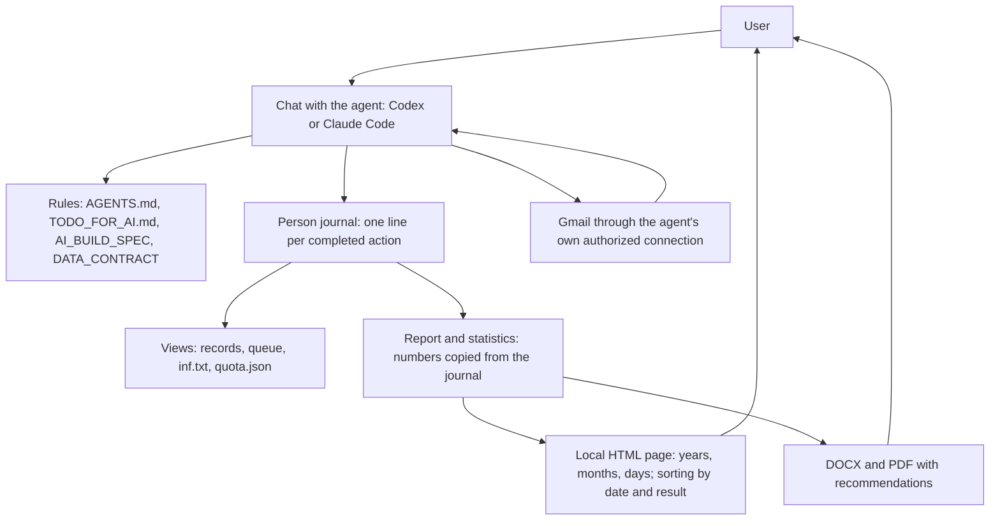

# HomenS.AI JobPilot — Architecture 1.4

[English](ARCHITECTURE.md) | [Русский](docs/ru/ARCHITECTURE.md)

7 October 2026 · Author of the idea and developer: Serhii Khomenko / HomenS.AI · https://homensai.com/ · Documentation: CC BY-NC 4.0.

Status: design. The system has **no program code**. It consists of rules written in documents and an AI agent that follows them and keeps plain files. This document supplements AI_BUILD_SPEC.md and DATA_CONTRACT.md. Servers, Docker, SQL and scripts are not used.

## 1. Core decision: rules and files

The system consists of three things: an **AI agent** (Codex or Claude Code), **written rules** and a **data folder**. The agent researches, interprets information, writes text and talks to the user. It also keeps the records: it follows the rules (`AGENTS.md`, `CLAUDE.md`, `TODO_FOR_AI.md`, this document and DATA_CONTRACT.md), writes JSON, JSONL and Markdown files, and updates the statistics page by replacing its data block. Every file is plain text that a person can open and read.

**What follows from this.** The safeguards of the system — the limit of 44 submissions, “never send twice”, “one writer at a time”, “nothing is sent without permission” — are *procedures that the agent must follow*, not technical locks. Nothing in the system can physically stop an agent that ignores a rule. For this reason:

- every rule is written as a short checklist the agent runs before the action and shows to the user when sending is involved;
- the safest mode is the default: drafts only, then approval of each message by the user in the chat;
- fully automatic sending is allowed only if the user has switched it on for a profile and has acknowledged in writing that the limit and duplicate protection then depend on the agent following the rules;
- the acceptance scenarios (ACCEPTANCE_TESTS.md) are checked by hand, in the chat, with synthetic data, before any real sending.



The HTML page does not give commands to anyone; data is updated only when the agent works.

## 2. Parts and responsibilities

| Part | What the agent does | Where it is kept |
|---|---|---|
| Workspace | Checks the folder, the format version, the selected person and profile; reports what it can really do | `workspace.json` |
| Profile and knowledge base | Materials from `Положите_сюда` and an interview in the chat → proposed facts → facts confirmed by the user, with the source of every fact; then the search profile (goals, radius, separate language settings) | `persons/<person_id>/База_знаний/Жизнеописание.md`, `profiles/<profile_id>/profile.json` |
| Discovery | Records research results as targets: duplicates, freshness, radius, route verification | `registry.json` |
| Documents | Builds the package from requirements and confirmed facts: versions, fact references, visual check status | application folder |
| Planning | Spreads packages over permitted workdays, reserves slots, reschedules, marks overdue entries | `registry.json`, journal |
| Mail | Reads whole threads, checks proof of sending, handles delivery notices and replies | journal, `inf.txt` |
| Reporting | Counts for a fixed journal position and period; produces DOCX/PDF/HTML with the same numbers; adds the market appendix | `reports/`, `dashboard/` |
| Capability check | Tests each tool it has (see section 7) and records the result | `workspace.json` |

The agent proposes recommendation text and mail classifications. Counting, de-duplication and state changes follow the written rules and are always recorded in the journal first.

Instruction files (Markdown, not code; drafts that have not yet been tried in practice): `AGENTS.md` for Codex, `CLAUDE.md` for Claude Code (it imports `AGENTS.md`), `TODO_FOR_AI.md` with the first-run flow and the step-by-step checklists. The agent loads its rules file by itself when the folder is opened, so the person only has to say “start”.

## 3. The accounting unit is a person

`person_id` groups one person's search directions. Each direction has its own profile_id, document languages, account, documents and consents. Quota accounting and repeat-application checks are shared by person_id. Different people have separate journals.

```text
Локальные_данные/
  workspace.json                    # workspace_id, format, language, stage of the first run, capability check results
  Положите_сюда/                    # the ONLY place where the person puts things (the agent only reads it)
    1_Мои_документы/                # CVs, diplomas, certificates, references (originals, never changed)
    2_Рассказ_о_себе/               # the person's story: voice transcripts, notes, interviews, the questions
    3_Шаблон_отчёта/                # optional report template
  persons/<person_id>/
    База_знаний/Жизнеописание.md    # the knowledge base: the person's life story as confirmed facts
    journal/transactions.jsonl       # sole authoritative journal
    journal/writer.lock              # exists only while one chat is writing
    state/person.json               # person and profile-list view
    state/quota.json                # monthly counters, rebuilt from the journal
    outbox/<attempt_id>/            # prepared send package, never edited
  profiles/<profile_id>/
    profile.json                    # current confirmed configuration
    registry.json                   # companies, vacancies, applications, queue
    versions/                       # profile/document versions
    runs/                           # work sessions: plans, results, questions
    reports/<YYYY-MM>/              # report revisions and manifests
    <YYYY>/<MM_Month>/<NNN_Company_City_Role>/
  dashboard/
    index.html                      # local entry page linking to profiles
    profiles/<profile_id>/
      summary.js                  # this profile plus the person's shared quota
      index.html                    # an unchanged copy of dashboard_template/index.html
```

The `Локальные_данные` directory name is a shared technical path in both language versions.

Every journal line carries person_id and, where applicable, its profile; the shared quota has person scope. Before acting, the agent checks that the profile belongs to the person and the account. Isolation prevents routing mistakes in the rules; a different profile_id does not itself create an operating-system access boundary for the same computer user.

## 4. One line per completed action

The journal is a text file with one JSON object per line. A line is written when an action is **completed**, and contains:

- `schema_version`, `sequence` (1, 2, 3 … without gaps), `action_id`, `person_id`, `recorded_at`;
- an `events` list, each event with its own unique `event_id` (quota reservation, send start, application change, and so on);
- a short `result` text that is enough to repeat the answer to the user if the same action is asked for again.

Rules for the agent:

1. **Append only.** An old line is never edited or deleted. A correction is a new line that names the earlier event it replaces (`supersedes_event_id`).
2. **Before writing:** read the last line, take the next `sequence`, and check that this `action_id` is not already in the journal. If it is, report the earlier result and do nothing else. This protects against an interrupted chat that is started again.
3. **Write the whole line at once**, then update the views (registry, queue, `inf.txt`, `quota.json`, statistics). If the chat stops between the two, the next chat rebuilds the views from the journal.
4. **A damaged or half-written last line** is not repaired silently. The agent stops, keeps the file as it is, tells the user and recovers from the last complete line and the mail evidence.
5. **One writer at a time.** Before writing, the agent creates `writer.lock` containing the run id and the time. If the file already exists and is not its own, it stops and asks the user whether another chat is still working; it removes the lock only after the user confirms that no other chat is active. When the work is done, it deletes its own lock. This is a convention: it protects only if every chat follows it, which is why the user is asked to keep one chat working at a time.
6. A quota or send decision always rereads the journal; a summary from an earlier part of the chat is never trusted.
7. **Count with the system's own tool, not by eye.** To find out how many slots a month has used, the agent counts the journal lines that contain a `"type":"sent_verified"` event with `occurred_at` in that month (the month is the person's local month, so lines within one day of the UTC month boundary are read by hand and converted to the person's time zone), using a command that the operating system already has (on Windows, for example, `Select-String` and `Measure-Object` in PowerShell) and shows the number to the user. It compares the result with `quota.json`; if they differ, the journal is right and `quota.json` is rebuilt. The same applies to checksums of files (`Get-FileHash`). No script is added to the package for this.

Document packages are first prepared in a temporary folder and checked. They are then saved as a new, numbered version folder (`v001`, `v002`), and only then registered in the journal with file names, sizes and, where the system's own tools can provide it, a checksum. A package that was accepted is never changed in place: a change creates a new version and returns the application to review.

## 5. Standard actions

Instead of programmed commands, the agent performs named actions. Each action is a checklist in `TODO_FOR_AI.md`; the names are used in the journal and in messages to the user.

| Action | Result |
|---|---|
| Inspect workspace | Inventory, format, available capabilities, selected person and profile |
| Resume work | Unfinished operations, next actions, questions |
| Propose / confirm profile | Proposed facts / a confirmed version |
| Import targets | Sourced target records or a list of conflicts |
| Register package | Document version, file list, check and review status |
| Plan queue | A preview of specific slots and quota availability |
| Commit plan | The plan and reservations are recorded after the user accepts |
| Send check | “Allowed” or “blocked” with exact reasons; nothing is sent |
| Send | One authorized send and a recorded outcome |
| Read / classify mail | Stored observations / a confirmed classification |
| Reconcile mail | Comparison with proof, without sending again |
| Rebuild views | Records, `inf.txt`, queue and `quota.json` rebuilt from the journal |
| Build report / statistics | Report files and the statistics page with the same numbers |
| Backup / restore check | A consistent copy and a check in a separate folder |

The agent's answer for every action states: the outcome (`ok`, `needs_input`, `conflict`, `blocked` or `failed`), a reason code, the journal position, the files it produced, and the next step in ordinary language. Reason codes stay stable: `ACCOUNT_MISMATCH`, `QUOTA_EXHAUSTED`, `SEND_UNCERTAIN`, `CAPABILITY_MISSING`, `JOURNAL_DAMAGED`, `PACKAGE_CHANGED`.

“Plan queue” only previews. Reservations become active only after “Commit plan”; the journal determines the real remaining quota. A successful “Send check” is not permission that lasts: “Send” checks the current journal position, the time, the consent and the package again.

## 6. Sending and the outbox

The outbox is a prepared folder for one attempt: recipient, subject and body, files, `account_id`, `application_id`, `attempt_id` and the reference to the consent. It contains no secrets. It is not a separate mail server.

1. Prepare the outbox and check that the package has not changed since approval.
2. In one journal line record `send_started` and reserve a slot (or turn a planned reservation into an in-flight one). Exactly one chat owns each `attempt_id`.
3. Only that chat makes the single send call with the agent's mail tool. If the work is repeated, the existing attempt is found and reconciled instead.
4. After a verified send, record `sent_verified` and turn the reservation into a used slot in one line. After a proven non-send, record `failed_before_send` and release the reservation. Otherwise keep the reservation and mark `send_uncertain`.
5. Views and reports can be rebuilt later. Losing the HTML page or `registry.json` never causes a second email.

The external call and the local record cannot be made atomic. If the chat stops after `send_started`, nobody can know whether the mail service was called. Consent withdrawn before `send_started` blocks the send; after a recorded start the send may already be under way and must be reconciled, not promised cancelled. Not finding the message in SENT during an incomplete check does not prove that it was not sent.

De-duplication of thank-you messages uses: account_id + incoming gmail_message_id + action_type. The single question about the period uses: account_id + thread_id + action_type. These keys are checked in the same journal line that starts the action, so that two chats cannot answer the same message twice.

## 7. Capabilities of the agent's tools

Codex and Claude Code follow the same rules. How a tool is called and how it signs in is the business of the agent's platform, not of these rules.

At setup the agent tests each capability separately: filesystem, web search, route lookup, mail reading, whole-thread reading, mail sending, proof of sending (SENT), DOCX rendering, PDF rendering and scheduled wake-up. For each it records available / unavailable / unknown, the time of the check and a non-secret tool version in `workspace.json`. A line in a settings file is not evidence of a working capability.

| Unavailable capability | Work that can continue |
|---|---|
| Gmail | Research, profile work and local packages; mail statistics stay marked unverified |
| Sending or SENT verification | Drafts and reading; automatic external actions stay off |
| Routes | The target stays `route_unverified`; the agent does not claim it meets the travel requirements |
| Rendering | Draft documents are saved; visual check is not marked accepted |
| Agent scheduling | The user starts a new chat by hand; the queue stays in files |

For mail the agent needs five abilities: identify the account, list messages page by page, read a whole thread, send once, and find proof of a send. These are plain descriptions, not interface names; the agent reports what its tools really offer.

Because the agent's own mail tool is the only way to send, nothing separate exists that could enforce the monthly limit. Therefore scheduled automatic sending is not offered by default. It can be switched on only for a profile whose user has read and accepted this limitation, after the acceptance scenarios for sending have been checked in that user's own environment. Controlled reading and preparation can be used earlier.

## 8. New chats and the daily cycle

Instruction files define the rules; the journal holds the state. The to-do list describes stages, but a checkbox in Markdown is not proof of sending or of quota use.

**First run.** A folder without `workspace.json` is new. The agent then starts Part A of `TODO_FOR_AI.md` on its own: introduction, check of its tools, consent, the person's story (by voice if nothing is written), the person's documents, analysis and the knowledge base, confirmation of the facts, then the search setup (what is searched, where the person lives, radius, transport). Its position is kept in `workspace.json` as `stage` (`new`, `consent_given`, `story_ready`, `documents_ready`, `knowledge_base_draft`, `knowledge_base_confirmed`, `profile_created`, `ready`), so an interrupted first run continues where it stopped.

When resuming, the agent:

1. Checks workspace_id, format, the selected profile and the capabilities of its tools.
2. Performs “Resume work” and deals first with damage or uncertain sends.
3. Reads new mail across all required pages, including replies to older applications.
4. Applies the permitted actions and the queue, then updates reports and statistics.
5. Saves a session record under `runs` — run id, actual actions, evidence, questions and the next step — so that the next chat continues from there.

A context limit or an interrupted chat does not change the state: unfinished operations stay in the journal. Before every external action the agent rereads the relevant status. Session summaries are helpers, never the source of truth.

The mail position is moved forward only after a whole processed page is saved. Reading a page again is safe because messages are matched by `(account_id, gmail_message_id)`. If the mail tool cannot continue from a position, the agent rescans a bounded, overlapping period and says explicitly that coverage is incomplete. An incomplete scan can never support “no new replies”. A failure for one profile does not mark other profiles as checked.

## 9. Snapshots, reports and scale

For a report the agent counts once, from a fixed journal position, and copies the same rows and counters into DOCX/PDF and into the statistics page; it never recounts the same numbers separately for each format. Both carry the same `source_revision` and cut-off. The market analysis has its own dates and sources and does not change verified mail counts.

`dashboard/index.html` is a local entry page that links to the separate profile snapshots. A profile page includes only its own applications and the person's shared quota. Adding a profile does not put its data into another person's open snapshot.

The statistics page reads its data from the file `summary.js` next to it, and contains the sorting, the filtering and the update time. The agent writes only `summary.js`; the page file is a copy of the template and is never edited, so a mistake in the data cannot break the page. The page does not send commands and does not query Gmail. The agent writes `summary.js` as a whole and compares its `snapshot_id` with the reports in the next session.

The journal grows by a few lines a day, which plain files handle easily. No indexes, queues or background workers are needed. The ability to rebuild every view from the full journal always remains.

## 10. Format changes and the first release boundary

The documentation version is 1.4; `schema_version` in the examples stays 1.2 because the file formats did not change. Older 1.1 data is not migrated automatically: a migration first makes a copy and a report, matches overlapping records of the two old journals by operation_id and then writes the single journal. Originals stay available. No real JobPilot data exists at present, so this revision changes only documents and examples.

The first trial is a full pass on synthetic data, done by hand in a chat: profile → one target → registered package → plan → simulated reply → neutral report and offline HTML. Reading Gmail and controlled sending are added separately. The checks for interrupted work and for two chats at once come before any scheduled sending. Automatic search never implies a complete or guaranteed view of the market.

The verification scenarios are in ACCEPTANCE_TESTS.md. Acceptance needs recorded evidence that the rules work in practice, not just the existence of this document.

## 11. Two languages, one project

English is the primary edition at the project root. The complete Russian edition lives in docs/ru; each page links to its counterpart. The same section structure, action names, examples and requirements apply to both. A wording difference is fixed in both editions against the user's requirement and the English base; it is not a second set of rules.

The statistics page uses `en` by default and supports `ru`. The label dictionaries have identical keys and are embedded in the page, so switching languages needs no network and no server. A missing translation falls back to English. Date formatting changes only the display; sorting uses the original timestamps. Company names and recorded evidence are not rewritten when the interface language changes. CV, cover letter, email and report languages stay separately selected and are not limited to en/ru by the documentation interface.

---

© 2026 Serhii Khomenko / HomenS.AI · [homensai.com](https://homensai.com/) · [GitHub](https://github.com/HomenSAI) · [LinkedIn](https://www.linkedin.com/in/serhii-khomenko-homensai/) · [ORCID](https://orcid.org/0009-0009-5371-9717) · [DOI](https://doi.org/10.5281/zenodo.23160031) · info@homensai.com · [CC BY-NC 4.0](https://creativecommons.org/licenses/by-nc/4.0/)
