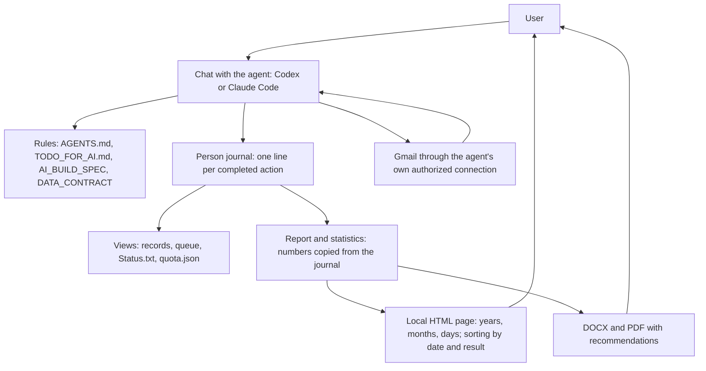

Deutsche Fassung. Maßgeblich ist die englische Fassung (DATA_CONTRACT.md bzw. ARCHITECTURE.md im Hauptverzeichnis).

# HomenS.AI JobPilot — Architektur 1.5

[English](../../ARCHITECTURE.md) | [Русский](../ru/ARCHITECTURE.md) | [Deutsch](ARCHITECTURE.md)

9. Oktober 2026 · Autor der Idee und Entwickler: Serhii Khomenko / HomenS.AI · https://homensai.com/ · Dokumentation: CC BY-NC 4.0.

Status: Entwurf und Betriebsspezifikation. Der Arbeitsablauf hat keine eigene Anwendung für die Jobsuche oder den Mailversand; er besteht aus einem KI-Agenten, schriftlichen Verfahren und lokalen Dateien. Die Statistikansicht enthält HTML/CSS/JavaScript, das einen vom Agenten geschriebenen Snapshot prüft, sortiert, filtert und anzeigt. Sie führt keine Recherche durch, verschickt keine Mails und ändert das Journal nicht. Dieses Dokument ergänzt AI_BUILD_SPEC.md, DATA_CONTRACT.md und OPERATING_REQUIREMENTS.md. Server, Docker und SQL werden nicht verwendet.

Die Abschnitte 3 (Isolation), 4b (Schreibsperre), 6a (Gmail Scheduled), 6b (Replay), 8a–8c (Takt, monatliche Vorbereitung, tägliche Prüfung) und 12 (lokale Archive und Wiederherstellung) beschreiben Verfahren, die bei der konsolidierten Prüfung (Befunde F04, F07, F12 und Anforderungen R01–R05) ergänzt wurden. Es sind nur schriftliche Verfahren; keines davon wurde bisher ausgeführt. Den Status jedes Verfahrens hält ACCEPTANCE_TESTS.md im Abschnitt „Consolidated review F01–F14 and R01–R20“ fest.

## 1. Grundentscheidung: Regeln und Dateien

Das System besteht aus einem **KI-Agenten** (Codex oder Claude Code), **schriftlichen Regeln**, einem **Datenordner** und einer lokalen Statistikansicht. Der Agent recherchiert, interpretiert Informationen, schreibt Dokumente und spricht mit der Person. Er folgt `AGENTS.md`, `CLAUDE.md`, `TODO_FOR_AI.md`, `OPERATING_REQUIREMENTS.md`, diesem Dokument und DATA_CONTRACT.md; er pflegt JSON-, JSONL-, Markdown- und freigegebene Dokumentdateien. Die Statistikansicht liest den Daten-Snapshot des Agenten und stellt ihn nur dar. Jeder Datensatz bleibt eine lesbare Datei.

**Was daraus folgt.** Die Sicherungen des Systems — die Grenze von 44 Einreichungen, „nie zweimal senden“, „ein Schreiber zur Zeit“, „ohne Erlaubnis wird nichts gesendet“ — sind *Verfahren, die der Agent einhalten muss*, keine technischen Sperren. Nichts im System kann einen Agenten physisch stoppen, der eine Regel ignoriert. Deshalb gilt:

- jede Regel ist als kurze Checkliste geschrieben, die der Agent vor der Handlung durchläuft und der Person zeigt, wenn ein Versand betroffen ist;
- der sicherste Modus ist der Standard: nur Entwürfe, danach die Freigabe jeder Nachricht durch die Person im Chat;
- vollautomatischer Versand ist nur erlaubt, wenn die Person ihn für ein Profil eingeschaltet und schriftlich bestätigt hat, dass Grenze und Doppelschutz dann davon abhängen, dass der Agent die Regeln einhält;
- die Abnahmeszenarien (ACCEPTANCE_TESTS.md) werden von Hand im Chat mit synthetischen Daten geprüft, bevor echter Versand stattfindet.



Die HTML-Seite gibt niemandem Befehle; Daten werden nur aktualisiert, wenn der Agent arbeitet.

## 2. Teile und Zuständigkeiten

| Teil | Was der Agent tut | Wo es aufbewahrt wird |
|---|---|---|
| Workspace | Prüft den Ordner, die Formatversion, die gewählte Person und das Profil; meldet, was er tatsächlich leisten kann | `workspace.json` |
| Profil und Wissensbasis | Materialien aus `Положите_сюда` und ein Interview im Chat → vorgeschlagene Fakten → von der Person bestätigte Fakten, mit der Quelle jedes Fakts; danach das Suchprofil (Ziele, Radius, getrennte Spracheinstellungen) | `persons/<person_id>/База_знаний/Жизнеописание.md`, `profiles/<profile_id>/profile.json` |
| Recherche | Hält Rechercheergebnisse als Ziele fest: Duplikate, Aktualität, Radius, Routenprüfung | `registry.json` |
| Dokumente | Erstellt das Paket aus Anforderungen und bestätigten Fakten: Versionen, Faktenverweise, Stand der Sichtprüfung | Bewerbungsordner |
| Planung | Verteilt Pakete auf erlaubte Arbeitstage, reserviert Slots, plant um, markiert überfällige Einträge | `registry.json`, Journal |
| Mail | Liest ganze Threads, prüft den Versandnachweis, bearbeitet Zustellungsmeldungen und Antworten | Journal, `Status.txt` |
| Berichtswesen | Zählt für eine feste Journalposition und einen Zeitraum; erstellt DOCX/PDF/HTML mit denselben Zahlen; ergänzt den Marktanhang | `reports/`, `dashboard/` |
| Fähigkeitsprüfung | Prüft jedes Werkzeug, das er hat (siehe Abschnitt 7), und hält das Ergebnis fest | `workspace.json` |

Der Agent schlägt Empfehlungstexte und Mail-Klassifikationen vor. Zählung, Duplikatprüfung und Zustandsänderungen folgen den schriftlichen Regeln und werden immer zuerst im Journal festgehalten.

Anweisungsdateien (Markdown, kein Code; Entwürfe, die in der Praxis noch nicht erprobt wurden): `AGENTS.md` für Codex, `CLAUDE.md` für Claude Code (es importiert `AGENTS.md`), `TODO_FOR_AI.md` mit dem Ablauf der Erstinstallation und den Schritt-für-Schritt-Checklisten. Der Agent lädt seine Regeldatei selbst, wenn der Ordner geöffnet wird, sodass die Person nur „start“ sagen muss.

## 3. Die Buchungseinheit ist die Person

`person_id` fasst die Suchrichtungen einer Person zusammen. Jede Richtung hat eine eigene `profile_id`, eigene Dokumentsprachen, ein eigenes Konto, eigene Dokumente und eigene Einwilligungen. Die Kontingentzählung und die Prüfung auf wiederholte Bewerbungen erfolgen gemeinsam pro `person_id`. Verschiedene Personen haben getrennte Journale.

```text
Локальные_данные/
  workspace.json                    # workspace_id, format, language, stage of the first run, capability check results
  Положите_сюда/                    # the ONLY place where the person puts things (the agent only reads it)
    1_Мои_документы/                # CVs, diplomas, certificates, references (originals, never changed)
    2_Рассказ_о_себе/               # the person's story: voice transcripts, notes, interviews, the questions
    3_Шаблон_отчёта/                # optional report template
  persons/<person_id>/
    База_знаний/Жизнеописание.md    # the knowledge base: the person's life story as confirmed facts
    journal/transactions-YYYY-MM.jsonl  # sole authoritative journal, monthly segments, split into -pN parts above 500 lines; only the current segment is written
    journal/writer.lock              # exists only while one chat is writing
    state/person.json               # person and profile-list view
    state/quota.json                # monthly counters, rebuilt from the journal
    outbox/<send_attempt_id>/            # prepared send package, never edited
  Resume/                              # resume template: your Word file, or a PDF converted to Word here
  CoverLetter/                         # cover letter template, same design as the resume
  profiles/<profile_id>/
    profile.json                    # current confirmed configuration
    registry.json                   # targets, applications and the queue (projection)
    runs/                           # work sessions: plans, results, questions
    reports/<YYYY-MM>/              # report revisions and manifests (in English, Russian or German)
  Applications/                       # ALL application work of the person, one tree for all years
    2026/                           # year
      10_October/                   # two-digit month number + English month name
        001_Muster-Maschinenbau_Stuttgart_Maintenance-technician/   # number, company, city, role
          Company.md                # company data from public sources, each with source and check date
          Resume_v001.docx          # versions are new files: Resume_v002.docx, ...
          Resume_v001.pdf
          CoverLetter_v001.docx
          CoverLetter_v001.pdf
          EmailText_de.txt          # the e-mail text in the chosen language
          Status.txt                # append-only history of this application
  dashboard/
    index.html                      # local menu: statistics and readiness per profile
    profiles/<profile_id>/
      summary.js                    # the data of this profile plus the person's shared quota
      index.html                    # an unchanged copy of dashboard_template/index.html
      readiness.html                # the readiness page of this profile
```

Der Verzeichnisname `Локальные_данные` ist ein gemeinsamer technischer Pfad in beiden Sprachfassungen. Das Dashboard hat nur einen Pfad, `Локальные_данные/dashboard/`, neben `persons/` und `profiles/`. Profil-IDs sind im ganzen Arbeitsbereich eindeutig, sodass sich die Seiten mehrerer Personen nicht überschneiden.

Jede Journalzeile trägt `person_id` und gegebenenfalls ihr Profil; das gemeinsame Kontingent hat Personenbezug. Vor jeder Handlung prüft der Agent, dass das Profil zur Person und das Konto zum Profil gehört. Die Trennung verhindert Zuordnungsfehler in den Regeln; eine andere `profile_id` bildet für denselben Computerbenutzer selbst keine Zugriffsgrenze des Betriebssystems.

**Trennung zwischen Personen und Profilen (Verfahren, F12).** Ein Ordner kann mehreren Personen dienen. Sie werden durch Verfahren getrennt:

- Jede Person hat `persons/<person_id>/` und für Originale einen persönlichen Unterordner `Положите_сюда/<name>/` mit seinen drei Unterordnern (ACCEPTANCE_TESTS.md, KB-04). Der Agent öffnet nie Originale, Wissensbasis, Journal, Zustand, Outbox, Archive oder Mail einer anderen Person.
- Eine zweite Person wird mit einer neuen `person_id` angelegt, und die gesamte Erstinstallation (Teil A von TODO_FOR_AI.md) läuft für diese Person erneut. Der Fortschritt dieser Installation wird je Person in `persons/<person_id>/state/person.json` (`setup_progress`) geführt. Die `stage` in `workspace.json` beschreibt nur den Ordner und bedeutet nicht, dass eine neue Person bereit ist.
- Die Einwilligung wird je Person erteilt (`consent_granted` trägt die `person_id` dieser Person). Eine Ablehnung oder ein Widerruf durch eine Person eröffnet nichts aus dem Bestand einer anderen.
- Bevor der Agent Originale liest, Mails öffnet oder eine Journalzeile schreibt, nennt er die aktive Person und prüft, dass Profil und Konto zu dieser Person gehören. Ist die Person unklar, fragt der Agent, bevor er etwas anderes tut.
- Das Monatskontingent gilt pro Person: Alle Profile einer Person teilen es, und kein Profil einer anderen Person wird mitgezählt. Kontingent wird nie zwischen Personen verschoben.
- Berichte, Statistik-Snapshots und Archive entstehen je Person (und je Profil, wenn das Profil der Gegenstand ist). Das Hinzufügen einer Person ändert keinen bereits veröffentlichten Snapshot einer anderen Person.

Das ist eine verfahrensmäßige Trennung. Sie schützt nicht vor einem anderen Benutzer desselben Computers und ist keine Grenze des Betriebssystems.

## 4. Eine Zeile pro abgeschlossene Aktion

Das Journal ist eine Reihe von Textdateien, eine je Monat (Monatsabschnitte [monthly segments], Regel 8), mit einem JSON-Objekt pro Zeile. Eine Zeile wird geschrieben, wenn eine Aktion **abgeschlossen** ist, und enthält:

- `schema_version`, `sequence` (1, 2, 3 … ohne Lücken), `action_id`, `person_id`, `recorded_at`;
- eine Liste `events`, wobei jedes Ereignis eine eigene eindeutige `event_id` hat (Kontingentreservierung, Versandbeginn, Änderung an einer Bewerbung usw.);
- einen kurzen `result`-Text, der ausreicht, um dieselbe Antwort an die Person zu wiederholen, falls dieselbe Aktion erneut verlangt wird.

Regeln für den Agenten:

1. **Nur anhängen.** Eine alte Zeile wird nie geändert oder gelöscht. Eine Korrektur ist eine neue Zeile, die das frühere Ereignis nennt, das sie ersetzt (`supersedes_event_id`).
2. **Vor dem Schreiben:** die letzte Zeile des aktuellen Monatsabschnitts lesen (ist er neu, die des neuesten früheren Abschnitts), die nächste `sequence` übernehmen und prüfen, dass diese `action_id` in keinem Abschnitt steht. Wenn doch, meldet der Agent das frühere Ergebnis und tut sonst nichts. So wird ein unterbrochener und neu gestarteter Chat geschützt.
3. **Die ganze Zeile auf einmal schreiben**, danach die Ansichten aktualisieren (Registry, Warteschlange, `Status.txt`, `quota.json`, Statistik). Bricht der Chat dazwischen ab, baut die nächste Sitzung die Ansichten aus dem Journal neu auf.
4. **Eine beschädigte oder halb geschriebene letzte Zeile** wird nicht stillschweigend repariert. Der Agent hält an, lässt die Datei unverändert, informiert die Person und stellt aus der letzten vollständigen Zeile und den Mail-Belegen wieder her.
5. **Ein Schreiber zur Zeit.** Vor dem Schreiben einer Journalzeile nimmt der Agent `writer.lock` durch exklusives Anlegen, wie in Abschnitt 4b beschrieben. Gehört die Datei zu einem anderen Lauf, hält der Agent an und fragt die Person, ob dieser Chat noch arbeitet; eine fremde Sperre entfernt er erst nach den Prüfungen in 4b. Ist die Arbeit erledigt, löscht er seine eigene Sperre. Die Sperre schützt nur, wenn jeder Chat dieses Protokoll einhält und die Umgebung exklusives Anlegen bietet; andernfalls muss die Person dafür sorgen, dass nur ein Chat zur Zeit arbeitet.
6. Eine Entscheidung über Kontingent oder Versand liest das Journal immer neu; eine Zusammenfassung aus einem früheren Teil des Chats wird nie als Grundlage genommen.
7. **Mit dem Werkzeug des Systems zählen, nicht nach Augenmaß.** Die in einem Monat belegten, reservierten oder ungeprüften Slots werden aus allen Monatsabschnitten des Journals per Textsuche nach den Monatsfeldern der Kontingent-Ereignisse gelesen (Formeln in DATA_CONTRACT.md §3c und der verbleibende Stand in §5; Befehle in §4a unten). Der Agent zeigt die Zahl und wie sie ermittelt wurde. Er vergleicht sie mit `quota.json`; weichen sie ab oder fehlt die Datei, gilt das Journal, und `quota.json` wird neu aufgebaut (`examples/quota.example.json`). Dasselbe gilt für Prüfsummen von Dateien. Dem Paket wird dafür kein Skript hinzugefügt.
8. **Eine Zeile schreiben (ein einziges Anhängeverfahren, Monatsabschnitte).** Das Journal wird je Monat geführt: Der aktuelle Abschnitt ist `journal/transactions-YYYY-MM.jsonl`, und sobald der Monat 500 Zeilen hat, sein nummerierter Teil `journal/transactions-YYYY-MM-pN.jsonl` (DATA_CONTRACT.md §3c). Nur der aktuelle Abschnitt wird geschrieben; ein geschlossener Abschnitt wird nie geändert. Existiert das Journal noch nicht, hat die erste Zeile `sequence` 1. Es wird nur das folgende Verfahren verwendet. JSON wird nicht von Hand zusammengesetzt, Text wird nicht durch Shell-Umleitung geschrieben, und ein Anker-Edit-Aufruf wird zum Hinzufügen einer Zeile nicht verwendet.
   1. Unter der Schreibsperre den Monat M der Person jetzt bestimmen und den ganzen aktuellen Abschnitt lesen. Hat der aktuelle Abschnitt schon 500 Zeilen, geht die neue Zeile in den nächsten nummerierten Teil (`-p2`, `-p3` …), der in Schritt 3 als neuer Abschnitt gilt. Existiert er nicht, ist er neu und leer. Zeilenzahl und letzte Zeile notieren. `n` übernehmen: die `sequence` der letzten Zeile des Journals, das ist die letzte Zeile dieses Abschnitts oder bei einem leeren oder neuen Abschnitt die letzte Zeile des neuesten früheren Abschnitts (n ist 0 bei der allerersten Zeile). Prüfen, dass die neue `action_id` in keinem Abschnitt steht (Regel 2).
   2. Die neue Zeile in der Schlüsselreihenfolge aus DATA_CONTRACT.md §3c mit `sequence` n+1 bilden. Prüfen, dass sie ein JSON-Objekt in einer einzigen Zeile ist und jede Kennung eine UUID in UUID-Form ist. Ein fehlgeschlagener Test stoppt das Schreiben (Schritt 5).
   3. Den ganzen aktuellen Abschnitt mit dem Dateiwerkzeug aus dem in Schritt 1 gelesenen Text schreiben: dieselben Zeilen (keine, bei einem neuen Monat), danach genau eine neue Zeile mit Zeilenumbruch am Ende.
   4. Den Abschnitt zurücklesen. Die Zeilenzahl muss um genau eins gewachsen sein; der Text vor der neuen Zeile ist byte-identisch mit dem in Schritt 1 gelesenen Text; die neue letzte Zeile lässt sich als JSON lesen und hat `sequence` n+1; die Zeile davor, falls vorhanden, lässt sich als JSON lesen und hat `sequence` n.
   5. Ein fehlgeschlagener Test stoppt das Schreiben. Die Abschnittsdatei bleibt, wie sie ist; nichts wird durch Umschreiben früherer Zeilen repariert. Keine Ansicht wird aktualisiert, keine externe Aktion erfolgt, die Sperre bleibt, und die Person wird informiert (Regel 4). Das Format der Sperrdatei ist festgelegt (DATA_CONTRACT.md §3c). Eine Prüfung „keine Sperre vorhanden“ mit anschließendem separatem Anlegen genügt allein nicht (4b).
   6. Freigabe. Erst nachdem Schritt 4 bestanden hat, gibt der Inhaber die Sperre frei: Er liest die Sperrdatei, prüft, dass sie seine eigene `lock_id` trägt, und löscht sie (4b). Ein fehlgeschlagenes Schreiben erreicht diesen Schritt nie.

### 4a. Befehle, die der Agent verwenden darf

Der Agent verwendet nur Befehle, die das Betriebssystem der Person ohnehin bereitstellt, direkt im Chat eingegeben; nichts wird als Skript ins Paket gespeichert. Erlaubt sind: die aktuelle Zeit, eine neue UUID, eine Dateiprüfsumme, eine Textsuche mit Zählung, eine JSON-Gültigkeitsprüfung, eine Zeitzonenumrechnung für den aktuellen Moment, ein Verzeichnislisting, das Anlegen von Ordnern, das Kopieren der freigegebenen Dateien in einen Outbox-Ordner (mit Prüfsummen-Rücklesung jeder Kopie), das Erstellen von DOCX- und PDF-Dateien mit dem unten genannten Dokumentwerkzeug sowie das Kopieren und Löschen eigener temporärer Dateien des Agenten. Drei Ausnahmen sind genannt: das exklusive Anlegen von `writer.lock`, die Kopie nach `outbox/` und das Dokumentwerkzeug. JSON-Dateien und alle anderen Textdateien (Status.txt, Company.md, Laufnotizen, EMAIL_TO_SEND.txt) werden mit dem Dateiwerkzeug geschrieben, nie mit Shell-Umleitung, Heredocs, `sed` oder ähnlichem. Python ist kein Betriebswerkzeug des Agenten. Die Windows-Form (PowerShell) ist unten angegeben; unter macOS oder Linux verwendet der Agent das Entsprechende:

| Bedarf | PowerShell |
|---|---|
| Aktuelle UTC-Zeit | `(Get-Date).ToUniversalTime().ToString("yyyy-MM-ddTHH:mm:ssZ")` |
| Neue UUID | `[guid]::NewGuid().ToString()` |
| Prüfsumme einer Datei | `(Get-FileHash -Algorithm SHA256 -LiteralPath <file>).Hash.ToLower()` |
| Lokaler Monat der Person jetzt | `[TimeZoneInfo]::ConvertTime([DateTimeOffset]::UtcNow,[TimeZoneInfo]::FindSystemTimeZoneById('W. Europe Standard Time')).ToString('yyyy-MM')` (der Agent ordnet die IANA-Zeitzone der Person, zum Beispiel `Europe/Berlin`, dem Windows-Namen zu) |
| Ereignisse eines Monats zählen | `(Select-String -Path <journal> -Pattern '"consumed_month"\s*:\s*"2026-10"' -AllMatches \| ForEach-Object { $_.Matches.Count } \| Measure-Object -Sum).Sum` (ein leeres Ergebnis bedeutet 0) |
| Prüfen, dass jede Journalzeile gültiges JSON ist | `Get-Content <journal> \| ForEach-Object { $_ \| ConvertFrom-Json } \| Out-Null` (ein Fehler nennt die fehlerhafte Zeile) |
| Letzte Journalzeile (aktueller Abschnitt) | `Get-Content <current segment> -Tail 1` |
| Letzte zwei Journalzeilen (Rücklesung eines Anhängens, Regel 8 aus Abschnitt 4) | `Get-Content <current segment> -Tail 2` |
| Exklusives Anlegen von `writer.lock` (scheitert, wenn die Datei existiert) | `[System.IO.File]::Open('<lock>', 'CreateNew', 'Write', 'None').Close()`; danach wird die eine JSON-Zeile mit dem Dateiwerkzeug in diese leere Datei geschrieben und zurückgelesen. Unter macOS oder Linux: `set -C` (noclobber) vor dem Anlegen |
| Kopie nach `outbox/<send_attempt_id>/` | `Copy-Item -LiteralPath <source> -Destination <outbox folder>`, danach die Prüfsummenzeile oben für jede Kopie |
| Erstellung von DOCX und PDF (Dokumentwerkzeug) | Das Dokumentwerkzeug der Plattform, wenn die Installation eines hat; sonst LibreOffice im Headless-Modus: `soffice --headless --convert-to pdf --outdir <folder> <file.docx>` für das PDF eines freigegebenen DOCX |

In der Tabelle ist `<journal>` jeder Abschnitt `journal/transactions-*.jsonl` der Person, und `<current segment>` ist der Abschnitt des aktuellen Monats. Eine Zeitzonenumrechnung eines alten Moments ist nicht nötig: Monate werden in die Ereignisse geschrieben, wenn sie geschehen. Textdateien schreibt der Agent mit seinem eigenen Dateiwerkzeug, nicht durch Umleitung in der Shell; die oben genannte Sperrdatei-Anlage ist die einzige Ausnahme. Diese Formen wurden auf einem echten Windows-Rechner noch nicht erprobt; der erste Test ist Teil der Abnahmeprüfungen.

Dokumentpakete werden zuerst in einem temporären Ordner vorbereitet und geprüft. Danach werden sie als neuer, nummerierter Versionsordner gespeichert (`v001`, `v002`) und erst dann mit Dateinamen, Größen und — wo die Systemwerkzeuge es liefern können — einer Prüfsumme im Journal registriert. Ein angenommenes Paket wird nie an Ort und Stelle geändert: Eine Änderung erzeugt eine neue Version und setzt die Bewerbung zurück in die Prüfung.

### 4b. Protokoll der Schreibsperre (F07)

**Geltungsbereich.** Eine Sperre pro Person: `persons/<person_id>/journal/writer.lock`. Sie schützt das Journal, das Kontingent und die Profilereignisse dieser Person. Sie gilt nur für die Schreibschritte; Suche, Rendering und externe Aufrufe finden außerhalb statt. Die Sperre einer anderen Person blockiert die Arbeit dieser Person nicht, und die Sperre dieser Person erlaubt nie Schreibvorgänge für eine andere Person.

**Sperre setzen.**

1. Die Datei wird mit einer Operation angelegt, die scheitert, wenn die Datei bereits existiert: exklusives Anlegen („neu anlegen“-Modus, ein exklusives Öffnen-Flag oder ein gleichwertiges Verfahren, das die Umgebung dokumentiert). Zu prüfen, dass die Datei fehlt, und sie danach in einem zweiten Schritt anzulegen, ist kein exklusives Anlegen.
2. Der Inhalt ist eine JSON-Zeile mit `lock_id`, `run_id`, `owner` (eine kurze Bezeichnung des Chats), `person_id` und `created_at` (UTC), wie in DATA_CONTRACT.md §5, „Schreibsperre (writer lock, F07)“. Die `run_id` wird auch in die Sitzungsnotiz des Chats geschrieben.
3. Scheitert das Anlegen, weil die Datei existiert, schreibt der Agent nichts und liest die Datei. Trägt sie die `run_id` dieses Chats, arbeitet der Agent weiter (ein neu gestarteter Chat erkennt seine eigene Sperre über seine Notiz). Andernfalls hält er an, meldet `LOCK_HELD` und fragt die Person; es gilt das Verfahren für veraltete Sperren unten.
4. Vor jedem Schreiben unter der Sperre liest der Agent die Sperre erneut und bestätigt, dass sie noch seine `lock_id` trägt. Ist die Sperre verschwunden oder geändert, wird das Schreiben abgebrochen und gemeldet.
5. Ob exklusives Anlegen in dieser Installation funktioniert, wird in `workspace.json` unter `capabilities.writer_lock` festgehalten (`available`, `unavailable` oder `unknown`). Ist das Ergebnis `unavailable` oder `unknown`, beansprucht der Agent keine Exklusivität und startet kein autonomes paralleles Schreiben oder externes Handeln: Nur ein Chat handelt für diese Person, und die Person wird darüber informiert.

**Sperre lösen.** Nur der Inhaber gibt sie frei, und erst nachdem die Rücklesung der letzten Journalzeile, die er geschrieben hat, nach Regel 8, Schritt 4 bestanden hat (ein Chat, der keine Zeile geschrieben hat, gibt nach seiner letzten Prüfung frei). Der Agent liest die Datei, bestätigt, dass sie seine eigene `lock_id` trägt, und löscht sie als eigenen, getrennten Schritt. Schlägt ein Schreiben fehl, bleibt die Sperre, und der Chat hält an; die Sperre wird nie im selben Befehl gelöscht wie ein Schreiben, das fehlgeschlagen sein kann. Der nächste Start übernimmt nichts von selbst: Er liest die Sperre, und eine Sperre, deren `lock_id` und `run_id` zur Notiz dieses Chats gehören, wird nach dieser Prüfung fortgesetzt (Schritt 3 unter „Sperre setzen“); jede andere Sperre folgt dem Verfahren für veraltete Sperren. Die Freigabe wird nie durch Alter, durch einen anderen Chat oder durch eine Zeitüberschreitung ausgelöst. Das Freigeben schreibt keine Journalzeile.

**Veraltete Sperre.** Eine Sperre läuft nie wegen ihres Alters ab, und ihr Ablauf gibt nie eine Reservierung frei. Bevor eine Sperre entfernt wird, die nicht zu diesem Chat gehört, sind folgende Schritte in dieser Reihenfolge nötig:

- (a) Die Person bestätigt, dass der Chat des Inhabers nicht mehr arbeitet (der Agent kann andere Chats nicht sehen);
- (b) die letzte Journalzeile ist vollständiges, gültiges JSON, und `sequence` hat keine Lücken (DATA_CONTRACT.md §3c);
- (c) jeder offene Versuch (`send_started` oder eine Terminabsicht ohne Ergebnis) wird aufgelistet; jeder wird `send_uncertain`, sofern er nicht mit SENT oder Scheduled abgeglichen wird (6a); Outbox-Ordner ohne Ergebnis werden aufgelistet;
- (d) der Zustand auf der Gegenseite wird geprüft, soweit das Mail-Werkzeug es erlaubt; was nicht geprüft werden kann, bleibt offen;
- (e) erst dann wird die Sperre gelöscht. Das Löschen wird im Laufprotokoll und im `result`-Text der nächsten Journalzeile vermerkt; es ist kein eigenes Ereignis.

Solange ein offener Versuch besteht, ist für diese Person in keinem Chat ein neuer Versand oder eine neue Terminierung erlaubt.

**Was bei jedem Abbruch geschieht.** Keiner der folgenden Fälle löst einen zweiten externen Aufruf aus. Die Tabelle zeigt, was die nächste Sitzung vorfindet und was sie tut.

| Abbruchstelle | Hinterlassener Zustand | Wiederherstellung |
|---|---|---|
| Vor dem Anlegen der Sperrdatei | Nichts | Vorgang erneut starten |
| Sperre angelegt, noch keine Journalzeile geschrieben | Nur die Sperrdatei; Journal unverändert | Prüfung auf veraltete Sperre; es hat noch kein externer Aufruf stattgefunden; Sperre nach Schritt (a) entfernen |
| Während des Schreibens der Journalzeile | Möglicherweise eine abgeschnittene letzte Zeile | Anhalten und Datei behalten (Regel 4 von Abschnitt 4); kein externer Aufruf hat stattgefunden; Diagnose anhand der letzten vollständigen Zeile |
| Nach der Absichtszeile (Reservierung und `send_started`), vor dem externen Aufruf | Offener Versuch; der Aufruf hat möglicherweise stattgefunden oder nicht | Abgleich mit SENT und Scheduled. Gefunden: die geprüfte Tatsache festhalten. Nachweislich nicht vorhanden: `failed_before_send` und `quota_released`. Sonst `send_uncertain`, Reservierung bleibt, die Person entscheidet. Nie erneut aufrufen |
| Während des externen Aufrufs geht die Antwort verloren | Wie oben | Wie oben. Eine verlorene Antwort lässt sich von einem nie erfolgten Aufruf nicht unterscheiden; der Versuch ist daher `send_uncertain`, sofern das Fehlen nicht nachgewiesen ist |
| Nach der Antwort, vor der Ergebniszeile | Der Chat kannte das Ergebnis; das Journal zeigt es nicht | Die Belege einmal abgleichen: bestätigt → `sent_verified` und `quota_consumed` (oder der Terminbeleg); nachweislich nicht erfolgt → `failed_before_send` und `quota_released`; sonst `send_uncertain`. Nie erneut aufrufen |
| Nach der Ergebniszeile, vor der Aktualisierung der Ansichten | Journal vollständig; Ansichten veraltet | Ansichten neu aufbauen (6b). Keine externe Aktion |
| Zwei Chats konkurrieren um den letzten Slot | Nur ein exklusives Anlegen kann gelingen | Der Unterlegene schreibt nichts und meldet `LOCK_HELD`. Die Kontingentprüfung läuft nach dem Setzen der Sperre, nicht davor |
| Ein anderer Akteur löscht die Sperre während eines Schreibvorgangs | Ein Schreibvorgang kann auf halbem Weg stoppen | Die erneute Prüfung in Schritt 4 stoppt das Schreiben; die nächste Sitzung folgt dem Verfahren für veraltete Sperren |

Ohne exklusives Anlegen gelten diese Regeln weiterhin, aber parallele Chats für dieselbe Person werden überhaupt nicht unterstützt.

## 5. Standardaktionen

Statt programmierter Befehle führt der Agent benannte Aktionen aus. Jede Aktion ist eine Checkliste in `TODO_FOR_AI.md`; die Namen werden im Journal und in Nachrichten an die Person verwendet.

| Aktion | Ergebnis |
|---|---|
| Inspect workspace | Bestand, Format, verfügbare Fähigkeiten, gewählte Person und gewähltes Profil |
| Resume work | Unfertige Vorgänge, nächste Schritte, Fragen |
| Propose / confirm profile | Vorgeschlagene Fakten / eine bestätigte Fassung |
| Import targets | Quellenbelegte Zieldatensätze oder eine Liste von Konflikten |
| Register package | Dokumentversion, Dateiliste, Prüfung und Prüfstatus |
| Plan queue | Vorschau konkreter Slots und der verfügbaren Kontingente |
| Commit plan | Der Plan und die Reservierungen werden festgehalten, nachdem die Person zugestimmt hat |
| Send check | „Allowed“ oder „blocked“ mit genauen Gründen; nichts wird gesendet |
| Send | Ein genehmigter Versand und ein festgehaltenes Ergebnis |
| Read / classify mail | Gespeicherte Beobachtungen / eine bestätigte Klassifikation |
| Reconcile mail | Abgleich mit Belegen, ohne erneut zu senden |
| Replay / rebuild views | Datensätze, `Status.txt`, Warteschlange, `quota.json` und Statistik aus Journal und unveränderlichen Versionen neu aufgebaut (6b) |
| Build report / statistics | Berichtsdateien und Statistikseite mit denselben Zahlen |
| Backup / restore check | Eine konsistente Kopie und eine Prüfung in einem separaten Ordner (Abschnitt 12) |
| Create local archive (R01) | Ein geprüfter, versionierter Snapshot nach einer abgeschlossenen Operation (Abschnitt 12) |
| Schedule in Gmail (R03) | Ein in Gmail Scheduled geprüfter Eintrag (6a); dies ist noch keine gesendete Nachricht |
| Plan the month and cadence (R02, R04) | Ein geprüfter Slot-Kalender und Reservierungen für den Monat (8a, 8b) |
| Daily check at 16:00 (R05) | Abgleich von Scheduled, SENT, Antworten und Zustellungsmeldungen (8c) |

Die Antwort des Agenten zu jeder Aktion nennt: das Ergebnis (`ok`, `needs_input`, `conflict`, `blocked` oder `failed`), einen Grundcode, die Journalposition, die erzeugten Dateien und den nächsten Schritt in verständlicher Sprache. Die Grundcodes bleiben stabil; die vollständige Liste steht in DATA_CONTRACT.md §3c (zum Beispiel `ACCOUNT_MISMATCH`, `QUOTA_EXHAUSTED`, `SEND_UNCERTAIN`, `PACKAGE_CHANGED`, `SUBJECT_TOO_LONG`, `MODE_DRAFT_ONLY`, `LOCK_HELD`). Dort ist auch festgelegt, welche Aktionen eine Journalzeile schreiben.

„Plan queue“ erstellt nur eine Vorschau. Reservierungen werden erst mit „Commit plan“ wirksam; das Journal bestimmt das tatsächlich verbleibende Kontingent. Eine erfolgreiche „Send check“ ist keine Erlaubnis, die fortbesteht: „Send“ prüft die aktuelle Journalposition, die Zeit, die Einwilligung und das Paket erneut.

## 6. Versand und Outbox

Die Outbox ist ein vorbereiteter Ordner für einen Versuch, `outbox/<send_attempt_id>/`: Kopien der Paketdateien, die angehängt werden, `message.txt` (Empfänger, Betreff und Text genau wie versendet) und `attempt.json` (`account_id`, `application_id`, `send_attempt_id`, `consent_id`, die Prüfsummen der kopierten Dateien). Sie enthält keine Geheimnisse. Sie ist kein eigener Mailserver. Ein Versuch mit einem `send_started` ohne Ergebnis gilt als offen.

Die folgende Reihenfolge ist die Reihenfolge externer Aktionen aus DATA_CONTRACT.md §5 und TODO_FOR_AI.md, Teil C (F07). Sie gilt für jede externe Mail-Aktion: einen Versand, eine Gmail-Terminierung, eine Umterminierung und eine Stornierung. Das Vorbereiten eines Pakets ist kein Versand. Jeder Schritt muss gelingen, bevor der nächste beginnt.

1. **Unveränderliches Paket.** Eine Kopie der genauen Dateien im Ordner `outbox/<send_attempt_id>/` und ein Manifest mit dem SHA256 jedes Anhangs, dem Empfänger und der Quelle seiner Adresse, dem sendenden Konto, dem Betreff, dem Text, dem Transportweg (`agent_local_run`, `gmail_scheduled` oder `manual_by_person`; nie zwei für ein Paket) und dem Slot mit seiner Zeitzone. Die Kopie wird zurückgelesen und mit dem freigegebenen Paket verglichen.
2. **Einwilligung an das Manifest gebunden.** Die Freigabe (`package_approved` bzw. der freigegebene Plan mit seiner Einwilligung) trägt den SHA256 des Manifests. Jede Komponente aus Schritt 1 muss noch damit übereinstimmen. Eine geänderte Komponente macht die frühere Einwilligung für die neue Version ungültig; es braucht eine neue Freigabe (`approval_revoked`, `PACKAGE_CHANGED`). Danach läuft die Sendeprüfung.
3. **Reservierung und dauerhafte Absicht (hartes Tor).** Unter der Schreibsperre (4b) liest der Chat Kontingent und Verlauf erneut und schreibt eine Journalzeile mit `quota_reserved` und `send_started`. Die Zeile trägt die Absicht, den Transportweg, die `send_attempt_id` und den SHA-256 des Manifests (und die übrigen Felder aus DATA_CONTRACT.md §3c). Der Chat liest sie nach Regel 8 aus Abschnitt 4 zurück und löst die Sperre erst, nachdem die Rücklesung bestanden hat (Regel 8, Schritt 6). Unmittelbar vor Schritt 4 liest er noch einmal die letzte Zeile des Journals: Es muss genau diese Absichtszeile sein, mit derselben `send_attempt_id` und demselben SHA-256 des Manifests wie in der Freigabe. **Tor:** Schlagen Schreiben oder Zurücklesen fehl, hält der Chat vor dem Lösen der Sperre an, macht keinen externen Aufruf, schreibt nichts anderes und behält die Sperre. Schlägt nur die Prüfung der letzten Zeile fehl, macht der Chat keinen externen Aufruf, und die offene Absicht wird nach 4b behandelt.
4. **Ein externer Aufruf.** Genau einer, durch den Chat, der die Absicht geschrieben hat. Kein Wiederholen im selben Chat und kein „zweites Exemplar zur Sicherheit“. Jede `attempt_id` hat genau einen Ausführenden; ein wiederholter Lauf findet den vorhandenen Versuch und gleicht ihn ab.
5. **Abgleich.** Suche in SENT bzw. Scheduled nach genau dieser Nachricht (Konto, Paket, Empfänger, Slot). Gefunden: weiter mit Schritt 6. Nachweislich nicht vorhanden: `failed_before_send` und `quota_released` in einer Zeile. Sonst `send_uncertain`: Die Reservierung bleibt, es wird kein neuer externer Aufruf gemacht, und die Person entscheidet nach einer Prüfung.
6. **Tatsache festhalten.** Bei einer `cv_submission` `sent_verified` und `quota_consumed` in einer Zeile; ein Dankesschreiben oder eine Antwort ohne Lebenslauf wird mit `thank_you_sent` bzw. `ordinary_reply_sent` festgehalten (DATA_CONTRACT.md §4), nie mit `sent_verified`; `gmail_scheduled_verified` für eine Terminierung (das ist kein Versandereignis). Danach Ansichten aktualisieren (6b) und das lokale Archiv erstellen (Abschnitt 12).

Ansichten und Berichte können später neu aufgebaut werden. Der Verlust der HTML-Seite oder von `registry.json` führt nie zu einer zweiten E-Mail.

**Arten von Versand und ihre Wiederholungsschlüssel (F01).** Jede Versandart hat einen eigenen Schlüssel, der in derselben Journalzeile geprüft wird, die den Versand startet:

- `cv_submission` (belegt einen Slot): Derselbe Bewerbungsversuch kann nicht wiederholt werden. Ein früher an den Arbeitgeber gesendeter Lebenslauf blockiert eine zulässige Nachfassung nicht.
- `thank_you`: eindeutig je Konto + eingehende `gmail_message_id` + `thank_you`. Ein erstes Dankesschreiben nach einer gesendeten Bewerbung ist erlaubt; ein zweites für dieselbe eingehende Nachricht nicht. Es wird als `thank_you_sent` festgehalten und braucht eine gültige Einwilligung `follow_up` (DATA_CONTRACT.md §4).
- Eine Zeitraumfrage ist keine eigene Art: Sie ist ein `ordinary_reply` (Ereignis `ordinary_reply_sent`), der erst versandt wird, nachdem die Person diese Nachricht freigegeben hat. Er ist eindeutig je Konto + eingehender Gmail-Message-ID; eine Zeitraumfrage wird je Thread (`thread_id`) gestellt. `thank_you_sent` ist der einzige automatische Nachfass-Versand.
- `ordinary_reply` (eine Antwort ohne Lebenslauf): belegt keinen Slot und wird vor dem Schreiben gegen denselben Thread-Verlauf geprüft.

Ein offener oder unsicherer Versuch blockiert eine Wiederholung desselben Schlüssels und alle neuen Versände für diese Person, bis er geklärt ist. Ein unsicheres Ergebnis öffnet nie einen Weg zu einem Duplikat.

Der externe Aufruf und der lokale Nachweis lassen sich nicht atomar zusammenfassen. Bricht der Chat nach `send_started` ab, weiß niemand, ob der Mail-Dienst aufgerufen wurde. Eine vor `send_started` widerrufene Einwilligung blockiert den Versand; nach einem festgehaltenen Beginn kann der Versand bereits laufen und muss abgeglichen werden, statt als abgebrochen versprochen zu werden. Eine fehlende Nachricht in SENT bei einer unvollständigen Prüfung beweist nicht, dass sie nicht gesendet wurde.

Die Deduplizierung von Dankesschreiben verwendet: account_id + eingehende gmail_message_id + Absicht (thank_you). Die einzige Frage zum Zeitraum verwendet: account_id + thread_id + Absicht (ordinary_reply). Diese Schlüssel werden in derselben Journalzeile geprüft, die die Aktion startet, damit zwei Chats dieselbe Nachricht nicht zweimal beantworten.

### 6a. Gmail Scheduled über den Browser des Agenten (R03)

**Voraussetzungen.** Der Modus erlaubt es, und die Person hat sich persönlich im vorgesehenen Gmail-Konto im Browser-Profil angemeldet. Der Agent empfängt oder speichert nie Passwörter, Einmalcodes oder Cookies. Eine Gmail-Sitzung gehört zu diesem Browser-Profil und kann jederzeit ablaufen. Gmail versendet eine geplante Nachricht auch dann, wenn der Agent nicht läuft; daher werden Einwilligung, Kalender, Paket und Reservierung vor der Terminierung geprüft. Eine Änderung an einem dieser Punkte braucht eine neue Freigabe und, bei einem bereits terminierten Eintrag, zuerst eine geprüfte Änderung oder Stornierung.

**Grenze des eingebauten Browsers.** In der dokumentierten Fassung kann der eingebaute Browser Dateien nicht automatisch hochladen (Änderung R03/R08 des konsolidierten Plans). Kann diese Installation die freigegebenen Dateien nicht anhängen, hält der Agent vor der Terminierung an und nutzt den manuellen Weg unten.

**Schritte.** Die Reihenfolge folgt Abschnitt 6.

1. **Vorher.** Prüfe die Person, den aktiven Gmail-Absender (es muss das Konto im Profil sein, und der Browser muss dieselbe Adresse zeigen), Modus und Einwilligung, den freigegebenen Slot, den Empfänger und seine Quelle, den Betreff (höchstens 50 Zeichen nach NFC-Normalisierung), den Text und jeden Anhang (Name, Größe und SHA256 gegen das Manifest).
2. **Reservieren.** Unter der Schreibsperre `quota_reserved` und `send_started` mit dem Transportweg `gmail_scheduled` für den Monat des geplanten Versands schreiben. Danach die Sperre lösen. Diese Zeile ist die dauerhafte Absicht.
3. **Verfassen.** Eine neue Nachricht öffnen, nur die freigegebenen Felder ausfüllen, nur die freigegebenen Dateien anhängen und warten, bis jeder Upload abgeschlossen ist. Schlägt ein Anhang fehl, anhalten: Es ist noch nichts terminiert.
4. **Terminieren.** **Schedule send** wählen, nicht **Send**. Das genaue Datum und die lokale Uhrzeit einstellen und die angezeigte Zeitzone prüfen.
5. **In Scheduled prüfen.** Den Ordner Scheduled öffnen und den Eintrag mit Konto, Empfänger, Betreff, Text, Anhängen sowie Datum und Uhrzeit abgleichen. Ein Klick oder eine Bestätigungsmeldung ist kein Beleg.
6. **Belege sichern.** Die Kennung oder den Verweis auf den Beleg speichern, den Gmail angibt. Eine Message-ID wird nie erfunden.
7. **Festhalten.** `gmail_scheduled_verified` schreiben (mit dem Manifest-Hash und der geplanten Zeit), die Ansichten aktualisieren und ein lokales Archiv erstellen (Abschnitt 12). Das ist nicht `sent_verified`.
8. **Nach der geplanten Zeit.** In SENT die genaue Nachricht und ihre tatsächliche Sendezeit prüfen und `sent_verified` und `quota_consumed` genau einmal festhalten.

**Zustände und Journalereignisse.** Es gilt DATA_CONTRACT.md §12.2; die Ereignisnamen sind die aus §3c.

| Zustand | Beleg | Journal |
|---|---|---|
| `local_planned` | Plan freigegeben; nichts an Gmail gesendet | `plan_committed` |
| `scheduling_started` | Reservierung und Absicht geschrieben; noch nicht bestätigt | `quota_reserved` und `send_started` (Transportweg `gmail_scheduled`) |
| `gmail_scheduled_verified` | Genauer Eintrag in Scheduled gefunden | `gmail_scheduled_verified` |
| `schedule_failed_before_commit` | Nichtvorhandensein nachgewiesen: Scheduled und SENT nach Konto, Paket, Empfänger und Slot durchsucht | `failed_before_send` und `quota_released` |
| `schedule_uncertain` | Absicht geschrieben; kein geprüftes Ergebnis | `schedule_uncertain`; Reservierung bleibt |
| `sent_verified` | Genauer Eintrag nach der geplanten Zeit in SENT gefunden | `sent_verified` und `quota_consumed` |
| verschoben (geprüft) | Genauer Eintrag mit Erlaubnis verschoben; in Gmail geprüft | `schedule_changed`, und `reservation_moved`, wenn sich der Monat ändert |
| storniert (geprüft) | Genauer Eintrag mit Erlaubnis aus Scheduled entfernt und nur noch als Entwurf vorhanden | `schedule_cancelled` und `quota_released` (Grund `schedule_cancelled_verified`) |

**Unbekanntes Ergebnis.** Nach einem Seitenfehler, einer abgelaufenen Sitzung, einem Captcha oder einer Schutzbestätigung wird der genaue Eintrag in Scheduled und in SENT gesucht, nach Konto, Paket, Empfänger und Slot. Gefunden: weiter ab dem geprüften Zustand. Nicht gefunden bei vollständiger Prüfung: `schedule_uncertain` oder `send_uncertain`, was die betroffenen Aktionen und Reservierungen blockiert. Nie eine zweite Nachricht „zur Sicherheit“ erstellen. Captchas, abgelaufene Sitzungen und Schutzbestätigungen gehen an die Person; nichts wird umgangen.

**Ändern oder stornieren.** Nur mit Erlaubnis der Person und nur für den genau gefundenen Eintrag. In Gmail kehrt eine stornierte geplante Nachricht in der Regel in die Entwürfe zurück. Das ist keine Löschung und keine Erlaubnis zum Löschen; das Löschen einer geplanten Nachricht ist eine eigene, bestätigte Aktion. Der Agent gibt eine Reservierung erst frei oder verschiebt sie, nachdem er gesehen hat, dass der Eintrag Scheduled verlassen hat (oder seine Position geändert hat). Der Widerruf der Einwilligung in einer lokalen Datei storniert eine bereits in Gmail liegende Nachricht nicht. Die Person muss vor jeder Stornierung im Fernzugriff darauf hingewiesen werden, und eine Stornierung gilt nie als erledigt ohne diese Prüfung.

**Browser oder Anmeldung nicht verfügbar (manueller Weg).** Wurde die Absicht nicht geschrieben, ist nichts terminiert, und die Bewerbung wechselt auf den manuellen Weg (R20, `EMAIL_TO_SEND.txt`): Die Person öffnet Gmail in einem beliebigen Browser, meldet sich beim selben Konto an, hängt die freigegebenen Dateien an und terminiert die Nachricht von Hand; danach meldet sie sich zurück (`manual_by_person`). Der Agent prüft dann den Eintrag in Scheduled oder SENT. Gibt es eine Absicht ohne geprüftes Ergebnis, lautet der Zustand `schedule_uncertain`: Die Person prüft zuerst Scheduled und SENT, und der Agent gleicht ab, bevor etwas anderes geschieht. Eine manuelle Terminierung nutzt dieselbe einzige Reservierung; sie ist kein zweiter Slot.

Der tägliche Abgleich (R05) prüft Scheduled und SENT: Eine geplante Nachricht ist keine gesendete, eine gesendete Nachricht ist keine zugestellte, und eine Zustellungsmeldung ist ein eigenes Ereignis.

### 6b. Replay: Neuaufbau der Ansichten (F04)

**Zweck.** Jede abgeleitete Datei (`registry.json`, die Warteschlange, `Status.txt`-Einträge, `quota.json`, `summary.js`, Bereitschaftsdaten und Berichtsdaten) kann aus dem Journal und den unveränderlichen Dateien neu aufgebaut werden. Das Replay folgt DATA_CONTRACT.md §3d, das die Quellereignisse und die Regeln zur Idempotenz auflistet. Das Replay verändert nie das Journal.

**Schritte.**

1. Alle Journalabschnitte an einen Arbeitsort kopieren. Das Replay schreibt nichts in das Journal der Person.
2. Jede Zeile prüfen: Sie ist parsbar, `sequence` läuft ohne Lücken über alle Abschnitte, und keine `event_id` oder `action_id` wiederholt sich mit abweichendem Inhalt (`INTEGRITY_CONFLICT`). Eine beschädigte oder unvollständige Zeile stoppt das Replay (`JOURNAL_DAMAGED`); es wird keine Ansicht geschrieben.
3. Die Ereignisse in der Reihenfolge `sequence` anwenden, wie DATA_CONTRACT.md §3d sie definiert: Firmen und Ziele, Routen, Pakete, Pläne und Verschiebungen, Stornierungen, Reservierungen und Kontingent, Einwilligungen, Mail und Antworten, Status, Archive.
4. Die Ansichten am Arbeitsort aufbauen: Registry, Warteschlange, `Status.txt`-Einträge, `quota.json` (Zählung wie in Abschnitt 4, Regel 7) und `summary.js` mit seiner `source_revision`.
5. Hat eine Datei einen SHA-256, der vom Ereignis abweicht, das sie zitiert, erhält die abhängige Ansicht `INTEGRITY_CONFLICT`. Das Replay ändert das Kontingent nicht und schreibt `approval_revoked` nicht von sich aus; der Agent hält `approval_revoked` in einer neuen Zeile fest, wenn die Änderung ein freigegebenes Paket betrifft.
6. Weicht eine neu aufgebaute Ansicht von der bestehenden Datei ab, wird die neue Datei über die alte geschrieben (temporäre Datei, Rücklesen zur Prüfung, dann Ersetzen). Eine Projektion, die sich nicht aus dem Journal und den unveränderlichen Dateien neu aufbauen lässt, wird als unvollständig gemeldet; sie wird nie mit einer Vermutung gefüllt.
7. Das Replay ist idempotent: Ein zweites Replay aus derselben Revision ändert nichts und fügt keine Journalzeile und keine `Status.txt`-Zeile für eine bereits erfasste `event_id` hinzu.

**Unveränderliche Versionen und Berichte.** Plandateien, Paketdateien, Outbox-Kopien und Archive werden nie bearbeitet. Ein ausgestellter Bericht wird nie überschrieben: Ändern sich die Zahlen eines Monats nach einem Replay, erhält der Monat eine neue Berichtsrevision (`report_built`); die alte Revision bleibt erhalten. Eine fehlende Version (zum Beispiel ein gelöschter Paketordner) wird als „Version fehlt“ angezeigt; der Agent baut sie nicht aus dem Gedächtnis neu. Eine wiederhergestellte Kopie (Abschnitt 12) kann sie liefern, wenn ihre Prüfsumme übereinstimmt.

**Kontingent.** `quota.json` ist eine Projektion. Ihre Zahlen stammen nur aus den Ereignissen (Abschnitt 4, Regel 7); eine beschädigte oder fehlende Datei wird durch das Ergebnis des Replays ersetzt.

## 7. Fähigkeiten der Werkzeuge des Agenten

Die schriftlichen Regeln sind für Codex und Claude Code gleich, aber nur die Plattformen, die im Prüfnachweis (ACCEPTANCE_TESTS.md) genannt sind, gelten als getestet; Claude Code ist in diesem Zyklus nicht bestätigt. Wie ein Werkzeug aufgerufen wird und wie es sich anmeldet, ist Sache der Plattform des Agenten, nicht dieser Regeln.

Bei der Einrichtung prüft der Agent jede Fähigkeit einzeln: Dateisystem, Websuche, Routensuche, Mail-Lesen, Lesen ganzer Threads, Mail-Versand, Versandnachweis (SENT), Lesen von Bildern und Scans, DOCX-Rendering, PDF-Rendering und geplantes Aufwecken (Struktur: `examples/workspace.example.json`). Zu Beginn jedes Chats, der senden darf, ruft der Agent die Funktion „identify the account“ des Mail-Werkzeugs auf und vergleicht die Adresse mit dem Profil. Ist der Nachweis der Mail-Fähigkeiten älter als 7 Tage, prüft er sie erneut, bevor er sendet. Für jede Fähigkeit hält er `available`, `unavailable` oder `unknown`, den Zeitpunkt der Prüfung und eine nicht geheime Werkzeugversion in `workspace.json` fest. Eine Zeile in einer Einstellungsdatei ist kein Nachweis für eine funktionierende Fähigkeit.

| Nicht verfügbare Fähigkeit | Arbeit, die weitergehen kann |
|---|---|
| Gmail | Recherche, Profilarbeit und lokale Pakete; Mailstatistiken bleiben als ungeprüft gekennzeichnet |
| Versand oder SENT-Prüfung | Entwürfe und Lesen; automatische externe Aktionen bleiben aus |
| Routen | Das Ziel bleibt `route_unverified`; der Agent behauptet nicht, dass es die Fahrtanforderungen erfüllt |
| Rendering | Entwurfsdokumente werden gespeichert; die Sichtprüfung gilt nicht als bestanden |
| Terminierung durch den Agenten | Die Person startet einen neuen Chat von Hand; die Warteschlange bleibt in Dateien |

Für Mail braucht der Agent fünf Fähigkeiten: das Konto identifizieren, Nachrichten seitenweise auflisten, einen ganzen Thread lesen, genau einmal senden und einen Versandnachweis finden. Das sind einfache Beschreibungen, keine Namen von Oberflächenelementen; der Agent meldet, was seine Werkzeuge tatsächlich bieten.

Da das eigene Mail-Werkzeug des Agenten der einzige Weg zum Versand ist, gibt es nichts Getrenntes, das das Monatslimit durchsetzen könnte. Deshalb wird geplanter automatischer Versand nicht standardmäßig angeboten. Er kann nur für ein Profil eingeschaltet werden, dessen Person diese Einschränkung gelesen und akzeptiert hat, und nachdem die Abnahmeszenarien für den Versand in der eigenen Umgebung dieser Person geprüft wurden. Kontrolliertes Lesen und Vorbereiten können früher genutzt werden.

## 8. Neue Chats und der Tageszyklus

Die Anweisungsdateien legen die Regeln fest; das Journal hält den Zustand. Die To-do-Liste beschreibt Stufen, aber ein Kästchen in Markdown ist kein Nachweis für einen Versand oder für eine Kontingentnutzung.

**Erste Ausführung.** Ein Ordner ohne `workspace.json` ist neu. Der Agent beginnt dann selbstständig mit Teil A von `TODO_FOR_AI.md`: Vorstellung, Prüfung seiner Werkzeuge, Einwilligung, die Lebensgeschichte der Person (per Sprache, wenn nichts geschrieben vorliegt), die Dokumente der Person, Analyse und Wissensbasis, Bestätigung der Fakten, danach die Sucheinstellungen (was gesucht wird, wo die Person wohnt, Radius, Verkehrsmittel). Seine Position wird in `workspace.json` als `stage` gehalten (`new`, `consent_given`, `story_ready`, `documents_ready`, `knowledge_base_draft`, `knowledge_base_confirmed`, `profile_created`, `ready`), sodass eine unterbrochene Erstausführung dort weitermacht, wo sie aufgehört hat.

Beim Wiederaufnehmen geht der Agent so vor:

1. Er prüft `workspace_id`, Format, das gewählte Profil und die Fähigkeiten seiner Werkzeuge.
2. Er führt „Resume work“ aus und kümmert sich zuerst um Schäden oder unsichere Versände.
3. Er liest neue Mails auf allen erforderlichen Seiten, einschließlich Antworten auf ältere Bewerbungen.
4. Er wendet die erlaubten Aktionen und die Warteschlange an und aktualisiert danach Berichte und Statistik.
5. Er speichert eine Sitzungsnotiz unter `runs` — Lauf-ID, tatsächliche Aktionen, Belege, Fragen und den nächsten Schritt —, damit der nächste Chat dort weitermacht.

Ein Kontextlimit oder ein unterbrochener Chat ändert den Zustand nicht: Unfertige Vorgänge bleiben im Journal. Vor jeder externen Aktion liest der Agent den betreffenden Status erneut. Sitzungszusammenfassungen sind Hilfsmittel, nie die Quelle der Wahrheit.

Der Mail-Abruf ist eine Schleife: Eine Seite lesen, ihre Nachrichten speichern, mit dem nächsten Token die nächste Seite anfordern und wiederholen, bis das Werkzeug kein nächstes Token mehr liefert (null). Erst dann ist der Abruf vollständig (TODO_FOR_AI.md, Teil B, Schritt 5). Die Mail-Position (der Lesestand) wird erst weitergeschoben, nachdem eine ganze verarbeitete Seite gespeichert ist. Eine Seite erneut zu lesen ist sicher, weil Nachrichten über `(account_id, gmail_message_id)` zugeordnet werden. Kann das Mail-Werkzeug nicht von einer Position aus fortfahren, prüft der Agent einen begrenzten, überlappenden Zeitraum erneut und sagt ausdrücklich, dass die Abdeckung unvollständig ist. Eine unvollständige Prüfung kann nie „keine neuen Antworten“ belegen. Ein Fehler bei einem Profil markiert andere Profile nicht als geprüft.

### 8a. Versandtakt (R02)

- **Zyklen.** `schedule.cadence` ist `immediate` (eine Nachricht pro erlaubtem Tag), `allowed_workdays`, `every_second_allowed_workday`, `every_n_calendar_days`, `every_n_allowed_workdays` (eine andere Zählung als Kalendertage; deshalb wird die Wahl mit der Person bestätigt) oder `selected_weekdays` (DATA_CONTRACT.md §13.1). Bei `approval_per_message` lautet der Rhythmus `on_request`: Es gibt keine festen Slots, und jeder Versand erfolgt in dem Augenblick, in dem die Person auf die Versandkarte antwortet. `max_per_run` ist in den terminierten Rhythmen eine oder zwei Nachrichten je Lauf. Bei zwei Nachrichten hat der Lauf entweder zwei lokale Uhrzeiten oder eine Uhrzeit plus einen Abstand (`inter_message_delay_minutes`). In jedem Modus ist die Zahl der CV-Einreichungen an einem lokalen Tag durch `max_per_day` begrenzt, eine Profileinstellung, die die Person als ganze Zahl von 1 bis 43 wählt (DATA_CONTRACT.md §13.2; der Vorschlag für ein neues Profil ist 2; 0 und 44 oder mehr werden abgelehnt). Eine Änderung gilt ab dem nächsten lokalen Tag und ändert das Monatslimit von 44 nie. Jede Nachricht ist eine eigene Operation mit eigenem Paket, Slot und Schlüssel.
- **Kalender.** Vor jeder externen Aktion zeigt der Agent den genauen Slot-Kalender des Monats: Datum, lokale Uhrzeit, Wochentag, den Kontingentmonat und die ausgeschlossenen Tage. Er verwendet die Zeitzone der Person, den Feiertagskalender der gewählten Region aus einer geprüften Quelle („nicht geprüft“ wird nie als „keine Feiertage“ gelesen) und die Tage, die die Person ausschließt.
- **Sommerzeit.** Eine lokale Uhrzeit, die bei einer Uhrzeitumstellung fehlt oder doppelt vorkommt, wird nicht geraten. `dst_rule` ist standardmäßig `ask`; `earlier`, `later` oder `next_valid` gelten nur, wenn die Person sie vorab gewählt hat und sie im Profil steht.
- **Transport.** Jede Nachricht hat genau einen Transportweg: `agent_local_run` (ein lokaler Lauf des Agenten zur festgelegten Zeit), `gmail_scheduled` (Gmail-Funktion „Schedule send“, Abschnitt 6a) oder `manual_by_person`. Dasselbe Paket wird nie über zwei Wege gesendet.
- **Verpasste Läufe.** Ein verpasster Lauf erzeugt keinen Nachhol-Stapel. Überfällige Slots werden als `slot_missed` festgehalten (DATA_CONTRACT.md §3c) und aufgelistet, und die Person vereinbart neue Slots (`plan_changed`). Die Reservierung eines verpassten Slots bleibt bis zum neuen Plan oder bis zu einer Stornierung bestehen; für diesen Slot wird später nichts versandt.
- **Kontingent.** Reservierungen werden im Monat des tatsächlichen Versands gebucht und zählen über alle Profile der Person hinweg. Ein Plan, der eine Monatsgrenze überschreitet, verschiebt seine Reservierung erst, nachdem die Änderung in Scheduled geprüft ist. Bei 44 belegten, reservierten oder ungeprüften Slots wird keine neue Bewerbung mehr geplant (DATA_CONTRACT.md §5). Die Person kann das Monatslimit im Chat nicht außer Kraft setzen; jeder neue Plan und jede Änderung des Kalenders braucht eine neue Freigabe (DATA_CONTRACT.md §5 und §14).

### 8b. Monatliche Vorbereitung und Erinnerung (R04)

- **Erinnerung.** Die Erinnerungszeit wird bei der Einrichtung vereinbart (`schedule.monthly_reminder_local_time`); keine Uhrzeit wird angenommen. Die Erinnerung ist eine echte geplante Aufgabe des Agenten, geprüft und festgehalten wie in 8c. Zu Beginn jedes Monats fragt der Agent einmal je Person und Monat: Bewerbungen für diesen Monat vorbereiten? Wie viele, welche Richtungen und Bedingungen, welcher Takt? Er zeigt die gespeicherten Einstellungen, die bereits versendeten Bewerbungen, die aktiven Reservierungen und das bestätigte verfügbare Kontingent. Ein wiederholter Lauf erzeugt keine zweite Frage. Eine Frage, die verpasst wurde, während Gerät oder Agent offline waren, wird beim nächsten Start einmal angezeigt.
- **Keine Antwort oder „überspringen“.** Ein neuer Monatsplan gilt dann nicht als vereinbart, und in Gmail wird nichts terminiert. Bereits freigegebene und terminierte Nachrichten bleiben gültig, bis eine geprüfte Änderung oder Stornierung erfolgt.
- **Nach „ja“.** Der Agent prüft das Profil, die bestätigten Fakten, Sprachen, Geografie, Verkehrsmittel, Richtungen und die Zahl der Bewerbungen innerhalb der gemeinsamen 44. Er prüft das Register aller Monate und Profile, damit Firmen und Stellen nicht entgegen den freigegebenen Regeln erneut verwendet werden; personenbezogene Daten werden nie zwischen Personen verschoben. Er findet und prüft Stellen, Kontakte und Quellen und speichert jede Firmenkarte im Monatsordner. Für jede Stelle bereitet er einen Lebenslauf, ein Anschreiben und einen E-Mail-Text mit korrekten Daten vor. Er erstellt den Slot-Kalender (8a) und zeigt ihn. Nach ausdrücklicher Freigabe der genauen Pakete und des Plans wird jede Nachricht terminiert (6a) und in Scheduled geprüft. Bericht: gefunden, vorbereitet, freigegeben, als terminiert geprüft, noch offen oder fehlgeschlagen. Ein teilweise vorbereiteter Monat wird nie als vollständig beschrieben.
- **Wiederaufnahme.** Teilarbeit setzt sich aus dem Journal fort, nicht aus dem Gedächtnis. Vorbereitung verbraucht kein Kontingent; geplante Nachrichten reservieren es.

### 8c. Tägliche Prüfung um 16:00 (R05)

- **Registrierung.** Bei der Einrichtung legt der Agent eine tägliche Aufgabe zu `schedule.daily_check_time` (Standard 16:00) in der Zeitzone der Person an. Die Zeit wird bei der Einrichtung bestätigt und nicht aus der UTC des Servers übernommen; die Aufgabe läuft auch an Wochenenden (DATA_CONTRACT.md §15.1). Er hält die Aufgaben-ID, den Zeitplan, die Zeitzone, den Geltungsbereich (Person und Profil), den letzten Lauf und dessen Ergebnis fest. Eine spätere erneute Einrichtung aktualisiert die bestehende Aufgabe und legt nie eine zweite an. Hat die Agenten-Plattform keinen dauerhaften Planer oder benötigt sie eine offene Anwendung oder einen laufenden Computer, sagt der Agent das und bietet den vereinbarten manuellen Start an. Eine Zeile in einer Konfigurationsdatei ist kein Nachweis, dass eine Aufgabe läuft.
- **Jeder Lauf.**
  1. Prüfe den Zugriff auf den erlaubten Ordner und das gewählte Mail-Konto. Ohne Zugriff wird ein fehlgeschlagener Lauf festgehalten; es wird nicht „keine Änderungen“ geschrieben, und kein unbekannter Status wird geändert.
  2. Scheduled und SENT werden mit dem Plan abgeglichen. Ein Versand zählt nur mit Beleg; Reservierung und Kontingent folgen dem Journal.
  3. Neue Antworten und Zustellungsmeldungen werden auf jeder Seite (mit der Token-Schleife aus Abschnitt 8, bis kein nächstes Token mehr kommt) und für jeden Monat gelesen, ganze Threads gelesen und den Bewerbungen zugeordnet.
  4. Duplikate werden über stabile Nachrichten-IDs übersprungen. Das ursprüngliche Versanddatum, das Antwortdatum, der Absender, der Link zur Bewerbung, der Beleg und ein kurzer Grund werden festgehalten.
  5. Nur erlaubte Reaktionen werden ausgeführt. Ein Dankesschreiben oder eine Zeitraumfrage nur mit Einwilligung und ohne Wiederholung. Einladungen, positive Antworten, Fragen und Dokumentenanforderungen gehen an die Person. Ein Zustellungsfehler wird getrennt von einer Absage festgehalten.
  6. Journal, Statistik und Berichtsdaten werden aktualisiert. Eine Antwort auf eine ältere Bewerbung zählt in dem Monat, in dem sie eingegangen ist; frühere Stichtage (cutoff) werden nicht umgeschrieben.
  7. Lokale Archive (Abschnitt 12) werden für die verarbeiteten Operationen erstellt. Eine wiederholte Prüfung ohne neue Ereignisse erstellt keine.
  8. Die Person wird über ein neues Ergebnis, einen Fehler oder eine nötige Entscheidung informiert. Eine saubere Prüfung wird still festgehalten.
- **Letzter Arbeitstag des Monats.** Nach der Prüfung wird der Monatsbericht mit seinem Stichtag und seiner Revision erstellt (AI_BUILD_SPEC.md §8). Er wird nicht per E-Mail versandt ohne gesonderte Erlaubnis.
- **Verpasste Läufe.** Der nächste Lauf zeigt die verpasste Prüfung einmal und nennt den Zeitraum, der nicht geprüft wurde. Abgelaufene Sitzungen und ein schlafender Computer machen die Prüfung unvollständig, und das wird so festgehalten.

## 9. Snapshots, Berichte und Umfang

Für einen Bericht zählt der Agent einmal aus einer festen Journalposition und kopiert dieselben Zeilen und Zähler in DOCX/PDF und in die Statistikseite; er zählt dieselben Zahlen nicht für jedes Format neu. Beide tragen dieselbe `source_revision` und denselben Stichtag. Die Marktanalyse hat eigene Daten und Quellen und ändert keine geprüften Mailzahlen.

`dashboard/index.html` ist eine lokale Einstiegsseite, die auf die getrennten Profil-Snapshots verweist. Eine Profilseite enthält nur die eigenen Bewerbungen und das gemeinsame Kontingent der Person. Ein neues Profil fügt seine Daten nicht dem offenen Snapshot einer anderen Person hinzu.

Die Statistikseite liest ihre Daten aus der Datei `summary.js` neben sich und enthält das Sortieren, das Filtern und die Aktualisierungszeit. Der Agent schreibt nur `summary.js`; die Seitendatei ist eine Kopie der Vorlage und wird nie bearbeitet, sodass ein Fehler in den Daten die Seite nicht zerstören kann. Die Seite sendet keine Befehle und fragt Gmail nicht ab. Der Agent schreibt `summary.js` als Ganzes und vergleicht seine `snapshot_id` mit den Berichten der nächsten Sitzung.

Lokale Archive abgeschlossener Operationen werden in Abschnitt 12 beschrieben. Sie sind Sicherungen; sie verändern nie Mails.

Das Journal wächst um wenige Zeilen am Tag, was einfache Dateien mühelos bewältigen. Keine Indizes, Warteschlangen oder Hintergrundprozesse sind nötig. Die Möglichkeit, jede Ansicht aus dem vollständigen Journal neu aufzubauen, bleibt immer erhalten.

## 10. Formatänderungen und Grenze der ersten Version

Die Dokumentationsversion ist 1.5.1; Einstellungen, Workspace und Statistik-Snapshots verwenden `schema_version` 1.4 für Statistik-Snapshots und 1.3 für Einstellungen und Workspace, und das `format_version` des Workspace ist 1.5. Das nur anhängbare Journal behält sein Zeilenlayout 1.2; die hinzugefügten Ereignisnamen sind additiv. Bestehende Ordner der Person werden nie überschrieben. Eine Migration erstellt zuerst eine separate Kopie und einen Bericht, erhält alte IDs und Datensätze und bittet dann die Person, jede Änderung freizugeben. Öffentliche Beispiele enthalten nur synthetische Daten.

Die erste Erprobung ist ein vollständiger Durchlauf mit synthetischen Daten, von Hand im Chat: Profil → ein Ziel → registriertes Paket → Plan → simulierte Antwort → neutraler Bericht und Offline-HTML. Das Lesen von Gmail und kontrollierter Versand werden getrennt hinzugefügt. Die Prüfungen für unterbrochene Arbeit und für zwei gleichzeitige Chats kommen vor jedem geplanten Versand. Eine automatische Suche bedeutet nie eine vollständige oder garantierte Sicht auf den Markt.

Die Prüfszenarien stehen in ACCEPTANCE_TESTS.md. Die Abnahme braucht festgehaltene Belege dafür, dass die Regeln in der Praxis funktionieren, nicht nur das Vorhandensein dieses Dokuments.

## 11. Zwei Sprachen, ein Projekt

Englisch ist die Hauptfassung im Projektstamm. Die vollständige russische Fassung liegt in docs/ru; jede Seite verlinkt auf ihr Gegenstück. Dieselbe Abschnittsstruktur, dieselben Aktionsnamen, Beispiele und Anforderungen gelten für beide. Eine Abweichung im Wortlaut wird in beiden Fassungen anhand der Anforderung der Person und der englischen Grundlage korrigiert; sie ist kein zweiter Regelsatz.

Die Statistikseite verwendet standardmäßig `en` und unterstützt `ru`. [Hinweis: Das englische Original nennt hier nur `en` und `ru`; DATA_CONTRACT.md §9.5 nennt zusätzlich `de`.] Die Beschriftungswörterbücher haben identische Schlüssel und sind in die Seite eingebettet, sodass ein Sprachwechsel ohne Netzwerk und ohne Server auskommt. Eine fehlende Übersetzung fällt auf Englisch zurück. Das Formatieren von Datumsangaben ändert nur die Anzeige; das Sortieren verwendet die ursprünglichen Zeitstempel. Firmennamen und erfasste Belege werden beim Wechsel der Oberflächensprache nicht umgeschrieben. Die Sprachen von Lebenslauf, Anschreiben, E-Mail und Bericht bleiben getrennt wählbar und sind durch die Dokumentationsoberfläche nicht auf `en`/`ru` beschränkt.

## 12. Lokale Archive und Wiederherstellung (R01)

Die Regeln stehen in DATA_CONTRACT.md §11 (Namen, Manifest, Integritätsfehler, Wiederherstellung, Verlust aller Archive). Dieser Abschnitt beschreibt das Verfahren.

**Wann.** Nach jeder abgeschlossenen Operation: ein geprüfter Eintrag in Gmail Scheduled (`gmail_scheduled_verified`), ein geprüfter Versand oder eine zulässige Nachfassung (`sent_verified`, `thank_you_sent`, `ordinary_reply_sent`), eine verarbeitete eingehende Nachricht und ihre Statusänderung, eine geprüfte Umterminierung oder Stornierung sowie ein festgehaltenes unsicheres Ergebnis (`send_uncertain` oder `schedule_uncertain`, das unsicher bleibt). Die Tatsache der Operation wird zuerst geschrieben, die Ansichten werden auf eine `source_revision` gebracht, und erst dann wird das Archiv erstellt. Jedes Archiv wird über seine `operation_id` geführt: Das erneute Lesen einer bereits verarbeiteten Nachricht oder das Neuerstellen der Statistik erzeugt kein zweites Archiv für dieselbe Operation. Ein Stapelarchiv nennt jede enthaltene Operation und ihr Ergebnis.

**Wo und was.** Im privaten Arbeitsordner der Person, nie im öffentlichen Paket. Archive sind Ordner, keine komprimierten Dateien, und ein fertiges Archiv wird nie überschrieben:

```text
persons/<person_id>/archives/
  <YYYY-MM-DD_HHmmss>_<UUID>/      # archive_id: one finished archive
    manifest.json                  # schema and product version, archive_id, operation_id list, run_id,
                                   # scope, local and UTC time, time zone, source_revision, files with
                                   # relative path, size and SHA-256, integrity result, referenced
                                   # immutable versions, missing_items
    journal/transactions-YYYY-MM.jsonl  # copies of all journal segments up to source_revision
    settings/                      # profile and person settings, without secrets
    registry/                      # companies, branches, vacancies and routes
    plans/                         # plan and reservation views
    packages/                      # package versions with their manifests (or references to them)
    applications/                  # Status.txt and Company.md of each application
    derived/                       # statistics summary.js and report manifests at this revision
  _tmp_<UUID>/                     # unfinished: marked incomplete and ignored by restores
```

Nicht gespeichert werden Passwörter, OAuth-Tokens, Cookies, Browser-Sitzungen, Einmalcodes, echte `.env`-Dateien mit Geheimnissen oder überflüssige vollständige Kopien von Nachrichten. Nur der Beleg, den die Ereignisse brauchen (Kennungen, Daten, Empfänger, kurze Auszüge), wird behalten. Hashes sind Integritätsprüfungen, keine Verschlüsselung; eine Verschlüsselung wäre eine gesonderte Entscheidung. Ein Verweis statt einer kopierten Paketdatei ist nur zulässig, wenn die referenzierte unveränderliche Version bei der Wiederherstellung verfügbar ist; andernfalls ist das Archiv unvollständig, und es sagt das.

**Wie es geschrieben wird.**

1. Die Quellrevision festlegen: die letzte vollständige Journalzeile (`sequence` n). Alle Journalabschnitte unter der Schreibsperre (4b) kopieren.
2. Den temporären Ordner schreiben und die SHA-256 jeder Datei mit dem Systembefehl berechnen (Abschnitt 4a).
3. `manifest.json` schreiben.
4. Prüfen: Jede Datei erneut lesen und ihre Prüfsumme vergleichen; jedes JSON und jede Journalzeile parsen; prüfen, dass die kopierten Abschnitte bei der angegebenen `sequence` enden, dass ihre Sequenzen ohne Lücken sind und jede Zeile zu dieser Person gehört.
5. Veröffentlichen: `_tmp_` in die endgültige `archive_id` umbenennen, atomar, sofern das System es unterstützt. Wo nicht, wird der endgültige Name erst verwendet, wenn die Prüfung bestanden ist.
6. `backup_created` festhalten (`archive_id`, Quellrevision, Manifest-Hash). Schlägt ein Schritt fehl, wird `backup_failed` mit dem Beleg festgehalten und die Person gewarnt.

Ein voller Datenträger, fehlender Speicherplatz, verweigerter Zugriff oder ein Komprimierungsfehler hält `backup_failed` fest. Das Archiv kann erneut erstellt werden; eine Nachricht wird nie erneut gesendet. Arbeitsdaten werden nicht gelöscht, um Platz zu schaffen.

**Integritätsfehler.** Ist ein Archiv fehlend oder beschädigt, stimmt ein Hash nicht oder lässt sich das Journal nicht vollständig lesen, hält der Agent `ARCHIVE_INTEGRITY_FAILED` fest und **setzt Versand und Terminierung für diese Person aus**: kein neues `cv_submission`, `thank_you`, `ordinary_reply` oder Gmail-Terminierung, bis die Wiederherstellung oder das unten beschriebene Verfahren abgeschlossen ist.

**Aufbewahrung.** Die Person wählt: alles behalten, die letzten N Archive, einen Zeitraum oder eine andere ausdrücklich genannte Regel. Solange keine Wahl festgehalten ist, gibt es keine automatische Löschung. Vor jeder Löschung zeigt der Agent die Folgen und behält jede Version und jeden Verweis, den das Journal oder ein anderes Manifest benötigt. Die Löschung eines Archivs verändert nie Gmail und gibt nie verbrauchtes oder reserviertes Kontingent frei.

**Wiederherstellung.** Die Wiederherstellung erfolgt in einer separaten Kopie mit `draft_only`, bei deaktiviertem Versand und deaktivierter Terminierung:

1. jede Prüfsumme gegen das Manifest, die Schemaversion und die Zugehörigkeit der Daten zu dieser Person prüfen;
2. prüfen, dass jede referenzierte unveränderliche Version vorhanden ist;
3. die Journalkopie in der wiederhergestellten Kopie erneut abspielen (6b) und das Kontingent mit den Journalzählungen vergleichen;
4. `restore_started` und `restore_completed` (mit `missing_items`) in das Journal der Kopie schreiben; das Arbeitsjournal bleibt unverändert;
5. keinen zweiten Mail-Ausführenden starten: Aus einer wiederhergestellten Kopie wird nichts gesendet oder terminiert.

**Wenn alle lokalen Archive verloren oder beschädigt sind.** Gmail ist die Quelle der Belege, keine Arbeitskopie. Das Verfahren folgt DATA_CONTRACT.md §11.8.

1. Die verbleibenden lokalen Journale, Dokumente und Ansichten unverändert lassen und sie zur Referenz an einen getrennten Ort kopieren. Für diese Person den Wiederherstellungsmodus aktivieren (`RECOVERY_MODE`): kein neuer Versand, keine neue Gmail-Terminierung und keine neue Reservierung, bis der Abgleich abgeschlossen ist. Nur lesende Prüfungen dürfen laufen.
2. Den Zugriff der Person auf jedes Gmail-Konto erhalten, das sie für Bewerbungen nutzt, und prüfen, dass jedes Konto zu dieser Person gehört. Fehlender Zugriff auf ein Konto macht die Wiederherstellung für dieses Konto unvollständig; das wird gemeldet.
3. Die gesamte verfügbare Historie der betreffenden Bewerbungen lesen, nicht nur den aktuellen Monat: SENT, Scheduled, Antworten, Zustellungsmeldungen, vollständige Threads und verwandte Mails in All Mail, Spam und Papierkorb, soweit lesbar. Jede Seite lesen. Nichts verschieben, löschen oder neu kennzeichnen. Entwürfe, auch solche, die nach einer stornierten Terminierung zurückkamen, sind kein Beleg für einen Versand.
4. Für jede gefundene Bewerbung nur wiederherstellen, was der Beleg zeigt: Empfänger, Absender, Firma, Betreff, Text, tatsächliche Daten, verfügbare Nachrichten- und Thread-Kennungen, Antworten und Zustellstatus. Anhänge werden als wiederhergestellte Kopien gespeichert, soweit das Werkzeug es erlaubt; eine PDF-Datei aus Gmail wird nicht als das ursprüngliche, bearbeitbare DOCX ausgegeben. Neue lokale Kennungen sind erlaubt, sie werden als wiederhergestellt markiert, und die verlorenen Verknüpfungen bleiben erhalten. Zweifelhafte Zuordnungen werden nie automatisch zusammengeführt.
5. Gmail kann nicht garantieren, dass die ursprünglichen Biografie-Dokumente, ungesendete Pakete, Stellenquellen, Routen, lokale Pläne, Einstellungen, die Berechtigungen der Person oder die ursprünglichen Dokumentversionen noch vorhanden sind. Gelöschte Nachrichten, Daten eines nicht verfügbaren Kontos und externe Einreichungen über andere Dienste können ebenfalls fehlen. Solche Punkte werden als unbekannt markiert und bei der Person angefragt; nichts wird erfunden. Eine gesendete Nachricht beweist keine künftige Einwilligung.
6. Ein neues Wiederherstellungsjournal in einer separaten Kopie aufbauen, in dem jede Tatsache ihre Herkunft, den Prüfzeitpunkt, die gelöschten Kennungen oder einen ehrlichen Locator und den Beleg trägt. Duplikate werden nach Konto und stabiler Nachrichten-ID ausgeschlossen. Alte Dankesschreiben und Zeitraumfragen werden für bereits behandelte Threads nicht wiederholt.
7. Das verbrauchte Kontingent wird aus den tatsächlichen CV-Einreichungen und den bestätigten Gmail-Scheduled-Reservierungen wiederhergestellt, summiert über alle Konten der Person. Dankesschreiben und einfache Antworten zählen nicht als CV-Einreichungen. Ein unklarer Nachrichtentyp, eine unvollständige Historie oder ein nicht verfügbares Konto bedeutet, dass das Kontingent „nicht bestätigt“ ist, nie null. Monatswerte werden aus den Ereignisdaten neu aufgebaut; aktuelle Status werden getrennt davon geführt.
8. Die Person erhält einen Wiederherstellungsbericht: welche Konten und Zeiträume geprüft wurden, wie viele Bewerbungen, Antworten und Pläne wiederhergestellt wurden, welche Dokumente extrahiert wurden, was nicht verfügbar ist und welche Konflikte bleiben. Danach wird ein neues, geprüftes Archiv erstellt.
9. Externe Aktionen werden erst wieder aufgenommen, wenn die Konflikte geklärt sind, das Kontingent bestätigt ist und eine gültige Erlaubnis besteht. Bereits bestehende geplante Nachrichten in Gmail dürfen während der Wiederherstellung versandt werden; sie werden vor Abschluss der Wiederherstellung erneut mit SENT abgeglichen. Sie werden nicht ohne Erlaubnis storniert, und es wird nicht versprochen, sie durch eine lokale Sperre zu stoppen.

---

© 2026 Serhii Khomenko / HomenS.AI · [homensai.com](https://homensai.com/) · [GitHub](https://github.com/HomenSAI) · [LinkedIn](https://www.linkedin.com/in/serhii-khomenko-homensai/) · [ORCID](https://orcid.org/0009-0009-5371-9717) · [DOI](https://doi.org/10.5281/zenodo.23160031) · info@homensai.com · [CC BY-NC 4.0](https://creativecommons.org/licenses/by-nc/4.0/)
