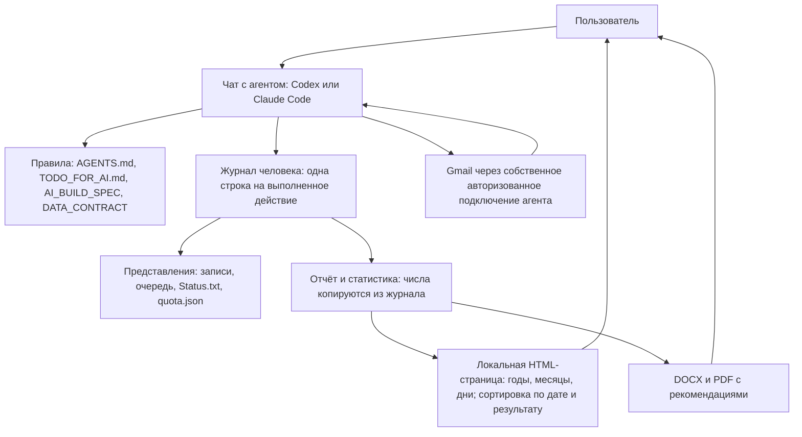

# HomenS.AI JobPilot — архитектура 1.6.0

[English](../../ARCHITECTURE.md) | [Русский](ARCHITECTURE.md)

09.10.2026 · Автор идеи и разработчик: Serhii Khomenko / HomenS.AI · https://homensai.com/ · документация CC BY-NC 4.0.

Статус: проектирование и рабочие процедуры. В проекте нет отдельного приложения для поиска работы и отправки почты; он состоит из ИИ-агента, письменных процедур и локальных файлов. Статистическая страница содержит HTML/CSS/JavaScript: она проверяет, сортирует, фильтрует и показывает снимок, который подготовил агент. Страница не ищет вакансии, не отправляет письма и не меняет журнал. Документ дополняет AI_BUILD_SPEC.md, DATA_CONTRACT.md и OPERATING_REQUIREMENTS.md. Серверы, Docker и SQL не используются.

Разделы 3 (изоляция), 4b (блокировка записи), 6a (Gmail Scheduled), 6b (пересборка из журнала), 8a–8c (ритм отправки, месячная подготовка, ежедневная проверка) и 12 (локальные архивы и восстановление) описывают процедуры, добавленные по итогам сводного разбора (замечания F04, F07, F12 и требования R01–R05). Это только письменные процедуры: ни одна из них ещё не выполнялась. Статус каждой записан в ACCEPTANCE_TESTS.md, раздел «Сводный разбор F01–F14 и R01–R20».

## 1. Основное решение: правила и файлы

Система состоит из **ИИ-агента** (Codex или Claude Code), **записанных правил**, **папки с данными** и локальной страницы статистики. Агент исследует рынок, разбирает сведения, готовит документы и общается с пользователем. Он ведёт JSON, JSONL, Markdown и согласованные файлы: следует `AGENTS.md`, `CLAUDE.md`, `TODO_FOR_AI.md`, `OPERATING_REQUIREMENTS.md`, этому документу и DATA_CONTRACT.md. Статистическая страница только показывает данные, записанные агентом. Все записи остаются в читаемых файлах.

**Что из этого следует.** Защиты системы — лимит 44 отправки, «никогда не отправлять дважды», «один пишущий в каждый момент», «ничего не уходит без разрешения» — это *порядок действий, которому агент обязан следовать*, а не технические замки. Ничто в системе не может физически остановить агента, который нарушил правило. Поэтому:

- каждое правило записано как короткий список проверок, который агент выполняет перед действием и показывает пользователю, когда речь об отправке;
- по умолчанию включён самый безопасный режим: только черновики, затем одобрение каждого письма пользователем в чате;
- полностью автоматическая отправка допускается, только если пользователь включил её для профиля и письменно подтвердил, что лимит и защита от повтора тогда зависят от соблюдения правил агентом;
- сценарии приёмки (ACCEPTANCE_TESTS.md) проверяются вручную, в чате, на синтетических данных — до любой реальной отправки.



HTML-страница никому не даёт команд; данные обновляются только тогда, когда работает агент.

## 2. Части и ответственность

| Часть | Что делает агент | Где хранится |
|---|---|---|
| Рабочая папка | Проверяет папку, версию формата, выбранного человека и профиль; сообщает, что реально умеет | `workspace.json` |
| Профиль и база знаний | Материалы из `Положите_сюда` и интервью в чате → предложенные факты → факты, подтверждённые пользователем, с источником каждого; затем профиль поиска (цели, радиус, отдельные настройки языков) | `persons/<person_id>/База_знаний/Жизнеописание.md`, `profiles/<profile_id>/profile.json` |
| Поиск | Записывает результаты исследования как цели: дубли, актуальность, радиус, проверка маршрута | `registry.json` |
| Документы | Собирает пакет из требований и подтверждённых фактов: версии, ссылки на факты, статус визуальной проверки | папка заявки |
| Планирование | Распределяет пакеты по допустимым рабочим дням, резервирует слоты, переносит, отмечает просроченные записи | `registry.json`, журнал |
| Почта | Читает цепочки целиком, проверяет подтверждение отправки, обрабатывает уведомления о доставке и ответы | журнал, `Status.txt` |
| Отчётность | Считает для зафиксированной позиции журнала и периода; выдаёт DOCX/PDF/HTML с одними и теми же числами; добавляет рыночное приложение | `reports/`, `dashboard/` |
| Проверка возможностей | Проверяет каждый свой инструмент (см. раздел 7) и записывает результат | `workspace.json` |

Агент предлагает текст рекомендаций и классификацию писем. Подсчёт, исключение дублей и смена состояний идут по записанным правилам и всегда сначала записываются в журнал.

Файлы инструкций (Markdown, а не код; черновики, ещё не проверенные на практике): `AGENTS.md` для Codex, `CLAUDE.md` для Claude Code (он подключает `AGENTS.md`), `TODO_FOR_AI.md` с ходом первого запуска и пошаговыми списками проверок. Агент сам загружает свой файл правил при открытии папки, поэтому человеку достаточно сказать «начинай».

## 3. Единица учёта — человек

`person_id` объединяет направления поиска одного человека. У каждого направления свои profile_id, языки документов, аккаунт, документы и согласия. Учёт квоты и проверка повторных заявок общие по person_id. У разных людей разные журналы.

```text
Локальные_данные/
  workspace.json                    # workspace_id, формат, язык, этап первого запуска, результаты проверки возможностей
  Положите_сюда/                    # ЕДИНСТВЕННОЕ место, куда человек кладёт материалы (агент только читает)
    1_Мои_документы/                # резюме, дипломы, сертификаты, рекомендации (оригиналы, не меняются)
    2_Рассказ_о_себе/               # рассказ человека: расшифровки голоса, заметки, интервью, вопросы
    3_Шаблон_отчёта/                # необязательный шаблон отчёта
  persons/<person_id>/
    База_знаний/Жизнеописание.md    # база знаний: жизнеописание человека в виде подтверждённых фактов
    journal/transactions-YYYY-MM.jsonl  # единственный главный журнал, помесячные сегменты; пишется только текущий месяц
    journal/writer.lock              # существует, только пока пишет один чат
    state/person.json               # представление: человек и список профилей
    state/quota.json                # месячные счётчики, пересобираются из журнала
    outbox/<send_attempt_id>/            # подготовленный пакет отправки, не редактируется
  Resume/                              # шаблон резюме: ваш файл Word или PDF, переведённый в Word здесь
  CoverLetter/                         # шаблон сопроводительного письма, то же оформление, что у резюме
  profiles/<profile_id>/
    profile.json                    # текущая подтверждённая конфигурация
    registry.json                   # цели, заявки и очередь (проекция)
    runs/                           # рабочие сессии: планы, результаты, вопросы
    reports/<YYYY-MM>/              # ревизии отчётов и манифесты (на английском, русском или немецком)
  Applications/                       # ВСЯ работа по заявкам человека, одно дерево для всех лет
    2026/                           # год
      10_October/                   # двузначный номер месяца + английское название месяца
        001_Muster-Maschinenbau_Stuttgart_Maintenance-technician/   # номер, фирма, город, должность
          Company.md                # данные о фирме из открытых источников, у каждого — источник и дата проверки
          Resume_v001.docx          # новые версии — новые файлы: Resume_v002.docx и т. д.
          Resume_v001.pdf
          CoverLetter_v001.docx
          CoverLetter_v001.pdf
          EmailText_de.txt          # текст письма на выбранном языке
          Status.txt                # журнал этой заявки, только добавление строк
  dashboard/
    index.html                      # локальное меню: статистика и готовность по каждому профилю
    profiles/<profile_id>/
      summary.js                    # данные этого профиля и общая квота человека
      index.html                    # неизменённая копия dashboard_template/index.html
      readiness.html                # страница готовности этого профиля
```

Имя каталога `Локальные_данные` — общий технический путь в обеих языковых версиях. Панель статистики имеет один путь — `Локальные_данные/dashboard/`, рядом с `persons/` и `profiles/`. Идентификаторы профилей уникальны во всём рабочем пространстве, поэтому страницы разных людей не пересекаются.

Каждая строка журнала содержит person_id и, где применимо, профиль; общая квота относится ко всему человеку. Перед действием агент проверяет, что профиль принадлежит этому человеку и аккаунту. Изоляция предотвращает ошибки маршрутизации в правилах; другой profile_id сам по себе не создаёт границу доступа на уровне операционной системы для того же пользователя компьютера.

**Изоляция между людьми и профилями (процедура, F12).** Одна папка может обслуживать нескольких людей; их разделяет порядок действий:

- У каждого человека есть `persons/<person_id>/` и личная подпапка оригиналов `Положите_сюда/<name>/` с собственными тремя подпапками (ACCEPTANCE_TESTS.md, KB-04). Агент не открывает оригиналы, базу знаний, журнал, состояние, outbox, архивы и почту другого человека.
- Второй человек добавляется под новым `person_id`, и для него проходит вся первичная настройка (часть A файла TODO_FOR_AI.md). Ход настройки хранится отдельно для каждого человека в `persons/<person_id>/state/person.json` (`setup_progress`). `stage` в `workspace.json` описывает только папку и не означает, что новый человек готов.
- Согласие даётся каждым человеком отдельно (`consent_granted` содержит его `person_id`). Отказ или отзыв одного человека не открывает ничего из данных другого.
- Перед чтением оригиналов, открытием почты или записью строки журнала агент называет активного человека и проверяет, что профиль и аккаунт принадлежат ему. Если человек не ясен, агент сначала спрашивает.
- Месячная квота имеет область действия «человек»: все профили одного человека делят её, профили другого не учитываются. Квота никогда не переносится между людьми.
- Отчёты, снимки статистики и архивы создаются отдельно для каждого человека (и для профиля, если профиль — предмет отчёта). Добавление человека не меняет уже опубликованный снимок другого человека.

Это процедурная изоляция. Она не защищает от другого пользователя того же компьютера и не является границей операционной системы.

## 4. Одна строка на выполненное действие

Журнал — набор текстовых файлов, по одному на месяц (помесячные сегменты, правило 8); в каждой строке один объект JSON. Строка пишется, когда действие **завершено**, и содержит:

- `schema_version`, `sequence` (1, 2, 3 … без пропусков), `action_id`, `person_id`, `recorded_at`;
- список `events`; у каждого события свой уникальный `event_id` (резерв квоты, начало отправки, изменение заявки и т. д.);
- короткий текст `result`, которого достаточно, чтобы повторить ответ пользователю, если то же действие запросят снова.

Правила для агента:

1. **Только добавление.** Старая строка никогда не правится и не удаляется. Исправление — новая строка, где указано событие, которое она заменяет (`supersedes_event_id`).
2. **Перед записью:** прочитать последнюю строку текущего сегмента (а если текущий сегмент новый — самого нового сегмента), взять следующий `sequence` и проверить, что такого `action_id` нет ни в одном сегменте. Если есть — сообщить прежний результат и больше ничего не делать. Это защищает от прерванного чата, который запускают заново.
3. **Писать строку целиком**, затем обновить представления (реестр, очередь, `Status.txt`, `quota.json`, статистику). Если чат остановился между этими шагами, следующий чат пересоберёт представления из журнала.
4. **Повреждённая или недописанная последняя строка** молча не чинится. Агент останавливается, оставляет файл как есть, сообщает пользователю и восстанавливается по последней целой строке и по подтверждениям в почте.
5. **Один пишущий в каждый момент.** Перед записью строки журнала агент берёт `writer.lock` эксклюзивным созданием, как описано в разделе 4b. Если файл принадлежит другому запуску, агент останавливается и спрашивает пользователя, работает ли ещё тот чат; чужую блокировку он снимает только после проверок из 4b. Закончив работу, он удаляет собственную блокировку. Блокировка защищает, только если каждый чат следует этому протоколу и среда даёт эксклюзивное создание; иначе пользователь должен вести один рабочий чат одновременно.
6. Решение о квоте или отправке всегда перечитывает журнал; пересказ из более ранней части чата не считается надёжным.
7. **Считать штатным средством системы, а не «на глаз».** Занятые, зарезервированные или не подтверждённые слоты месяца читаются из всех сегментов журнала текстовым поиском по полям месяца в событиях квоты (формулы — в DATA_CONTRACT.md §3c, свободный остаток — в §5, команды — в §4a ниже). Агент показывает число и способ, которым его получил. Он сравнивает результат с `quota.json`; если они расходятся или файла нет, прав журнал, а `quota.json` пересобирается (`examples/quota.example.json`). То же относится к контрольным суммам файлов. Для этого в пакет не добавляется никакого скрипта.
8. **Запись строки (один способ дописывания, помесячные сегменты).** Журнал ведётся по месяцам: текущий сегмент — `journal/transactions-YYYY-MM.jsonl` (DATA_CONTRACT.md §3c). Пишется только он; закрытый сегмент никогда не редактируется. Если журнала ещё нет, первая строка имеет `sequence` 1. Используется только следующий способ. JSON не склеивается вручную, текст не пишется перенаправлением вывода оболочки или heredoc. Точная замена инструментом работы с файлами применяется для одной цели: дописать строку после последней строки сегмента, как описано в шагах 3 и 4.
   1. Под блокировкой записи определить текущий местный месяц M. Прочитать последнюю строку текущего сегмента; она должна быть целой. Если сегмент новый или пуст, прочитать вместо неё последнюю строку самого нового более раннего сегмента; для самой первой строки её нет и `n` = 0. Взять `n` — `sequence` этой последней строки журнала. Проверить, что нового `action_id` нет ни в одном сегменте (правило 2). Записать в заметку прогона: число строк сегмента; последнюю строку `L` без перевода строки (она уникальна, потому что несёт собственные `sequence` и `action_id`); и `C0` — SHA-256 всего файла сегмента (для нового сегмента — SHA-256 пустого файла, `e3b0c442…b855`). Проверить, что файл заканчивается переводом строки.
   2. Составить новую строку в порядке ключей DATA_CONTRACT.md §3c с `sequence` n+1. Проверить, что это один JSON-объект в одной строке и что каждый идентификатор — UUID в формате UUID. Неудачная проверка останавливает запись (шаг 5).
   3. Дописать. (а) Если в сегменте есть строки: точной заменой инструментом работы с файлами заменить `L` на `L`, перевод строки и `N`. Если `L` не найдена ровно один раз, остановиться (шаг 5). Тогда файл заканчивается на `N` и его переводом строки. (б) Если сегмент новый: проверить, что файла нет, затем создать его инструментом работы с файлами, содержащим ровно `N` и перевод строки. (в) Для сегмента короче 300 строк сегмент может быть вместо этого записан целиком инструментом работы с файлами из текста, прочитанного на шаге 1: те же строки, затем `N` с переводом строки. Вариант (в) — единственная перезапись сегмента целиком, и только для небольшого сегмента.
   4. Перечитывание. (а) `N` разбирается как JSON с `sequence` n+1; предыдущая строка, если она есть, побайтно совпадает с `L` и разбирается как JSON с `sequence` n. (б) Число строк выросло ровно на одну. (в) Контрольная сумма сегмента без последней строки равна `C0`, так что каждый байт до `N` не изменился (например, `head -n -1 <сегмент> | sha256sum`, раздел 4a). Значения перечитывания записываются в заметку прогона.
   5. Неудачная проверка останавливает запись: файл сегмента остаётся как есть, представления не обновляются, внешнее действие не совершается, блокировка сохраняется, человек извещается (правило 4). Ничего не исправляется переписыванием прежних строк. Формат файла блокировки фиксирован (DATA_CONTRACT.md §3c). Проверка «файла нет» сама по себе недостаточна: см. 4b.
   6. Снятие. Только после прохождения шага 4 владелец снимает блокировку: читает файл блокировки, проверяет, что в нём его собственный `lock_id`, и удаляет его (4b). Неудачная запись до этого шага не доходит.

### 4a. Команды, которыми может пользоваться агент

Агент использует только команды, которые уже есть в операционной системе человека; они пишутся прямо в чате, и ни одна не сохраняется в пакете как скрипт. Разрешено: текущее время, новый UUID, контрольная сумма файла, текстовый поиск с подсчётом, проверка корректности JSON, пересчёт часового пояса для текущего момента, список папки, создание папок, копирование утверждённых файлов в папку отправки (с перечитыванием контрольной суммы каждой копии), создание DOCX и PDF инструментом документов, указанным ниже, и копирование или удаление собственных временных файлов агента. Названы исключения: эксклюзивное создание `writer.lock`, копирование в `outbox/`, инструмент документов и однократное разбиение журнала при переносе (DATA_CONTRACT.md §3d), которое копирует байты по диапазонам строк и проверяется контрольной суммой. Файлы JSON и все прочие текстовые файлы (Status.txt, Company.md, записи о запусках, EMAIL_TO_SEND.txt) пишутся инструментом работы с файлами, никогда не перенаправлением вывода оболочки, heredoc, `sed` или подобными средствами. Журнал строки дописывается только по правилу 8 (точная замена последней строки). Python не является рабочим инструментом агента: это только инструмент аудита тестировщика. Подсчёты, пересчёт страниц и контрольные суммы в чате делаются собственным текстовым поиском и средствами контрольных сумм операционной системы и инструментом работы с файлами. Ниже — формы для Windows (PowerShell); на macOS или Linux агент использует эквиваленты: `date -u +%Y-%m-%dT%H:%M:%SZ`, `uuidgen`, `sha256sum`, `grep -c` и `grep -o` (подсчёт), `tail -n 1` и `tail -n 2`, `head -n -1` (сегмент без последней строки), `cp` и `set -C` (noclobber) для эксклюзивного создания `writer.lock`.

| Нужно | PowerShell |
|---|---|
| Текущее время UTC | `(Get-Date).ToUniversalTime().ToString("yyyy-MM-ddTHH:mm:ssZ")` |
| Новый UUID | `[guid]::NewGuid().ToString()` |
| Контрольная сумма файла | `(Get-FileHash -Algorithm SHA256 -LiteralPath <file>).Hash.ToLower()` |
| Текущий локальный месяц человека | `[TimeZoneInfo]::ConvertTime([DateTimeOffset]::UtcNow,[TimeZoneInfo]::FindSystemTimeZoneById('W. Europe Standard Time')).ToString('yyyy-MM')` (агент сопоставляет часовой пояс человека, например `Europe/Berlin`, с именем для Windows) |
| Подсчёт событий месяца | `(Select-String -Path <journal> -Pattern '"consumed_month"\s*:\s*"2026-10"' -AllMatches \| ForEach-Object { $_.Matches.Count } \| Measure-Object -Sum).Sum` (пустой результат означает 0) |
| Проверка, что каждая строка журнала — корректный JSON | `Get-Content <journal> \| ForEach-Object { $_ \| ConvertFrom-Json } \| Out-Null` (ошибка указывает плохую строку) |
| Последняя строка журнала (текущий сегмент) | `Get-Content <current segment> -Tail 1` |
| Две последние строки журнала (перечитывание после дописывания, правило 8 раздела 4) | `Get-Content <current segment> -Tail 2` |
| Контрольная сумма сегмента без последней строки (перечитывание дописывания, правило 8, шаг 4) | `head -n -1 <сегмент> \| sha256sum` на macOS или Linux; PowerShell-аналог нужно проверить побайтно до первого применения |
| Эксклюзивное создание `writer.lock` (ошибка, если файл есть) | `[System.IO.File]::Open('<lock>', 'CreateNew', 'Write', 'None').Close()`; затем одна JSON-строка записывается в этот пустой файл инструментом работы с файлами и перечитывается. На macOS или Linux: `set -C` (noclobber) перед созданием |
| Копия в `outbox/<send_attempt_id>/` | `Copy-Item -LiteralPath <источник> -Destination <папка outbox>`, затем строка контрольной суммы выше для каждой копии |
| Создание DOCX и PDF (инструмент документов) | Инструмент документов платформы, если он есть в установке; иначе LibreOffice в режиме без интерфейса: `soffice --headless --convert-to pdf --outdir <папка> <файл.docx>` — PDF утверждённого DOCX |

В таблице `<journal>` — все сегменты `journal/transactions-*.jsonl` человека, а `<current segment>` — сегмент текущего месяца. Текстовые файлы пишутся собственным инструментом агента, а не перенаправлением вывода оболочки; исключения — создание блокировки выше и однократное разбиение журнала при переносе (DATA_CONTRACT.md §3d). Эти формы ещё не проверялись на реальной машине с Windows; первая проба входит в проверки приёмки.

Пакеты документов сначала готовятся во временной папке и проверяются. Затем они сохраняются как новая пронумерованная папка версии (`v001`, `v002`) и только потом регистрируются в журнале с именами файлов, размерами и — если это позволяют штатные средства системы — контрольной суммой. Принятый пакет никогда не меняется на месте: изменение создаёт новую версию и возвращает заявку на проверку.

### 4b. Протокол блокировки записи (F07)

**Область.** Одна блокировка на человека: `persons/<person_id>/journal/writer.lock`. Она защищает журнал этого человека, квоту и события профилей. Блокировка покрывает только шаги записи; поиск, формирование документов и внешние действия выполняются вне её. Блокировка другого человека не мешает работе этого человека, а блокировка этого человека никогда не разрешает записи для другого.

**Получение блокировки.**

1. Файл создаётся одной операцией, которая завершается ошибкой, если файл уже существует: эксклюзивным созданием (режим «создать новый», флаг эксклюзивного открытия или эквивалент, описанный средой). Проверка, что файла нет, и отдельное создание на втором шаге эксклюзивным созданием не являются.
2. Содержимое — одна строка JSON с полями `lock_id`, `run_id`, `owner` (короткая метка чата), `person_id` и `created_at` (UTC), как в DATA_CONTRACT.md §5, «Блокировка записи (F07)». `run_id` записан и в заметке о сессии чата.
3. Если создание не удалось, потому что файл есть, агент ничего не пишет и читает файл. Если его `run_id` — это `run_id` данного чата, агент продолжает (перезапущенный чат узнаёт свою блокировку по заметке). Иначе агент останавливается, сообщает `LOCK_HELD` и спрашивает человека; действует процедура устаревшей блокировки ниже.
4. Перед каждой записью под блокировкой агент читает её снова и убеждается, что в ней по-прежнему его `lock_id`. Если блокировка исчезла или изменилась, запись прерывается и об этом сообщается.
5. Работает ли эксклюзивное создание в данной установке, записывается в `workspace.json` в `capabilities.writer_lock` (`available`, `unavailable` или `unknown`). При `unavailable` или `unknown` агент не заявляет эксклюзивность и не начинает автономных параллельных записей и внешних действий: для этого человека работает только один чат, и человек об этом предупреждён.

**Снятие блокировки.** Снимает её только владелец, и только после того, как последняя строка журнала, которую он записал, прошла перечитывание по правилу 8, шаг 4 (чат, который строк не писал, снимает блокировку после своей последней проверки). Владелец читает файл, убеждается, что в нём его собственный `lock_id`, и отдельным шагом удаляет файл. Неудачная запись сохраняет блокировку и останавливает чат; блокировку никогда не удаляют в той же команде, что запись, которая могла не удаться. Следующий запуск ничего не берёт сам: он читает блокировку, и блокировка, у которой `run_id` совпадает с `run_id` в заметке о сессии этого чата, продолжается после проверки (шаг 3 выше); любая другая блокировка идёт по процедуре устаревшей блокировки. Снятие никогда не происходит по возрасту, по действию другого чата или по тайм-ауту. Снятие строки в журнал не пишет.

**Устаревшая блокировка.** Блокировка не истекает по возрасту, и её истечение никогда не освобождает резерв. Прежде чем удалить блокировку, которая не принадлежит этому чату, нужно выполнить по порядку:

- (а) человек подтверждает, что чат-владелец больше не работает (агент не видит другие чаты);
- (б) последняя строка журнала — целая, корректная по JSON, и `sequence` без пропусков (DATA_CONTRACT.md §3c);
- (в) каждая незавершённая попытка (`send_started` или намерение планирования без результата) перечислена; каждая становится `send_uncertain`, если её не удалось сверить с SENT или Scheduled (6a); папки outbox без результата перечислены;
- (г) состояние на стороне почты проверено там, где инструмент почты это позволяет; то, что проверить нельзя, остаётся открытым;
- (д) только после этого блокировка удаляется. Удаление отмечается в записи о запуске и в тексте `result` следующей строки журнала; это не отдельное событие.

Пока есть незавершённая попытка, для этого человека не разрешена никакая новая отправка или постановка в расписание ни в одном чате.

**Что происходит на каждом переходе.** Ни один из случаев ниже не приводит ко второму внешнему вызову. В таблице указано, что найдёт следующий чат и что он сделает.

| Точка сбоя | Оставшееся состояние | Восстановление |
|---|---|---|
| До создания файла блокировки | Ничего | Начать операцию заново |
| Блокировка создана, строка журнала ещё не записана | Только файл блокировки; журнал не изменён | Проверка устаревшей блокировки; внешнего вызова не было; снять блокировку после шага (а) |
| Во время записи строки журнала | Возможно, обрезанная последняя строка | Остановиться и оставить файл как есть (правило 4 раздела 4); внешнего вызова не было; разбираться по последней целой строке |
| После строки намерения (резерв и `send_started`), до внешнего вызова | Незавершённая попытка; вызов мог быть, а мог не быть | Сверка в SENT и Scheduled. Найдено: записать подтверждённый факт. Доказано отсутствие: `failed_before_send` и `quota_released`. Иначе `send_uncertain`, резерв сохраняется, решает человек. Никогда не вызывать снова |
| Во время внешнего вызова потерян ответ | То же, что выше | То же. Потерянный ответ нельзя отличить от вызова, которого не было, поэтому попытка — `send_uncertain`, если отсутствие не доказано |
| После ответа, до строки результата | Чат знал результат, журнал его не показывает | Сверить доказательства один раз: подтверждено → `sent_verified` и `quota_consumed` (или запись о постановке); доказано отсутствие → `failed_before_send` и `quota_released`; иначе `send_uncertain`. Никогда не вызывать снова |
| После строки результата, до обновления представлений | Журнал полный; представления устарели | Пересобрать представления (6b). Внешних действий нет |
| Два чата борются за последний слот | Эксклюзивное создание удаётся только одному | Проигравший ничего не пишет и сообщает `LOCK_HELD`. Проверка квоты выполняется после получения блокировки, а не до |
| Кто-то другой удалил блокировку во время записи | Запись может прерваться на середине | Повторная проверка из шага 4 останавливает запись; следующий чат действует по процедуре устаревшей блокировки |

Если эксклюзивное создание недоступно, эти правила всё равно действуют, а параллельные чаты для одного человека не поддерживаются вовсе.

## 5. Стандартные действия

Вместо запрограммированных команд агент выполняет именованные действия. Каждое действие — список проверок в `TODO_FOR_AI.md`; названия используются в журнале и в сообщениях пользователю.

| Действие | Результат |
|---|---|
| Проверка рабочей папки | Состав, формат, доступные возможности, выбранные человек и профиль |
| Продолжение работы | Незавершённые операции, следующие действия, вопросы |
| Предложить / подтвердить профиль | Предложенные факты / подтверждённая версия |
| Импорт целей | Записи целей с источниками или список конфликтов |
| Регистрация пакета | Версия документов, список файлов, статус проверки и одобрения |
| План очереди | Предварительный расчёт конкретных слотов и доступности квоты |
| Принять план | План и резервы записываются после согласия пользователя |
| Проверка перед отправкой | «Разрешено» или «заблокировано» с точными причинами; ничего не отправляется |
| Отправка | Одна авторизованная отправка и записанный исход |
| Чтение / классификация почты | Сохранённые наблюдения / подтверждённая классификация |
| Сверка почты | Сравнение с подтверждениями без повторной отправки |
| Пересборка представлений (replay) | Записи, `Status.txt`, очередь, `quota.json` и статистика заново из журнала и неизменяемых версий (6b) |
| Отчёт / статистика | Файлы отчёта и страница статистики с одними и теми же числами |
| Резервная копия / проверка восстановления | Согласованная копия и проверка в отдельной папке (раздел 12) |
| Создание локального архива (R01) | Проверенный версионированный снимок после завершённой операции (раздел 12) |
| Постановка в Gmail (R03) | Запланированное письмо, проверенное в Gmail «Запланированные» (6a); это ещё не отправленное письмо |
| Планирование месяца и ритма (R02, R04) | Проверенный календарь слотов и резервы на месяц (8a, 8b) |
| Ежедневная проверка в 16:00 (R05) | Сверка «Запланированных», отправленных, ответов и уведомлений о доставке (8c) |

В ответе на любое действие агент называет: исход (`ok`, `needs_input`, `conflict`, `blocked` или `failed`), код причины, позицию в журнале, созданные файлы и следующий шаг обычными словами. Коды причин остаются стабильными: `ACCOUNT_MISMATCH`, `QUOTA_EXHAUSTED`, `SEND_UNCERTAIN`, `CAPABILITY_MISSING`, `JOURNAL_DAMAGED`, `PACKAGE_CHANGED`.

«План очереди» только показывает расчёт. Резервы становятся действующими лишь после «Принять план»; остаток квоты определяет журнал. Успешная «Проверка перед отправкой» — не разрешение на потом: «Отправка» заново проверяет текущую позицию журнала, время, согласие и пакет.

## 6. Отправка и outbox

Outbox — подготовленная папка для одной попытки, `outbox/<send_attempt_id>/`: копии файлов пакета, которые будут прикреплены, `message.txt` (получатель, тема и текст ровно так, как отправлено) и `attempt.json` (`account_id`, `application_id`, `send_attempt_id`, `consent_id`, контрольные суммы скопированных файлов). Секретов в ней нет. Это не отдельный почтовый сервер. Попытка с `send_started` и без результата считается открытой.

Порядок ниже — порядок внешних действий из DATA_CONTRACT.md §5 и TODO_FOR_AI.md, часть C (F07). Он относится к каждому внешнему действию с почтой: отправке, постановке в Gmail «Запланированные», переносу и отмене. Подготовка пакета — не отправка. Каждый шаг должен завершиться успешно, прежде чем начнётся следующий.

1. **Неизменяемый пакет.** Создать копию точных файлов в `outbox/<send_attempt_id>/` и манифест с SHA256 каждого вложения, получателем и источником его адреса, отправляющим аккаунтом, темой, текстом, транспортом (`agent_local_run`, `gmail_scheduled` или `manual_by_person`; два транспорта для одного пакета не допускаются) и слотом с часовым поясом. Перечитать копию и сверить её с утверждённым пакетом.
2. **Согласие, привязанное к манифесту.** В одобрении (`package_approved` или утверждённом плане с его согласием) указан SHA256 манифеста. Каждый компонент шага 1 должен ему соответствовать. Изменённый компонент делает прежнее согласие недействительным для новой версии, и нужно новое одобрение (`approval_revoked`, `PACKAGE_CHANGED`). Затем выполняется проверка перед отправкой.
3. **Резерв и долговечное намерение (жёсткое условие).** Под блокировкой записи (4b) чат перечитывает квоту и историю и одной строкой журнала записывает `quota_reserved` и `send_started`. Строка содержит намерение, транспорт, `send_attempt_id` и SHA-256 манифеста (и прочие поля DATA_CONTRACT.md §3c). Чат перечитывает её по правилу 8 раздела 4 и снимает блокировку только после того, как перечитывание прошло (правило 8, шаг 6). Непосредственно перед шагом 4 он перечитывает последнюю строку журнала ещё раз: это должна быть строка намерения с тем же `send_attempt_id` и SHA-256 манифеста, что в одобрении. **Условие:** если запись или её перечитывание не удались, чат останавливается до снятия блокировки, внешнего вызова не делает, ничего другого не записывает и блокировку сохраняет. Если не прошла только проверка последней строки, внешнего вызова нет, а открытое намерение обрабатывается по 4b.
4. **Один внешний вызов.** Ровно один, чатом, который записал намерение. Без повтора в том же чате и без «второй копии на всякий случай». У каждого `attempt_id` один исполнитель; повторный запуск находит существующую попытку и сверяет её.
5. **Сверка.** Искать точное письмо в SENT или Scheduled (аккаунт, пакет, адресат, слот). Найдено — шаг 6. Доказано отсутствие — `failed_before_send` и `quota_released` одной строкой. Иначе `send_uncertain`: резерв сохраняется, новый внешний вызов не делается, решает человек после проверки.
6. **Записать факт.** Для `cv_submission` — `sent_verified` и `quota_consumed` одной строкой; благодарность или ответ без CV записываются как `thank_you_sent` или `ordinary_reply_sent` (DATA_CONTRACT.md §4), но не как `sent_verified`; либо `gmail_scheduled_verified` для постановки (это не событие отправки). Затем обновить представления (6b) и создать локальный архив (раздел 12).

Представления и отчёты можно пересобрать позже. Потеря HTML-страницы или `registry.json` никогда не приводит ко второму письму.

**Виды отправки и ключи повтора (F01).** У каждого вида отправки свой ключ, который проверяется в той же строке журнала, что начинает действие:

- `cv_submission` (расходует слот): одну и ту же попытку заявки повторить нельзя. CV, отправленное раньше работодателю, не блокирует разрешённое продолжение.
- `thank_you`: уникально по аккаунту + входящему `gmail_message_id` + `thank_you`. Первая благодарность после отправленного CV разрешена; вторая на то же входящее письмо — нет. Она записывается как `thank_you_sent` и требует действующего согласия `follow_up` (DATA_CONTRACT.md §4).
- Вопрос о периоде не является отдельным видом: это `ordinary_reply` (событие `ordinary_reply_sent`), который отправляется только после одобрения человеком этого сообщения; уникален по аккаунту + Gmail Message-ID входящего письма, а на одну цепочку задаётся один вопрос о периоде (`thread_id`). `thank_you_sent` — единственное автоматическое follow-up.
- `ordinary_reply`: ответ без CV; слот не расходует, перед записью проверяется по истории той же цепочки.

Незавершённая или неопределённая попытка блокирует повтор того же ключа и все новые отправки для этого человека, пока не будет разрешена. Неопределённый исход никогда не открывает путь к дублю.

Внешний вызов и локальную запись нельзя сделать атомарными. Если чат остановился после `send_started`, никто не знает, вызывался ли почтовый сервис. Отозванное до `send_started` согласие блокирует отправку; после записанного начала отправка уже может идти и требует сверки, а не обещаний отмены. Отсутствие письма в «Отправленных» при неполной проверке не доказывает, что оно не уходило.

Исключение дублей благодарностей: account_id + входящий gmail_message_id + intent (thank_you). Единственный вопрос о периоде: account_id + thread_id + intent (ordinary_reply). Эти ключи проверяются в той же строке журнала, что начинает действие, чтобы два чата не ответили на одно письмо дважды.

### 6a. Gmail «Запланированные» через браузер агента (R03)

**Условия.** Режим это допускает, и человек сам вошёл в нужный аккаунт Gmail в профиле браузера. Агент не получает и не хранит пароли, одноразовые коды и cookies. Сессия Gmail принадлежит этому профилю браузера и может истечь в любой момент. Gmail отправляет запланированное письмо даже тогда, когда агент не работает, поэтому согласие, календарь, пакет и резерв проверяются до постановки. Любое изменение требует нового одобрения, а для уже поставленного письма — сначала проверенного изменения или отмены.

**Ограничение встроенного браузера.** В задокументированной версии встроенный браузер не загружает файлы автоматически (поправка R03/R08 сводного плана). Если данная установка не может прикрепить утверждённые файлы, агент останавливается до постановки и переходит к ручному варианту ниже.

**Шаги.** Порядок следует разделу 6.

1. **До.** Проверить человека, активного отправителя Gmail (он должен совпадать с аккаунтом профиля, а браузер показывать тот же адрес), режим и согласие, утверждённый слот, адресата и источник его адреса, тему (не более 50 символов после нормализации NFC), текст и каждое вложение (имя, размер и SHA256 по манифесту).
2. **Резерв.** Под блокировкой записи записать `quota_reserved` и `send_started` с транспортом `gmail_scheduled` для месяца планируемой отправки. Блокировку снять. Эта строка — долговечное намерение.
3. **Составление.** Открыть новое письмо, заполнить только утверждённые поля, прикрепить только утверждённые файлы и дождаться окончания каждой загрузки. Если вложение не прикрепилось, остановиться: ничего ещё не поставлено.
4. **Постановка.** Выбрать **Запланировать отправку**, а не «Отправить». Задать точную дату и местное время и проверить показанный часовой пояс.
5. **Проверка в «Запланированных».** Открыть папку «Запланированные» и сопоставить запись с аккаунтом, адресатом, темой, текстом, вложениями, датой и временем. Нажатие кнопки или сообщение о подтверждении доказательством не является.
6. **Сохранить доказательство.** Сохранить идентификатор или ссылку-локатор, которую даёт Gmail. Message-ID никогда не выдумывается.
7. **Записать.** `gmail_scheduled_verified` (с хешем манифеста и временем постановки), обновить представления и создать локальный архив (раздел 12). Это не `sent_verified`.
8. **После назначенного времени.** Проверить SENT на точное письмо и фактическое время отправки; записать `sent_verified` и `quota_consumed` один раз.

**Состояния и события журнала.** Следуют DATA_CONTRACT.md §12.2; имена событий — из §3c.

| Состояние | Доказательство | Журнал |
|---|---|---|
| `local_planned` | План одобрен; в Gmail ничего не отправлено | `plan_committed` |
| `scheduling_started` | Резерв и намерение записаны; ещё не подтверждено | `quota_reserved` и `send_started` (транспорт `gmail_scheduled`) |
| `gmail_scheduled_verified` | Точная запись найдена в «Запланированных» | `gmail_scheduled_verified` |
| `schedule_failed_before_commit` | Отсутствие доказано: поиск в «Запланированных» и SENT по аккаунту, пакету, адресату и слоту | `failed_before_send` и `quota_released` |
| `schedule_uncertain` | Намерение записано; подтверждённого результата нет | `schedule_uncertain`; резерв сохраняется |
| `sent_verified` | Точная запись найдена в SENT после назначенного времени | `sent_verified` и `quota_consumed` |
| перенесено (проверено) | Точная запись перенесена с разрешения; проверено в Gmail | `schedule_changed`, а при смене месяца — `reservation_moved` |
| отменено (проверено) | Точной записи нет в «Запланированных», она осталась только черновиком, отмена с разрешения | `schedule_cancelled` и `quota_released` (причина `schedule_cancelled_verified`) |

**Неизвестный результат.** После сбоя страницы, истёкшей сессии, captcha или защитного подтверждения искать точную запись в «Запланированных» и в SENT по аккаунту, пакету, адресату и слоту. Найдено — продолжать с подтверждённого состояния. Не найдено при полной проверке — `schedule_uncertain` или `send_uncertain`, что блокирует затронутые действия и резервы. Никогда не создавать второе письмо «на всякий случай». Captcha, истёкшие сессии и защитные подтверждения передаются человеку; обход не делается.

**Изменение или отмена.** Только с разрешения человека и только для точно найденной записи. В Gmail отменённое запланированное письмо обычно возвращается в «Черновики». Это не удаление и не разрешение на удаление; удаление запланированного письма — отдельное подтверждённое действие. Агент освобождает или переносит резерв только после того, как сам увидел, что запись ушла из «Запланированных» (или изменила время). Отзыв согласия в локальном файле не отменяет письмо, которое уже хранится в Gmail. Человеку нужно сказать об этом до любой удалённой отмены, и отмена никогда не объявляется выполненной без такой проверки.

**Браузер или вход недоступны (ручной вариант).** Если намерение не записано, ничего не поставлено, и заявка переходит на ручной путь (R20, `EMAIL_TO_SEND.txt`): человек открывает Gmail в любом браузере, входит в тот же аккаунт, прикрепляет утверждённые файлы, ставит письмо в расписание вручную и сообщает агенту (`manual_by_person`). Затем агент проверяет запись в «Запланированных» или SENT. Если намерение есть без подтверждённого результата, состояние — `schedule_uncertain`: сначала человек проверяет «Запланированные» и SENT, и только потом агент сверяет. Ручная постановка использует тот же один резерв; это не второй слот.

Ежедневная сверка (R05) проверяет «Запланированные» и SENT: запланированное письмо — не отправленное, отправленное — не доставленное, а уведомление о доставке — отдельное событие.

### 6b. Пересборка представлений из журнала (F04)

**Назначение.** Любой производный файл (`registry.json`, очередь, записи в `Status.txt`, `quota.json`, `summary.js`, данные готовности и данные отчётов) можно пересобрать из журнала и неизменяемых файлов. Пересборка следует DATA_CONTRACT.md §3d, где перечислены исходные события и правила идемпотентности. Пересборка никогда не меняет журнал.

**Шаги.**

1. Скопировать все сегменты журнала в рабочую папку. Пересборка ничего не пишет в журнал человека.
2. Проверить каждую строку: она разбирается, `sequence` идёт без пропусков по всем сегментам, и ни один `event_id` или `action_id` не повторяется с другим содержимым (`INTEGRITY_CONFLICT`). Повреждённая или неполная строка останавливает пересборку (`JOURNAL_DAMAGED`); ни одно представление не записывается.
3. Применить события в порядке `sequence`, как их определяет DATA_CONTRACT.md §3d: фирмы и цели, маршруты, пакеты, планы и переносы, отмены, резервы и квоту, согласия, почту и ответы, статусы, архивы.
4. Собрать представления в рабочей папке: реестр, очередь, записи `Status.txt`, `quota.json` (счёт по разделу 4, правило 7) и `summary.js` с его `source_revision`.
5. Файл, чей SHA-256 отличается от события, которое на него ссылается, переводит зависимое представление в состояние `INTEGRITY_CONFLICT`. Пересборка не меняет квоту и сама не пишет `approval_revoked`; агент записывает `approval_revoked` новой строкой, когда изменение касается утверждённого пакета.
6. Если пересобранное представление отличается от существующего файла, новый файл записывается поверх старого (временный файл, проверка чтением, затем замена). Проекция, которую нельзя пересобрать из журнала и неизменяемых файлов, помечается как неполная; её не заполняют догадкой.
7. Пересборка идемпотентна: повторная пересборка с той же ревизии ничего не меняет, не добавляет ни строки журнала, ни строки `Status.txt` для уже записанного `event_id`.

**Неизменяемые версии и отчёты.** Файлы планов, файлы пакетов, копии outbox и архивы никогда не правятся. Выпущенный отчёт никогда не переписывается: если после пересборки числа месяца меняются, для этого месяца создаётся новая ревизия отчёта (`report_built`), а старая сохраняется. Отсутствующая версия (например, удалённая папка пакета) показывается как «версия отсутствует»; агент не восстанавливает её по памяти. Восстановленная копия (раздел 12) может её дать, если контрольная сумма совпадает.

**Квота.** `quota.json` — производное представление. Его числа берутся только из событий (раздел 4, правило 7); повреждённый или отсутствующий файл заменяется результатом пересборки.

## 7. Возможности инструментов агента

Codex и Claude Code следуют одним и тем же правилам. Как вызывается инструмент и как он входит в аккаунт — дело платформы агента, а не этих правил.

При настройке агент проверяет каждую возможность отдельно: файловая система, веб-поиск, поиск маршрутов, чтение почты, чтение цепочки целиком, отправка почты, подтверждение отправки (SENT), формирование DOCX, формирование PDF и пробуждение по расписанию. Для каждой он записывает в `workspace.json`: доступно / недоступно / неизвестно, время проверки и несекретную версию инструмента. Строка в файле настроек не доказывает, что возможность работает.

| Недоступная возможность | Что можно продолжать |
|---|---|
| Gmail | Исследование, работа с профилем и локальные пакеты; почтовая статистика остаётся помеченной как непроверенная |
| Отправка или проверка SENT | Черновики и чтение; автоматические внешние действия остаются выключенными |
| Маршруты | Цель остаётся `route_unverified`; агент не утверждает, что она подходит по дороге |
| Формирование документов | Сохраняются черновики; визуальная проверка не отмечается принятой |
| Расписание агента | Пользователь запускает новый чат вручную; очередь остаётся в файлах |

Для почты агенту нужны пять умений: определить аккаунт, перечислять письма постранично, прочитать цепочку целиком, отправить один раз и найти подтверждение отправки. Это описания, а не названия интерфейсов; агент сообщает, что его инструменты умеют на самом деле.

Поскольку собственный почтовый инструмент агента — единственный способ отправки, отдельного механизма, который мог бы принудительно соблюдать месячный лимит, нет. Поэтому автоматическая отправка по расписанию по умолчанию не предлагается. Её можно включить только для профиля, пользователь которого прочитал и принял это ограничение, после того как сценарии приёмки для отправки проверены в среде этого пользователя. Контролируемое чтение и подготовку можно использовать раньше.

## 8. Новые чаты и ежедневный цикл

Файлы инструкций задают правила, состояние хранится в журнале. Список задач описывает этапы, но галочка в Markdown не подтверждает ни отправку, ни расход квоты.

**Первый запуск.** Папка без `workspace.json` — новая. Тогда агент сам начинает часть A файла `TODO_FOR_AI.md`: знакомство, проверка своих инструментов, согласие, рассказ человека о себе (голосом, если ничего не написано), документы человека, анализ и база знаний, подтверждение фактов, затем настройка поиска (что ищем, где живёт человек, радиус, транспорт). Его позиция хранится в `workspace.json` как `stage` (`new`, `consent_given`, `story_ready`, `documents_ready`, `knowledge_base_draft`, `knowledge_base_confirmed`, `profile_created`, `ready`), поэтому прерванный первый запуск продолжается с того места, где остановился.

При продолжении работы агент:

1. Проверяет workspace_id, формат, выбранный профиль и возможности своих инструментов.
2. Выполняет «Продолжение работы» и в первую очередь разбирается с повреждениями и неопределёнными отправками.
3. Получает новую почту по всем нужным страницам, включая ответы на старые заявки.
4. Применяет разрешённые действия и очередь, затем обновляет отчёты и статистику.
5. Сохраняет запись сессии в `runs`: идентификатор запуска, фактические действия, подтверждения, вопросы и следующий шаг — чтобы следующий чат продолжил с этого места.

Ограничение контекста или оборванный чат не меняют состояние: незавершённые операции остаются в журнале. Перед каждым внешним действием агент перечитывает нужный статус. Пересказы сессий — помощники, а не источник истины.

Проверка почты — цикл: прочитать страницу, сохранить её письма, запросить следующую страницу по следующему токену и повторять, пока инструмент не вернёт отсутствие следующего токена (null). Только тогда проверка полна (TODO_FOR_AI.md, часть B, шаг 5). Позиция в почте сдвигается только после того, как целая обработанная страница сохранена. Повторное чтение страницы безопасно, потому что письма сопоставляются по `(account_id, gmail_message_id)`. Если почтовый инструмент не может продолжить с позиции, агент пересматривает ограниченный перекрывающийся период и явно говорит, что охват неполон. Неполная проверка никогда не подтверждает «новых ответов нет». Сбой по одному профилю не отмечает другие профили проверенными.

### 8a. Ритм отправки (R02)

- **Циклы.** `schedule.cadence` — одно из значений `immediate` (одно письмо в каждый разрешённый день), `allowed_workdays`, `every_second_allowed_workday`, `every_n_calendar_days`, `every_n_allowed_workdays` (число разрешённых рабочих дней, а не календарных, поэтому выбор подтверждается человеком) или `selected_weekdays` (DATA_CONTRACT.md §13.1). При `approval_per_message` ритм — `on_request`: фиксированных слотов нет, каждая отправка происходит в момент ответа человека на карточку отправки. `max_per_run` — одно или два письма за запуск в плановых ритмах. При двух письмах у запуска либо два местных времени, либо одно время и интервал (`inter_message_delay_minutes`). Во всех режимах число CV-отправок за один местный день ограничено `max_per_day` (DATA_CONTRACT.md §13.2; по умолчанию 2, открытое решение владельца). Каждое письмо — отдельная операция со своим пакетом, слотом и ключом.
- **Календарь.** До любого внешнего действия агент показывает точный календарь слотов на месяц: дата, местное время, день недели, месяц квоты и исключённые даты. Он использует часовой пояс человека, календарь праздников выбранного региона из проверенного источника («не проверено» никогда не читается как «праздников нет») и даты, которые исключил человек.
- **Переход на летнее время.** Местное время, которое отсутствует или повторяется при смене часов, не угадывается. `dst_rule` по умолчанию равен `ask`; `earlier`, `later` или `next_valid` применяются только если человек выбрал правило заранее и оно записано в профиль.
- **Транспорт.** У каждого письма ровно один транспорт: `agent_local_run` (локальный запуск агента в назначенное время), `gmail_scheduled` (отправка по расписанию Gmail, раздел 6a) или `manual_by_person`. Один и тот же пакет никогда не отправляется двумя транспортами.
- **Пропущенные запуски.** Пропуск не создаёт догоняющей пачки. Просроченные слоты записываются как `slot_missed` (DATA_CONTRACT.md §3c) и перечисляются; новые слоты согласует человек (`plan_changed`). Резерв пропущенного слота сохраняется до нового плана или отмены; для этого слота ничего не отправляется позже.
- **Квота.** Резервы берутся в месяце фактической отправки и учитываются по всем профилям человека. План, пересекающий границу месяца, переносит свой резерв только после проверенного изменения в «Запланированных». При 44 использованных, зарезервированных или не подтверждённых (`unverified`) слотах новое CV не планируется (DATA_CONTRACT.md §5). Человек не может отменить месячный лимит в чате; любой новый план и любое изменение календаря требуют нового одобрения (DATA_CONTRACT.md §5 и §14).

### 8b. Месячная подготовка и напоминание (R04)

- **Напоминание.** Время напоминания согласовывается при настройке (`schedule.monthly_reminder_local_time`); час не предполагается. Напоминание — настоящая запланированная задача агента, проверенная и записанная, как в 8c. В начале каждого месяца агент спрашивает один раз на человека и месяц: подготовить отклики на этот месяц? сколько, по каким направлениям и условиям, по какому расписанию? Он показывает сохранённые предпочтения, уже отправленные заявки, действующие резервы и подтверждённую доступную квоту. Повторный запуск не создаёт второго вопроса. Вопрос, пропущенный, пока устройство или агент были недоступны, показывается один раз при следующем запуске.
- **Нет ответа или «пропустить».** Новый месячный план не считается согласованным, и в Gmail ничего не ставится. Уже одобренные и поставленные письма остаются действующими до проверенного изменения или отмены.
- **После «да».** Проверить профиль, подтверждённые факты, языки, географию, транспорт, направления и число заявок в пределах общих 44. Проверить реестр всех месяцев и профилей, чтобы фирмы и вакансии не повторялись против утверждённых правил; персональные данные никогда не переносятся между людьми. Найти и проверить вакансии, контакты и источники, сохранить карточку каждой фирмы в папке месяца. Подготовить CV, сопроводительное письмо и текст письма для каждой вакансии с правильными датами. Построить календарь слотов (8a) и показать его. После явного одобрения точных пакетов и плана поставить каждое письмо (6a) и проверить его в «Запланированных». Отчитаться: найдено, подготовлено, одобрено, подтверждённо запланировано, осталось открытым или с ошибкой. Частично подготовленный месяц никогда не описывается как завершённый.
- **Продолжение.** Частичная работа продолжается по журналу, а не по памяти. Подготовка квоту не расходует; запланированные письма резервируют её.

### 8c. Ежедневная проверка в 16:00 (R05)

- **Регистрация.** При настройке агент создаёт одну ежедневную задачу на `schedule.daily_check_time` (по умолчанию 16:00) в часовом поясе человека; пояс подтверждается при настройке и не берётся из серверного UTC; выходные включены (DATA_CONTRACT.md §15.1). Записываются идентификатор задачи, расписание, часовой пояс, область (человек и профиль), последний запуск и его результат. Повторная настройка обновляет существующую задачу и никогда не создаёт вторую. Если платформа агента не имеет постоянного планировщика или требует открытого приложения и работающего компьютера, агент говорит об этом и предлагает согласованный ручной запуск. Строка в файле настроек не является доказательством, что задача работает.
- **Каждый запуск.**
  1. Проверить доступ к разрешённой папке и выбранному почтовому аккаунту. Без доступа записать неудачную проверку, не писать «изменений нет» и не менять неизвестные статусы.
  2. Сверить «Запланированные» и SENT с планом. Отправка учитывается только по доказательству; резерв и квота следуют журналу.
  3. Прочитать новые ответы и уведомления о доставке по всем страницам (цикл раздела 8, до отсутствия следующего токена) и за все месяцы, прочитать цепочки целиком и сопоставить их с заявками.
  4. Исключить дубли по стабильным идентификаторам сообщений. Записать дату исходной отправки, дату ответа, отправителя, связь с заявкой, доказательство и краткую причину.
  5. Выполнять только разрешённые реакции. Благодарность или вопрос о периоде — только с согласия и без повтора. Приглашения, положительные ответы, вопросы и запросы документов передаются человеку. Ошибка доставки учитывается отдельно от отказа.
  6. Обновить журнал, статистику и данные отчёта. Ответ на старую заявку учитывается в месяце получения; прежние срезы не переписываются.
  7. Создать локальные архивы (раздел 12) для обработанных операций. Повторная проверка без новых событий архивов не создаёт.
  8. Сообщить человеку о новом результате, ошибке или нужном решении. Чистая проверка записывается тихо.
- **Последний рабочий день месяца.** После проверки формируется месячный отчёт с его срезом и ревизией (AI_BUILD_SPEC.md §8). Без отдельного разрешения он не отправляется по почте.
- **Пропущенные запуски.** Следующий запуск один раз показывает пропущенную проверку и называет период, который не проверен. Истёкшая сессия и спящий компьютер делают проверку неполной, и это записывается.

## 9. Снимки, отчёты и масштаб

Для отчёта агент считает один раз, от зафиксированной позиции журнала, и копирует одни и те же строки и счётчики в DOCX/PDF и в страницу статистики; он не пересчитывает те же числа отдельно для каждого формата. У обоих одинаковые `source_revision` и момент отсечения. Анализ рынка имеет собственные даты и источники и не меняет проверенные почтовые счётчики.

`dashboard/index.html` — локальная входная страница со ссылками на отдельные снимки профилей. Страница профиля включает только его заявки и общую квоту человека. Добавление профиля не вносит его данные в уже открытый снимок другого человека.

Страница статистики берёт данные из файла `summary.js` рядом с ней и содержит сортировку, фильтры и время обновления. Агент пишет только `summary.js`; файл страницы — копия шаблона, его никогда не правят, поэтому ошибка в данных не может сломать страницу. Страница не отправляет команды и не обращается к Gmail. Агент записывает `summary.js` целиком и в следующей сессии сверяет его `snapshot_id` с отчётами.

Локальные архивы завершённых операций описаны в разделе 12. Это резервные копии; они никогда не меняют почту.

Журнал растёт на несколько строк в день, с чем обычные файлы справляются легко. Индексы, очереди и фоновые процессы не нужны. Возможность пересобрать любое представление из полного журнала сохраняется всегда.

## 10. Изменения формата и граница первого выпуска

**Метки версий (у каждого номера один смысл; другие документы ссылаются на эти названия).**
- Версия документации — файл `VERSION`: сейчас 1.6.0.
- `schema_version` снимка статистики (`summary.js`) — 1.4 (DATA_CONTRACT.md §9.1).
- `schema_version` настроек (`profile.json`) — 1.3, и `workspace.json` — 1.3 (`examples/settings.example.json`, `examples/workspace.example.json`); `schema_version` `quota.json` — 1.3 (`examples/quota.example.json`).
- `format_version` `workspace.json` — 1.4: структура файла рабочей области (DATA_CONTRACT.md §1).
- `schema_version` строки журнала — 1.2 (формат строки, DATA_CONTRACT.md §3c); `registry.json` тоже использует 1.2.

Эти номера меняются только тогда, когда меняется их собственный формат; новая версия документации сама по себе их не меняет. Структура append-only журнала остаётся 1.2; новые имена событий добавлены без изменения формата строки. Папки пользователя никогда не перезаписываются. Перенос сначала создаёт отдельную копию и отчёт, сохраняет старые ID и записи, а затем запрашивает согласие пользователя на изменения. Однократный перенос журнала из одного файла — процедура «Устаревший журнал» в DATA_CONTRACT.md §3d. В публичных примерах используются только синтетические данные.

Первая проверка — полный проход на синтетических данных, вручную, в чате: профиль → одна цель → зарегистрированный пакет → план → имитация ответа → нейтральный отчёт и офлайн-HTML. Чтение Gmail и контролируемая отправка добавляются отдельно. Проверки прерванной работы и двух одновременных чатов выполняются до любой отправки по расписанию. Автоматический поиск никогда не означает полный или гарантированный обзор рынка.

Сценарии проверки — в ACCEPTANCE_TESTS.md. Приёмка требует записанных доказательств того, что правила работают на практике, а не просто наличия этого документа.

## 11. Два языка, один проект

Английская редакция — основная, в корне проекта. Полная русская редакция лежит в docs/ru; каждая страница ссылается на свою пару. К обеим применяются та же структура разделов, названия действий, примеры и требования. Расхождение формулировок исправляется в обеих редакциях по требованию пользователя и английской основе; это не второй набор правил.

Страница статистики по умолчанию использует `en` и поддерживает `ru` и `de`. Словари подписей имеют одинаковые ключи и встроены в страницу, поэтому для переключения языка не нужны ни сеть, ни сервер. Отсутствующий перевод заменяется английским. Формат дат меняет только отображение; сортировка использует исходные метки времени. Названия компаний и записанные подтверждения при смене языка интерфейса не переписываются. Языки CV, сопроводительного письма, почты и отчёта выбираются отдельно и не ограничены en/ru языком документации.

## 12. Локальные архивы и восстановление (R01)

Правила — в DATA_CONTRACT.md §11 (имена, манифест, сбой целостности, восстановление, утрата всех архивов). Этот раздел описывает порядок действий.

**Когда.** После каждой завершённой операции: подтверждённой постановки в «Запланированные» (`gmail_scheduled_verified`), подтверждённой отправки или разрешённого продолжения (`sent_verified`, `thank_you_sent`, `ordinary_reply_sent`), обработанного входящего письма и его изменения статуса, подтверждённого переноса или отмены, а также зафиксированного неопределённого исхода (`send_uncertain` или `schedule_uncertain`, который остаётся неопределённым). Сначала записывается факт операции, представления приводятся к одной `source_revision`, и только потом делается архив. Каждый архив привязан к своему `operation_id`: повторное чтение уже обработанного письма или пересборка статистики не создаёт второй архив. Пакетный архив перечисляет каждую операцию, которую содержит, и её результат.

**Где и что.** Внутри личной папки человека, никогда в публичном пакете. Архивы — это папки, а не сжатые файлы; завершённый архив никогда не перезаписывается:

```text
persons/<person_id>/archives/
  <YYYY-MM-DD_HHmmss>_<UUID>/      # archive_id: один завершённый архив
    manifest.json                  # версия схемы и продукта, archive_id, список operation_id, run_id,
                                   # область, местное и UTC-время, часовой пояс, source_revision, файлы
                                   # с относительным путём, размером и SHA-256, результат проверки,
                                   # указанные неизменяемые версии, missing_items
    journal/transactions-YYYY-MM.jsonl  # копии всех сегментов журнала до source_revision
    settings/                      # настройки человека и профиля, без секретов
    registry/                      # фирмы, филиалы, вакансии и маршруты
    plans/                         # представления планов и резервов
    packages/                      # версии пакетов с манифестами (или ссылки на них)
    applications/                  # Status.txt и Company.md каждой заявки
    derived/                       # статистика summary.js и манифесты отчётов на этой ревизии
  _tmp_<UUID>/                     # незавершённый: помечен как incomplete и игнорируется при восстановлении
```

Не сохраняются: пароли, OAuth-токены, cookies, браузерные сессии, одноразовые коды, настоящие файлы `.env` с секретами и избыточные полные копии писем; сохраняется только доказательство, нужное для событий (идентификаторы, даты, адресаты, короткие фрагменты). Хеши — проверка целостности, а не шифрование; шифрование, если оно нужно, — отдельное решение. Ссылка вместо копии пакета допустима, только если указанная неизменяемая версия доступна при восстановлении; иначе архив неполный и это отмечается.

**Как записывается.**

1. Зафиксировать `source_revision`: последняя целая строка журнала (sequence n). Копировать все сегменты журнала, удерживая блокировку записи (4b).
2. Записать временную папку и вычислить SHA-256 каждого файла штатным средством системы (раздел 4a).
3. Записать `manifest.json`.
4. Проверить: перечитать каждый файл и сравнить контрольные суммы; разобрать каждый JSON и каждую строку журнала; убедиться, что скопированные сегменты заканчиваются на заявленном sequence, что их `sequence` идут без пропусков и каждая строка принадлежит этому человеку.
5. Опубликовать: переименовать `_tmp_` в окончательный `archive_id`, атомарно там, где система это поддерживает. Где не поддерживает, окончательное имя используется только после успешной проверки.
6. Записать `backup_created` (archive_id, ревизия источника, хеш манифеста). Если любой шаг не удался, записать `backup_failed` с доказательством и предупредить человека.

Полный диск, отказ в доступе или сбой сжатия записывают `backup_failed`. Архив можно создать снова; письмо никогда не отправляется повторно. Рабочие данные ради освобождения места не удаляются.

**Сбой целостности.** Если архив отсутствует или повреждён, хеш не совпадает либо журнал нельзя прочитать полностью, агент записывает `ARCHIVE_INTEGRITY_FAILED` и приостанавливает отправку и постановку для этого человека: никаких новых `cv_submission`, `thank_you`, `ordinary_reply` и постановок в Gmail, пока не завершены восстановление или процедура ниже.

**Хранение.** Человек выбирает: хранить всё, последние N архивов, период или другое явное правило. Пока выбор не записан, ничего не удаляется автоматически. Перед любым удалением агент показывает последствия и сохраняет каждую версию и ссылку, которые нужны журналу или другому манифесту. Удаление архива никогда не меняет Gmail и никогда не освобождает израсходованную или занятую квоту.

**Восстановление.** Восстанавливать в отдельную копию, никогда не поверх рабочей папки, с `draft_only` и отключёнными отправкой и постановкой:

1. проверить каждый хеш по манифесту, версию схемы и принадлежность данных этому человеку;
2. проверить, что каждая указанная неизменяемая версия существует;
3. пересобрать копию журнала (6b) и сверить квоту с подсчётом по журналу;
4. записать `restore_started` и `restore_completed` (с `missing_items`) в журнал копии; рабочий журнал не меняется;
5. не запускать второй почтовый исполнитель: из восстановленной копии ничего не отправляется и не ставится в расписание.

**Если все локальные архивы утрачены или повреждены.** Источником доказательств служит Gmail, а не рабочая копия. Порядок следует DATA_CONTRACT.md §11.8.

1. Оставшиеся журнал, документы и представления сохранить без изменений и скопировать в отдельное место для справки. Включить для этого человека режим восстановления (`RECOVERY_MODE`): никаких новых отправок, постановок в «Запланированные» и резервов, пока сверка не завершена. Проверки только для чтения можно выполнять.
2. Получить доступ человека ко всем аккаунтам Gmail, которые используются для заявок, и проверить, что каждый принадлежит этому человеку. Отсутствие доступа к аккаунту делает восстановление неполным для этого аккаунта, и это сообщается.
3. Прочитать всю доступную историю заявок, а не только текущий месяц: SENT, «Запланированные», ответы, уведомления о доставке, цепочки целиком и связанную почту в «Все письма», «Спам» и «Корзина», где она доступна. Прочитать каждую страницу. Ничего не перемещать, не удалять и не менять метки. Черновики, в том числе вернувшиеся после отмены запланированного письма, не являются доказательством отправки.
4. По каждой найденной заявке восстановить только то, что подтверждают доказательства: адресата, отправителя, фирму, тему, текст, фактические даты, доступные идентификаторы сообщений и цепочек, ответы и статус доставки. Вложения восстанавливаются как восстановленные копии, если инструмент это позволяет; PDF, найденный в Gmail, не выдаётся за исходный редактируемый DOCX. Сомнительные совпадения автоматически не объединяются.
5. То, что Gmail не может вернуть, отмечается как неизвестное, и человек получает запрос: оригиналы документов биографии, неотправленные пакеты, источники вакансий, маршруты, локальные планы, настройки, разрешения человека, исходные версии документов и всё, что удалено окончательно или отправлено через другие сервисы. Отправленное письмо не доказывает действующего согласия на будущие действия.
6. Построить новый журнал восстановления в отдельной копии, где у каждого факта есть происхождение (аккаунт, идентификатор сообщения или локатор, время проверки, доказательство). Дубли удаляются по аккаунту и стабильному идентификатору сообщения. Старые благодарности и вопросы о периоде по уже обработанным цепочкам не повторяются.
7. Восстановить израсходованную квоту по доказанным отправкам CV, а резервы — по подтверждённым записям «Запланированных» по всем аккаунтам человека. Благодарности и обычные ответы не считаются CV. Неясное письмо, неполная история или недоступный аккаунт делают квоту «не подтверждённой», а не нулевой. Месячные показатели пересобираются по датам событий; текущие статусы показываются отдельно.
8. Отчитаться перед человеком: какие аккаунты и периоды проверены, сколько заявок, ответов и планов восстановлено, какие документы извлечены, что недоступно и какие конфликты остались. Затем создать новый проверенный архив.
9. Внешние действия возобновляются только после урегулирования конфликтов, подтверждения квоты и повторного действующего согласия. Уже существующие записи «Запланированных» могут отправиться во время восстановления; их нужно сверить с SENT до завершения. Без разрешения их не отменять и не обещать остановить локальной блокировкой.

---

© 2026 Serhii Khomenko / HomenS.AI · [homensai.com](https://homensai.com/) · [GitHub](https://github.com/HomenSAI) · [LinkedIn](https://www.linkedin.com/in/serhii-khomenko-homensai/) · [ORCID](https://orcid.org/0009-0009-5371-9717) · [DOI](https://doi.org/10.5281/zenodo.23160031) · info@homensai.com · [CC BY-NC 4.0](https://creativecommons.org/licenses/by-nc/4.0/)
