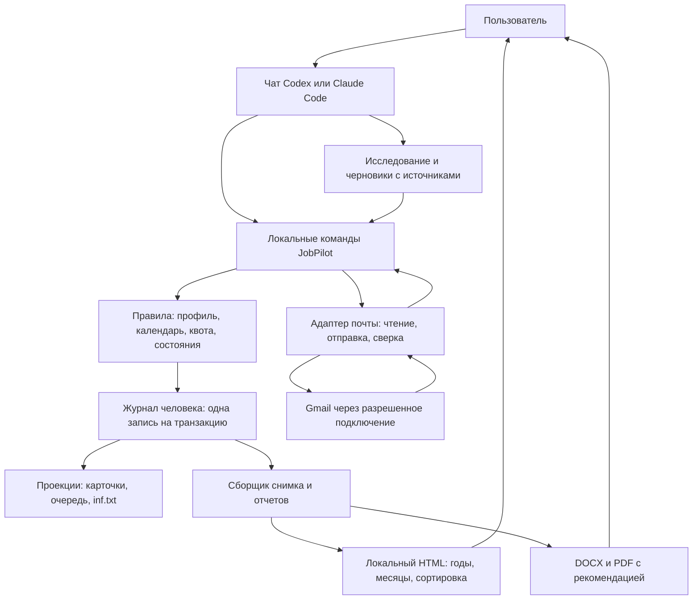

# HomenS.AI JobPilot — архитектура 1.2

[English](../../ARCHITECTURE.md) | [Русский](ARCHITECTURE.md)

07.10.2026 · Автор идеи и разработчик: Serhii Khomenko / HomenS.AI · https://homensai.com/ · документация CC BY-NC 4.0.

Статус: проектирование. Описанные команды и модули предстоит реализовать самостоятельно. Этот документ уточняет AI_BUILD_SPEC.md и DATA_CONTRACT.md; создание серверов, Docker и SQL не требуется.

## 1. Основное решение

Система состоит из агента, небольшого локального набора инструментов и папки данных. Агент ищет, интерпретирует, пишет тексты и общается с пользователем. Инструменты проверяют форматы, фиксируют операции, рассчитывают квоту/календарь и собирают отчеты. Они запускаются по команде, выполняют работу и завершаются. Постоянный процесс и сетевой порт не нужны.

Первая реализация локальных инструментов — собственные модули Python со стандартной библиотекой. Установленный runtime выбирается при настройке и сохраняется локально. Работа с DOCX/PDF и почтой подключается через отдельные адаптеры доступных инструментов; их наличие проверяется, зависимости автоматически не устанавливаются. Страница статистики — собственные HTML/CSS/JavaScript без внешних библиотек.



Диаграмма описывает будущую реализацию. HTML не вызывает команды; обновление данных всегда начинается с запуска агента.

## 2. Модули и ответственность

| Модуль | Вход → выход | Что обеспечивает |
|---|---|---|
| `entrypoint` | Корень + команда JSON → результат JSON | Версию, разрешенный корень, person/profile, маршрутизацию |
| `domain` | Текущее состояние + команда → новые события | Переходы статусов, условия отправки, квоту 44, границы профиля |
| `storage` | Транзакция → надежная запись журнала | Один писатель, ревизии, дедупликацию команд, восстановление |
| `profile` | Документы/анкета → предложения фактов → подтвержденная версия | Источник каждого факта и независимые языки |
| `discovery` | Результаты поиска агента → карточки целей | Дубликаты, актуальность, радиус, проверенность маршрута |
| `documents` | Требования + подтвержденные факты → пакет и manifest | Версии, хеши, связи с фактами, статус визуальной проверки |
| `planning` | Пакеты + рабочие дни → очередь | Равномерные слоты, резервы, переносы и overdue |
| `mail` | Почтовые observations / принятый пакет → события | Полные цепочки, evidence отправки, разбор DSN и ответы |
| `reporting` | Зафиксированная ревизия + период → DOCX/PDF/HTML | Одинаковые счетчики, поздние ответы, рыночное приложение |
| `adapters` | Стандартный запрос → конкретный инструмент | Gmail, поиск, маршруты, рендер; доступные возможности |

Модули находятся в одном локальном пакете. Общие domain/storage не импортируют Codex, Claude, Gmail или HTML. Адаптеры не редактируют журнал напрямую: они возвращают результат, который фиксирует команда. Тексты рекомендаций и классификацию писем предлагает агент; точные счетчики, дедупликацию и переходы выполняют инструменты.

Предлагаемая структура исходников будущей реализации:

```text
jobpilot.py                   # короткоживущая точка входа
jobpilot/
  commands.py                 # обработка команд и результат
  domain/                     # правила без файлов и сети
  storage/                    # journal, lock, projections, recovery
  workflows/                  # prepare, plan, check_mail, close_month
  adapters/                   # mail, render, source import
  reporting/                  # общие расчеты, DOCX/PDF/HTML
schemas/                      # версионированные форматы
dashboard_template/           # чистый HTML, только отображение
tests/fixtures/               # синтетические случаи
```

Это план структуры, перечисленных исполняемых файлов сейчас нет.

## 3. Единица учета — человек

`person_id` объединяет направления поиска одного человека. У каждого направления свой profile_id, язык материалов, аккаунт, документы и согласия. Квота и проверка повторных подач общие для person_id. Люди имеют отдельные журналы.

```text
Локальные_данные/
  workspace.json                    # workspace_id, формат, активные person/profile
  runtime.json                      # обнаруженные пути инструментов, без секретов
  persons/<person_id>/
    journal/transactions.jsonl       # единственный источник операционных событий
    journal/writer.lock              # один писатель на человека
    state/person.json               # проекция личности и списка профилей
    state/quota.json                # проекция резерва/расхода по месяцам
    state/checkpoint.json           # снимок состояния, проверенный до sequence
    outbox/<attempt_id>/            # неизменяемый подготовленный пакет отправки
  profiles/<profile_id>/
    profile.json                    # проекция текущей подтвержденной конфигурации
    registry.json                   # проекция компаний, вакансий, заявок и очереди
    inbox/                          # неподтвержденные импорты и предложения
    source_documents/               # личные оригиналы
    versions/                       # версии профиля и документов, хеши в событиях
    runs/                           # план/результат циклов и вопросы пользователю
    reports/<YYYY-MM>/              # ревизии отчетов и их manifest
    <YYYY>/<MM_Месяц>/<NNN_Фирма_Город_Роль>/
  dashboard/
    index.html                      # локальный вход, ссылки на профили
    profiles/<profile_id>/
      summary.json                  # снимок только этого профиля + квота человека
      index.html                    # та же статистика, встроенная в HTML
```

В журнале каждое событие несет person_id и профиль, к которому относится; общая квота — person scope. Команды проверяют принадлежность профиля человеку и аккаунту. Изоляция защищает от ошибочного смешения в приложении; файл одного пользователя ОС не становится недоступным ему только из-за другого profile_id.

## 4. Одна запись — одна локальная транзакция

Версия 1.1 предполагала разные первичные журналы квоты и профиля. В версии 1.2 они объединены: резерв, начало отправки и изменения заявки записываются одним объектом транзакции в JSONL. Это убирает необходимость согласовывать два первичных файла после сбоя.

Транзакция содержит:

- schema_version, transaction_id, person_id, sequence и previous_record_hash;
- command_id, request_hash и expected_revision;
- recorded_at, список events с уникальными event_id;
- сохраненный результат команды, sufficient для повторного возврата;
- record_hash канонической UTF-8 JSON-записи без самого record_hash.

Запись становится принятой только после полной строки с завершающим LF, проверки формата/хеша и надежной записи на диск. JSON канонизируется одинаково: ключи сортируются, компактные разделители, без NaN/Infinity и неоднозначных float в денежных/счетных полях. sequence растет строго на 1. Проверяемая цепочка хешей обнаруживает повреждения, но не заменяет цифровую подпись или права ОС.

Порядок команды: взять эксклюзивный lock → перечитать хвост → сначала проверить command_id → проверить expected_revision и бизнес-условия → дописать одну транзакцию → flush/fsync → отпустить lock → построить проекции. Тот же command_id + тот же request_hash возвращают прежний результат; тот же ID с другим запросом — IDEMPOTENCY_CONFLICT. Новая команда со старой ревизией — REVISION_CONFLICT. Таким образом два агента не перезаписывают решения друг друга.

Lock удерживается только на время локальной фиксации. Веб-поиск, генерация текста, рендер и ожидание почты выполняются вне lock. Эксклюзивное создание lock требуется технически; проверка существования файла недостаточна. Зависший владелец/поврежденная строка требуют recovery, а не автоматического снятия по таймеру.

Пакет документов сначала создается и проверяется во временном каталоге. Затем размещается как новая неизменяемая версия, и только после этого журнал фиксирует ее пути/хеши. После сбоя до записи события такая версия считается orphan и не участвует в отправке. Старый документ не заменяется новым по тому же пути при принятой заявке.

## 5. Контракт команд для любого агента

Будущая точка входа принимает JSON из файла внутри корня или stdin. Она не принимает инструкции свободным текстом и не вставляет поля пользователя в shell-команды. Все изменяющие команды имеют command_id, expected_revision, person_id и при необходимости profile_id. Корень передается отдельно и канонизируется один раз.

| Команда | Результат |
|---|---|
| `workspace.inspect` | Состав, формат, доступные возможности, выбранные person/profile |
| `run.resume` | Незавершенные операции, ближайшие действия, вопросы и revision |
| `profile.propose` / `profile.confirm` | Черновые факты / подтвержденная версия |
| `target.import` | Проверенные карточки с источниками или список конфликтов |
| `package.register` | Версия документов, хеши, QA и статус review |
| `queue.plan` | Конкретные слоты и остаток квоты, предварительный результат |
| `queue.commit` | Зафиксированный план/резервы после принятия |
| `send.preflight` | Решение eligible/blocked и точные причины, без внешнего эффекта |
| `send.execute` | Один разрешенный вызов транспорта + фиксация исхода |
| `mail.ingest` / `mail.classify` | Сохраненные observations / подтвержденная классификация |
| `mail.reconcile` | Результат сверки неопределенных операций без повторной отправки |
| `projection.rebuild` | Восстановленные карточки/inf.txt/очередь по журналу |
| `report.build` / `dashboard.build` | Артефакты одного source_revision |
| `workspace.backup` / `workspace.restore_check` | Согласованная копия / проверка в отдельной папке |

`queue.plan` показывает предварительный расчет; активными резервы становятся только после queue.commit. Только записи журнала определяют реальный остаток. `send.preflight` не выдает бессрочный пропуск: send.execute повторно проверяет текущую ревизию, время, согласие и хеши.

Ответ команды: status (`ok / needs_input / conflict / blocked / failed`), code, command_id, source_revision, artifacts, facts и next_action. Коды ошибок стабильны: например ACCOUNT_MISMATCH, QUOTA_EXHAUSTED, SEND_UNCERTAIN, CAPABILITY_MISSING, JOURNAL_DAMAGED, PACKAGE_CHANGED. Для пользователя агент переводит их на обычный язык и сообщает конкретное следующее действие.

Образец формы запроса: [examples/command.example.json](../../examples/command.example.json). Это синтетический запрос, не активная задача.

## 6. Отправка и outbox

Outbox — локальный неизменяемый пакет одной попытки: адресат, subject/body, файлы/хеши, account_id, application_id, attempt_id, consent_ref. Секретов в нем нет. Это не отдельный сервер и не автономный почтовый робот.

1. Подготовить outbox и сверить package_hash.
2. В одной локальной транзакции зафиксировать send_started и резерв квоты (или преобразовать существующий плановый резерв в in-flight). attempt_id получает единственного исполнителя.
3. Отпустить lock. Только этот исполнитель вызывает транспорт один раз. Повторный запуск обнаруживает существующий attempt и выполняет reconcile.
4. При подтвержденной отправке одной транзакцией отметить sent_verified и превратить reserved в consumed. При доказанной неотправке — failed_before_send и освобождение резерва. Иначе — send_uncertain с удержанием резерва.
5. Проекции/отчет можно перестроить позднее: потеря HTML или registry не вызывает повторного письма.

Граница внешнего вызова и локальной записи не атомарна. Если исполнитель погиб после send_started, нельзя предположить, успел ли он вызвать сервис. Если согласие отозвано до send_started, отправка блокируется; после зафиксированного старта возможный уже начавшийся внешний эффект нужно сверить, а не обещать отмену. Отсутствие найденного SENT при неполной сверке не доказывает неотправку.

Ключ благодарности: account_id + входящий gmail_message_id + action_type. Ключ однократного вопроса о периоде: account_id + thread_id + action_type. Они проверяются в той же транзакции начала действия. Это предотвращает второй ответ от двух одновременно работающих чатов.

## 7. Адаптеры и доступные возможности

Одинаковый workflow применяется к Codex и Claude Code. Способ вызова инструментов и авторизации относится к адаптеру, не зашивается в правила квоты/отчета.

Проверка среды сохраняет доступность отдельно: filesystem, web_search, route_lookup, mail_read, full_thread_read, mail_send, sent_evidence, docx_render, pdf_render, scheduled_wakeup. Значения: available/unavailable/unknown, checked_at и несекретная версия инструмента. Наличие настройки не считается успешной проверкой.

| Недоступная возможность | Продолжающаяся работа |
|---|---|
| Gmail | Поиск, профиль и локальные пакеты; почтовая статистика помечается непроверенной |
| Отправка или проверка SENT | Черновики и чтение; автоматические внешние действия выключены |
| Маршруты | Сохранить цель с route_unverified; не утверждать транспортную пригодность |
| Рендер | Сохранить документы как draft; нельзя считать пакет визуально принятым |
| Расписание агента | Ручной запуск run.resume; очередь остается в файлах |

Почтовой адаптер должен поддерживать identify_account, list_messages (с пагинацией), get_thread, send_once и find_send_evidence. Это внутренние имена интерфейса, не обещание наличия таких команд у внешнего сервиса. Адаптер сообщает фактические возможности.

Если доступная интеграция позволяет только прямой вызов почты из чата, она работает как agent_bridge: агент использует общий preflight/журнал, но техническое предотвращение обхода этим не доказано. Для первой реализации такой транспорт не объявляется пригодным к scheduled_send_with_profile_consent, пока проверенный путь send.execute не охватывает внешний вызов и восстановление. Контролируемое чтение и подготовка доступны раньше.

## 8. Новый чат и ежедневный цикл

Файлы инструкций задают правила, состояние хранится в журнале. TODO будущего релиза описывает этапы, но галочка в Markdown не подтверждает отправку или расход квоты.

При возобновлении агент:

1. Проверяет workspace_id, формат, активный профиль и доступность инструментов.
2. Вызывает run.resume; сначала разбирает повреждения и неопределенные отправки.
3. Подтягивает новые письма со всех нужных страниц, включая ответы на старые заявки.
4. Применяет разрешенные действия и очередь, затем обновляет отчеты/статистику.
5. Сохраняет run_id, фактические действия, evidence, вопросы и next_action в runs; новый чат продолжает с этой точки.

Ограничение контекста/обрыв чата не меняет состояние: незавершенные операции остаются в журнале. Перед каждым внешним действием агент перечитывает нужный текущий статус. Резюме сессии и checkpoint — ускорители, а не самостоятельные источники истины.

Для чтения почты cursor/checkpoint продвигается только после сохранения всей обработанной страницы. Повторное чтение допустимо благодаря дедупликации `(account_id, gmail_message_id)`. Если история/cursor недоступны, выполнить ограниченную повторную сверку с перекрытием и явно отметить неполный охват; нельзя писать «новых ответов нет» по неполному сканированию. Ошибка одного профиля не помечает остальные проверенными.

## 9. Снимки, отчеты и масштаб

Один расчет reporting строит строки и счетчики из фиксированной sequence журнала. DOCX/PDF и HTML получают один source_revision и cutoff; способы отображения не пересчитывают бизнес-статистику по-разному. Рыночный анализ имеет собственные время/источники и не меняет подтвержденные почтовые числа.

`dashboard/index.html` — локальный вход к отдельным снимкам профилей. Страницы профилей содержат только свой набор заявок и общую квоту этого человека. Добавление профиля не должно автоматически встраивать его данные в открытый снимок другого человека.

Внутри HTML — встроенный JSON, сортировка/фильтры и дата обновления. Скрипты не отправляют команды и не запрашивают Gmail. Обновление снимка атомарно для самого HTML; отдельный summary.json сверяется по snapshot_id при следующем запуске.

Checkpoint хранит sequence/hash и материализованное состояние; он принимается лишь при совпадении с соответствующей записью журнала. После него проигрывается хвост. Для начального масштаба без ротации: не создавать индексы, очереди-сервисы или фоновые воркеры до измерения реальной задержки. Восстановление из одного полного журнала остается обязательным.

## 10. Изменения формата и граница первого выпуска

Версия документов — 1.2; schema_version для новых примеров — 1.2. Данные из версии 1.1 автоматически не преобразуются при чтении. Миграция сначала создает копию/отчет, сопоставляет дубли двух старых журналов по operation_id и затем пишет единый журнал; исходники остаются доступными. Реальных данных JobPilot сейчас нет, поэтому данная ревизия обновляет только проектные документы и примеры.

Первый проверяемый срез будущей реализации: синтетический профиль → одна цель → зарегистрированный пакет → план → симуляция ответа → нейтральный отчет и офлайн HTML. Затем отдельно подключаются чтение Gmail и управляемая отправка. Тесты сбоев и конкурентных команд выполняются до включения расписанных отправок. Автоматический поиск и полнота рынка не выдаются за гарантию.

Проверяемые сценарии перечислены в ACCEPTANCE_TESTS.md. Приемка требует доказательства работы модулей, а не наличия этого архитектурного документа.

## 11. Два языка, один проект

Основная английская версия находится в корне проекта, полная русская — в docs/ru; каждая страница ссылается на свою пару. Структура разделов, идентификаторы команд, примеры и требования общие. Расхождение формулировок исправляется в обеих версиях по требованию пользователя и базовой английской версии; это не вторая конфигурация правил.

Будущий интерфейс статистики по умолчанию использует en и поддерживает ru. Словари подписей имеют одинаковые ключи и встраиваются при генерации HTML, поэтому переключение не требует fetch или сервера. Недостающий перевод заменяется английским и отмечается при генерации. Формат дат влияет только на представление; сортировка использует исходные timestamps. Названия компаний и evidence не переписываются при смене языка UI. Языки CV, сопроводительного письма, email и отчета выбираются независимо и не ограничиваются en/ru из-за языка документации.
