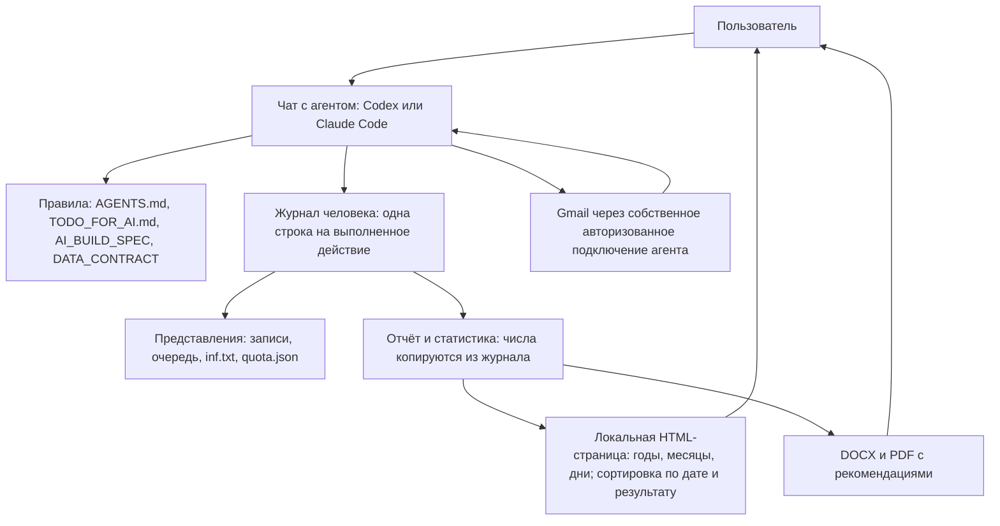

# HomenS.AI JobPilot — архитектура 1.4

[English](../../ARCHITECTURE.md) | [Русский](ARCHITECTURE.md)

07.10.2026 · Автор идеи и разработчик: Serhii Khomenko / HomenS.AI · https://homensai.com/ · документация CC BY-NC 4.0.

Статус: проектирование. В системе **нет программного кода**. Она состоит из правил, записанных в документах, и ИИ-агента, который им следует и ведёт обычные файлы. Этот документ уточняет AI_BUILD_SPEC.md и DATA_CONTRACT.md. Серверы, Docker, SQL и скрипты не используются.

## 1. Основное решение: правила и файлы

Система состоит из трёх частей: **ИИ-агент** (Codex или Claude Code), **записанные правила** и **папка с данными**. Агент исследует рынок, разбирает информацию, пишет тексты и общается с пользователем. Он же ведёт записи: следует правилам (`AGENTS.md`, `CLAUDE.md`, `TODO_FOR_AI.md`, этому документу и DATA_CONTRACT.md), пишет файлы JSON, JSONL и Markdown и обновляет страницу статистики, заменяя в ней блок данных. Каждый файл — обычный текст, который человек может открыть и прочитать.

**Что из этого следует.** Защиты системы — лимит 44 отправки, «никогда не отправлять дважды», «один пишущий в каждый момент», «ничего не уходит без разрешения» — это *порядок действий, которому агент обязан следовать*, а не технические замки. Ничто в системе не может физически остановить агента, который нарушил правило. Поэтому:

- каждое правило записано как короткий список проверок, который агент выполняет перед действием и показывает пользователю, когда речь об отправке;
- по умолчанию включён самый безопасный режим: только черновики, затем одобрение каждого письма пользователем в чате;
- полностью автоматическая отправка допускается, только если пользователь включил её для профиля и письменно подтвердил, что лимит и защита от повтора тогда зависят от соблюдения правил агентом;
- сценарии приёмки (ACCEPTANCE_TESTS.md) проверяются вручную, в чате, на синтетических данных — до любой реальной отправки.



HTML-страница никому не даёт команд; данные обновляются только тогда, когда работает агент.

## 2. Части и ответственность

| Часть | Что делает агент | Где хранится |
|---|---|---|
| Рабочая папка | Проверяет папку, версию формата, выбранного человека и профиль; сообщает, что реально умеет | `workspace.json` |
| Профиль и база знаний | Материалы из `Положите_сюда` и интервью в чате → предложенные факты → факты, подтверждённые пользователем, с источником каждого; затем профиль поиска (цели, радиус, отдельные настройки языков) | `persons/<person_id>/База_знаний/Жизнеописание.md`, `profiles/<profile_id>/profile.json` |
| Поиск | Записывает результаты исследования как цели: дубли, актуальность, радиус, проверка маршрута | `registry.json` |
| Документы | Собирает пакет из требований и подтверждённых фактов: версии, ссылки на факты, статус визуальной проверки | папка заявки |
| Планирование | Распределяет пакеты по допустимым рабочим дням, резервирует слоты, переносит, отмечает просроченные записи | `registry.json`, журнал |
| Почта | Читает цепочки целиком, проверяет подтверждение отправки, обрабатывает уведомления о доставке и ответы | журнал, `inf.txt` |
| Отчётность | Считает для зафиксированной позиции журнала и периода; выдаёт DOCX/PDF/HTML с одними и теми же числами; добавляет рыночное приложение | `reports/`, `dashboard/` |
| Проверка возможностей | Проверяет каждый свой инструмент (см. раздел 7) и записывает результат | `workspace.json` |

Агент предлагает текст рекомендаций и классификацию писем. Подсчёт, исключение дублей и смена состояний идут по записанным правилам и всегда сначала записываются в журнал.

Файлы инструкций (Markdown, а не код; черновики, ещё не проверенные на практике): `AGENTS.md` для Codex, `CLAUDE.md` для Claude Code (он подключает `AGENTS.md`), `TODO_FOR_AI.md` с ходом первого запуска и пошаговыми списками проверок. Агент сам загружает свой файл правил при открытии папки, поэтому человеку достаточно сказать «начинай».

## 3. Единица учёта — человек

`person_id` объединяет направления поиска одного человека. У каждого направления свои profile_id, языки документов, аккаунт, документы и согласия. Учёт квоты и проверка повторных заявок общие по person_id. У разных людей разные журналы.

```text
Локальные_данные/
  workspace.json                    # workspace_id, формат, язык, этап первого запуска, результаты проверки возможностей
  Положите_сюда/                    # ЕДИНСТВЕННОЕ место, куда человек кладёт материалы (агент только читает)
    1_Мои_документы/                # резюме, дипломы, сертификаты, рекомендации (оригиналы, не меняются)
    2_Рассказ_о_себе/               # рассказ человека: расшифровки голоса, заметки, интервью, вопросы
    3_Шаблон_отчёта/                # необязательный шаблон отчёта
  persons/<person_id>/
    База_знаний/Жизнеописание.md    # база знаний: жизнеописание человека в виде подтверждённых фактов
    journal/transactions.jsonl       # единственный главный журнал
    journal/writer.lock              # существует, только пока пишет один чат
    state/person.json               # представление: человек и список профилей
    state/quota.json                # месячные счётчики, пересобираются из журнала
    outbox/<attempt_id>/            # подготовленный пакет отправки, не редактируется
  profiles/<profile_id>/
    profile.json                    # текущая подтверждённая конфигурация
    registry.json                   # фирмы, вакансии, заявки, очередь
    versions/                       # версии профиля и документов
    runs/                           # рабочие сессии: планы, результаты, вопросы
    reports/<YYYY-MM>/              # ревизии отчётов и манифесты
    <YYYY>/<MM_Month>/<NNN_Company_City_Role>/
  dashboard/
    index.html                      # локальная входная страница со ссылками на профили
    profiles/<profile_id>/
      summary.js                  # этот профиль и общая квота человека
      index.html                    # неизменённая копия dashboard_template/index.html
```

Имя каталога `Локальные_данные` — общий технический путь в обеих языковых версиях.

Каждая строка журнала содержит person_id и, где применимо, профиль; общая квота относится ко всему человеку. Перед действием агент проверяет, что профиль принадлежит этому человеку и аккаунту. Изоляция предотвращает ошибки маршрутизации в правилах; другой profile_id сам по себе не создаёт границу доступа на уровне операционной системы для того же пользователя компьютера.

## 4. Одна строка на выполненное действие

Журнал — текстовый файл, в каждой строке один объект JSON. Строка пишется, когда действие **завершено**, и содержит:

- `schema_version`, `sequence` (1, 2, 3 … без пропусков), `action_id`, `person_id`, `recorded_at`;
- список `events`; у каждого события свой уникальный `event_id` (резерв квоты, начало отправки, изменение заявки и т. д.);
- короткий текст `result`, которого достаточно, чтобы повторить ответ пользователю, если то же действие запросят снова.

Правила для агента:

1. **Только добавление.** Старая строка никогда не правится и не удаляется. Исправление — новая строка, где указано событие, которое она заменяет (`supersedes_event_id`).
2. **Перед записью:** прочитать последнюю строку, взять следующий `sequence` и проверить, что такого `action_id` в журнале ещё нет. Если есть — сообщить прежний результат и больше ничего не делать. Это защищает от прерванного чата, который запускают заново.
3. **Писать строку целиком**, затем обновить представления (реестр, очередь, `inf.txt`, `quota.json`, статистику). Если чат остановился между этими шагами, следующий чат пересоберёт представления из журнала.
4. **Повреждённая или недописанная последняя строка** молча не чинится. Агент останавливается, оставляет файл как есть, сообщает пользователю и восстанавливается по последней целой строке и по подтверждениям в почте.
5. **Один пишущий в каждый момент.** Перед записью агент создаёт `writer.lock` с идентификатором запуска и временем. Если файл уже есть и он не его, агент останавливается и спрашивает пользователя, работает ли ещё другой чат; он убирает блокировку только после подтверждения, что других активных чатов нет. Закончив работу, он удаляет собственную блокировку. Это соглашение: оно защищает, только если ему следует каждый чат, поэтому пользователя просят вести один рабочий чат одновременно.
6. Решение о квоте или отправке всегда перечитывает журнал; пересказ из более ранней части чата не считается надёжным.
7. **Считать штатным средством системы, а не «на глаз».** Чтобы узнать, сколько слотов израсходовал месяц, агент считает строки журнала, содержащие событие `"type":"sent_verified"` с `occurred_at` в этом месяце (месяц — местный месяц человека, поэтому строки в пределах суток от границы месяца по UTC читаются вручную и пересчитываются в часовой пояс человека), командой, которая уже есть в операционной системе (в Windows, например, `Select-String` и `Measure-Object` в PowerShell), и показывает число пользователю. Результат он сравнивает с `quota.json`; при расхождении прав журнал, а `quota.json` пересобирается. То же относится к контрольным суммам файлов (`Get-FileHash`). Никакой скрипт для этого в пакет не добавляется.

Пакеты документов сначала готовятся во временной папке и проверяются. Затем они сохраняются как новая пронумерованная папка версии (`v001`, `v002`) и только потом регистрируются в журнале с именами файлов, размерами и — если это позволяют штатные средства системы — контрольной суммой. Принятый пакет никогда не меняется на месте: изменение создаёт новую версию и возвращает заявку на проверку.

## 5. Стандартные действия

Вместо запрограммированных команд агент выполняет именованные действия. Каждое действие — список проверок в `TODO_FOR_AI.md`; названия используются в журнале и в сообщениях пользователю.

| Действие | Результат |
|---|---|
| Проверка рабочей папки | Состав, формат, доступные возможности, выбранные человек и профиль |
| Продолжение работы | Незавершённые операции, следующие действия, вопросы |
| Предложить / подтвердить профиль | Предложенные факты / подтверждённая версия |
| Импорт целей | Записи целей с источниками или список конфликтов |
| Регистрация пакета | Версия документов, список файлов, статус проверки и одобрения |
| План очереди | Предварительный расчёт конкретных слотов и доступности квоты |
| Принять план | План и резервы записываются после согласия пользователя |
| Проверка перед отправкой | «Разрешено» или «заблокировано» с точными причинами; ничего не отправляется |
| Отправка | Одна авторизованная отправка и записанный исход |
| Чтение / классификация почты | Сохранённые наблюдения / подтверждённая классификация |
| Сверка почты | Сравнение с подтверждениями без повторной отправки |
| Пересборка представлений | Записи, `inf.txt`, очередь и `quota.json` заново из журнала |
| Отчёт / статистика | Файлы отчёта и страница статистики с одними и теми же числами |
| Резервная копия / проверка восстановления | Согласованная копия и проверка в отдельной папке |

В ответе на любое действие агент называет: исход (`ok`, `needs_input`, `conflict`, `blocked` или `failed`), код причины, позицию в журнале, созданные файлы и следующий шаг обычными словами. Коды причин остаются стабильными: `ACCOUNT_MISMATCH`, `QUOTA_EXHAUSTED`, `SEND_UNCERTAIN`, `CAPABILITY_MISSING`, `JOURNAL_DAMAGED`, `PACKAGE_CHANGED`.

«План очереди» только показывает расчёт. Резервы становятся действующими лишь после «Принять план»; остаток квоты определяет журнал. Успешная «Проверка перед отправкой» — не разрешение на потом: «Отправка» заново проверяет текущую позицию журнала, время, согласие и пакет.

## 6. Отправка и outbox

Outbox — подготовленная папка для одной попытки: получатель, тема и текст, файлы, `account_id`, `application_id`, `attempt_id` и ссылка на согласие. Секретов в ней нет. Это не отдельный почтовый сервер.

1. Подготовить outbox и убедиться, что пакет не менялся после одобрения.
2. Одной строкой журнала записать `send_started` и зарезервировать слот (или превратить плановый резерв в выполняемый). У каждого `attempt_id` ровно один чат-владелец.
3. Только этот чат делает единственный вызов отправки почтовым инструментом агента. При повторной работе существующая попытка находится и сверяется.
4. После подтверждённой отправки записать `sent_verified` и превратить резерв в использованный слот — одной строкой. После доказанной неотправки записать `failed_before_send` и освободить резерв. Иначе сохранить резерв и пометить `send_uncertain`.
5. Представления и отчёты можно пересобрать позже. Потеря HTML-страницы или `registry.json` никогда не приводит ко второму письму.

Внешний вызов и локальную запись нельзя сделать атомарными. Если чат остановился после `send_started`, никто не знает, вызывался ли почтовый сервис. Отозванное до `send_started` согласие блокирует отправку; после записанного начала отправка уже может идти и требует сверки, а не обещаний отмены. Отсутствие письма в «Отправленных» при неполной проверке не доказывает, что оно не уходило.

Исключение дублей благодарностей: account_id + входящий gmail_message_id + action_type. Единственный вопрос о периоде: account_id + thread_id + action_type. Эти ключи проверяются в той же строке журнала, что начинает действие, чтобы два чата не ответили на одно письмо дважды.

## 7. Возможности инструментов агента

Codex и Claude Code следуют одним и тем же правилам. Как вызывается инструмент и как он входит в аккаунт — дело платформы агента, а не этих правил.

При настройке агент проверяет каждую возможность отдельно: файловая система, веб-поиск, поиск маршрутов, чтение почты, чтение цепочки целиком, отправка почты, подтверждение отправки (SENT), формирование DOCX, формирование PDF и пробуждение по расписанию. Для каждой он записывает в `workspace.json`: доступно / недоступно / неизвестно, время проверки и несекретную версию инструмента. Строка в файле настроек не доказывает, что возможность работает.

| Недоступная возможность | Что можно продолжать |
|---|---|
| Gmail | Исследование, работа с профилем и локальные пакеты; почтовая статистика остаётся помеченной как непроверенная |
| Отправка или проверка SENT | Черновики и чтение; автоматические внешние действия остаются выключенными |
| Маршруты | Цель остаётся `route_unverified`; агент не утверждает, что она подходит по дороге |
| Формирование документов | Сохраняются черновики; визуальная проверка не отмечается принятой |
| Расписание агента | Пользователь запускает новый чат вручную; очередь остаётся в файлах |

Для почты агенту нужны пять умений: определить аккаунт, перечислять письма постранично, прочитать цепочку целиком, отправить один раз и найти подтверждение отправки. Это описания, а не названия интерфейсов; агент сообщает, что его инструменты умеют на самом деле.

Поскольку собственный почтовый инструмент агента — единственный способ отправки, отдельного механизма, который мог бы принудительно соблюдать месячный лимит, нет. Поэтому автоматическая отправка по расписанию по умолчанию не предлагается. Её можно включить только для профиля, пользователь которого прочитал и принял это ограничение, после того как сценарии приёмки для отправки проверены в среде этого пользователя. Контролируемое чтение и подготовку можно использовать раньше.

## 8. Новые чаты и ежедневный цикл

Файлы инструкций задают правила, состояние хранится в журнале. Список задач описывает этапы, но галочка в Markdown не подтверждает ни отправку, ни расход квоты.

**Первый запуск.** Папка без `workspace.json` — новая. Тогда агент сам начинает часть A файла `TODO_FOR_AI.md`: знакомство, проверка своих инструментов, согласие, рассказ человека о себе (голосом, если ничего не написано), документы человека, анализ и база знаний, подтверждение фактов, затем настройка поиска (что ищем, где живёт человек, радиус, транспорт). Его позиция хранится в `workspace.json` как `stage` (`new`, `consent_given`, `story_ready`, `documents_ready`, `knowledge_base_draft`, `knowledge_base_confirmed`, `profile_created`, `ready`), поэтому прерванный первый запуск продолжается с того места, где остановился.

При продолжении работы агент:

1. Проверяет workspace_id, формат, выбранный профиль и возможности своих инструментов.
2. Выполняет «Продолжение работы» и в первую очередь разбирается с повреждениями и неопределёнными отправками.
3. Получает новую почту по всем нужным страницам, включая ответы на старые заявки.
4. Применяет разрешённые действия и очередь, затем обновляет отчёты и статистику.
5. Сохраняет запись сессии в `runs`: идентификатор запуска, фактические действия, подтверждения, вопросы и следующий шаг — чтобы следующий чат продолжил с этого места.

Ограничение контекста или оборванный чат не меняют состояние: незавершённые операции остаются в журнале. Перед каждым внешним действием агент перечитывает нужный статус. Пересказы сессий — помощники, а не источник истины.

Позиция в почте сдвигается только после того, как целая обработанная страница сохранена. Повторное чтение страницы безопасно, потому что письма сопоставляются по `(account_id, gmail_message_id)`. Если почтовый инструмент не может продолжить с позиции, агент пересматривает ограниченный перекрывающийся период и явно говорит, что охват неполон. Неполная проверка никогда не подтверждает «новых ответов нет». Сбой по одному профилю не отмечает другие профили проверенными.

## 9. Снимки, отчёты и масштаб

Для отчёта агент считает один раз, от зафиксированной позиции журнала, и копирует одни и те же строки и счётчики в DOCX/PDF и в страницу статистики; он не пересчитывает те же числа отдельно для каждого формата. У обоих одинаковые `source_revision` и момент отсечения. Анализ рынка имеет собственные даты и источники и не меняет проверенные почтовые счётчики.

`dashboard/index.html` — локальная входная страница со ссылками на отдельные снимки профилей. Страница профиля включает только его заявки и общую квоту человека. Добавление профиля не вносит его данные в уже открытый снимок другого человека.

Страница статистики берёт данные из файла `summary.js` рядом с ней и содержит сортировку, фильтры и время обновления. Агент пишет только `summary.js`; файл страницы — копия шаблона, его никогда не правят, поэтому ошибка в данных не может сломать страницу. Страница не отправляет команды и не обращается к Gmail. Агент записывает `summary.js` целиком и в следующей сессии сверяет его `snapshot_id` с отчётами.

Журнал растёт на несколько строк в день, с чем обычные файлы справляются легко. Индексы, очереди и фоновые процессы не нужны. Возможность пересобрать любое представление из полного журнала сохраняется всегда.

## 10. Изменения формата и граница первого выпуска

Версия документации — 1.4; `schema_version` в примерах остаётся 1.2, потому что форматы файлов не менялись. Старые данные версии 1.1 автоматически не переносятся: перенос сначала делает копию и отчёт, сопоставляет пересекающиеся записи двух старых журналов по operation_id и только затем пишет единый журнал. Оригиналы остаются доступными. Реальных данных JobPilot сейчас нет, поэтому эта редакция меняет только документы и примеры.

Первая проверка — полный проход на синтетических данных, вручную, в чате: профиль → одна цель → зарегистрированный пакет → план → имитация ответа → нейтральный отчёт и офлайн-HTML. Чтение Gmail и контролируемая отправка добавляются отдельно. Проверки прерванной работы и двух одновременных чатов выполняются до любой отправки по расписанию. Автоматический поиск никогда не означает полный или гарантированный обзор рынка.

Сценарии проверки — в ACCEPTANCE_TESTS.md. Приёмка требует записанных доказательств того, что правила работают на практике, а не просто наличия этого документа.

## 11. Два языка, один проект

Английская редакция — основная, в корне проекта. Полная русская редакция лежит в docs/ru; каждая страница ссылается на свою пару. К обеим применяются та же структура разделов, названия действий, примеры и требования. Расхождение формулировок исправляется в обеих редакциях по требованию пользователя и английской основе; это не второй набор правил.

Страница статистики по умолчанию использует `en` и поддерживает `ru`. Словари подписей имеют одинаковые ключи и встроены в страницу, поэтому для переключения языка не нужны ни сеть, ни сервер. Отсутствующий перевод заменяется английским. Формат дат меняет только отображение; сортировка использует исходные метки времени. Названия компаний и записанные подтверждения при смене языка интерфейса не переписываются. Языки CV, сопроводительного письма, почты и отчёта выбираются отдельно и не ограничены en/ru языком документации.

---

© 2026 Serhii Khomenko / HomenS.AI · [homensai.com](https://homensai.com/) · [GitHub](https://github.com/HomenSAI) · [LinkedIn](https://www.linkedin.com/in/serhii-khomenko-homensai/) · [ORCID](https://orcid.org/0009-0009-5371-9717) · [DOI](https://doi.org/10.5281/zenodo.23160031) · info@homensai.com · [CC BY-NC 4.0](https://creativecommons.org/licenses/by-nc/4.0/)
