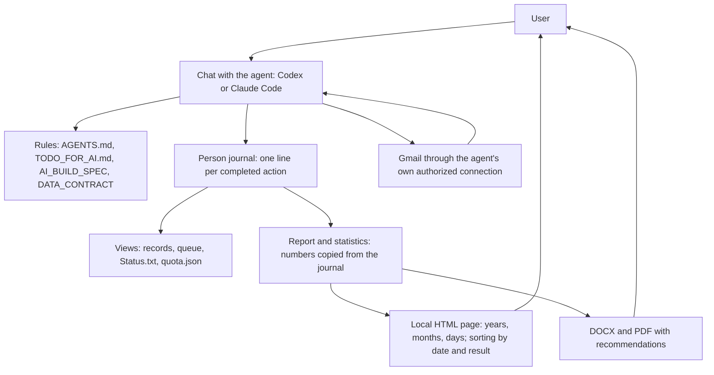

# HomenS.AI JobPilot — Архітектура 1.9.0

Українська редакція. Авторитетним є англійський текст у кореневій папці.

[English](./ARCHITECTURE.md) | [Deutsch](../de/ARCHITECTURE.md) | [Русский](../ru/ARCHITECTURE.md) | [Українська](ARCHITECTURE.md)

9 жовтня 2026 року · Автор ідеї та розробник: Serhii Khomenko / HomenS.AI · https://homensai.com/ · Документація: CC BY-NC 4.0.

Статус: проєктна та експлуатаційна специфікація. Робочий сценарій не має окремого застосунку для пошуку роботи або надсилання пошти; він складається з ШІ-агента, письмових процедур і локальних файлів. Сторінка статистики містить HTML/CSS/JavaScript, які перевіряють, сортують, фільтрують і показують знімок, написаний агентом. Вона не проводить дослідження, не надсилає пошту й не змінює журнал. Цей документ доповнює AI_BUILD_SPEC.md, DATA_CONTRACT.md і OPERATING_REQUIREMENTS.md. Сервери, Docker і SQL не використовуються.

Розділи 3 (ізоляція), 4b (блокування запису), 6a (Gmail Scheduled), 6b (відтворення), 8a–8c (ритм, місячна підготовка, щоденна перевірка) і 12 (локальні архіви та відновлення) описують процедури, додані під час узгодженого перегляду (висновки F04, F07, F12 і вимоги R01–R05). Це лише письмові процедури: жодну з них ще не виконано. Статус кожної зафіксовано в ACCEPTANCE_TESTS.md, у розділі «Consolidated review F01–F14 and R01–R20».

## 1. Основне рішення: правила і файли

Система складається з **ШІ-агента** (Codex або Claude Code), **письмових правил**, **папки даних** і локального перегляду статистики. Агент досліджує, інтерпретує інформацію, пише документи та спілкується з користувачем. Він дотримується `AGENTS.md`, `CLAUDE.md`, `TODO_FOR_AI.md`, `OPERATING_REQUIREMENTS.md`, цього документа та DATA_CONTRACT.md; він підтримує файли JSON, JSONL, Markdown і затверджені документи. Перегляд статистики читає знімок даних агента і лише показує його. Кожен запис лишається читабельним файлом.

**Що з цього випливає.** Запобіжники системи — ліміт 44 подань, «ніколи не надсилати двічі», «один записувач одночасно», «нічого не надсилається без дозволу» — є *процедурами, яких має дотримуватися агент*, а не технічними блокуваннями. Ніщо в системі не може фізично зупинити агента, який ігнорує правило. Тому:

- кожне правило записано як короткий контрольний список, який агент виконує перед дією і показує користувачеві, коли йдеться про надсилання;
- найбезпечніший режим є типовим: лише чернетки, а потім погодження кожного повідомлення користувачем у чаті;
- повністю автоматичне надсилання дозволяється лише тоді, коли користувач увімкнув його для профілю і письмово підтвердив, що ліміт і захист від дублів тоді залежать від того, чи дотримується агент правил;
- приймальні сценарії (ACCEPTANCE_TESTS.md) перевіряються вручну, у чаті, на синтетичних даних, до будь-якого реального надсилання.



HTML-сторінка нікому не дає команд; дані оновлюються лише тоді, коли працює агент.

## 2. Частини та відповідальність

| Частина | Що робить агент | Де зберігається |
|---|---|---|
| Робочий простір | Перевіряє папку, версію формату, обрану людину та профіль; повідомляє, що він справді може | `workspace.json` |
| Профіль і база знань | Матеріали з `Положите_сюда` і інтерв'ю в чаті → запропоновані факти → факти, підтверджені користувачем, з джерелом кожного факту; потім профіль пошуку (цілі, радіус, окремі мовні налаштування) | `persons/<person_id>/База_знаний/Жизнеописание.md`, `profiles/<profile_id>/profile.json` |
| Пошук | Записує результати досліджень як цілі: дублікати, актуальність, радіус, перевірка маршруту | `registry.json` |
| Документи | Будує пакет з вимог і підтверджених фактів: версії, посилання на факти, стан візуальної перевірки | папка заявки |
| Планування | Розподіляє пакети за дозволеними робочими днями, резервує слоти, переносить, позначає прострочені записи | `registry.json`, журнал |
| Пошта | Читає цілі ланцюжки листування, перевіряє докази надсилання, обробляє повідомлення про недоставку та відповіді | журнал, `Status.txt` |
| Звітність | Рахує для фіксованої позиції журналу та періоду; створює DOCX/PDF/HTML з однаковими числами; додає ринковий додаток | `reports/`, `dashboard/` |
| Перевірка можливостей | Перевіряє кожен наявний інструмент (див. розділ 7) і записує результат | `workspace.json` |

Агент пропонує текст рекомендацій і класифікацію листів. Підрахунок, усунення дублів і зміни станів виконуються за письмовими правилами і завжди спершу записуються в журнал.

Файли інструкцій (Markdown, не код; чернетки, які ще не випробувано на практиці): `AGENTS.md` для Codex, `CLAUDE.md` для Claude Code (він імпортує `AGENTS.md`), `TODO_FOR_AI.md` з потоком першого запуску та покроковими контрольними списками. Агент сам завантажує свій файл правил, коли відкривається папка, тож людині достатньо сказати «start».

## 3. Одиниця обліку — людина

`person_id` об'єднує напрями пошуку однієї людини. Кожен напрям має власний profile_id, мови документів, обліковий запис, документи та згоди. Облік квоти і перевірки повторних заявок є спільними за person_id. Різні люди мають окремі журнали.

```text
Локальные_данные/
  workspace.json                    # workspace_id, format, language, stage of the first run, capability check results
  Положите_сюда/                    # the ONLY place where the person puts things (the agent only reads it)
    1_Мои_документы/                # CVs, diplomas, certificates, references (originals, never changed)
    2_Рассказ_о_себе/               # the person's story: voice transcripts, notes, interviews, the questions
    3_Шаблон_отчёта/                # optional report template
    4_Шаблон_резюме/                # everything about your CVs, any format; read only
    5_Шаблон_сопроводительного_письма/  # everything about your cover letters; read only
  persons/<person_id>/
    База_знаний/Жизнеописание.md    # the knowledge base: the person's life story as confirmed facts
    journal/transactions-YYYY-MM.jsonl  # sole authoritative journal, monthly segments, split into -pN parts above 500 lines; only the current segment is written
    journal/writer.lock              # exists only while one chat is writing
    state/person.json               # person and profile-list view
    state/quota.json                # monthly counters, rebuilt from the journal
    outbox/<send_attempt_id>/            # prepared send package, never edited
  Resume/                              # working documents: CV drafts and the Word copy of the template in use
  CoverLetter/                         # working documents: letter drafts and the Word copy of the template in use
  profiles/<profile_id>/
    profile.json                    # current confirmed configuration
    registry.json                   # targets, applications and the queue (projection)
    runs/                           # work sessions: plans, results, questions
    reports/<YYYY-MM>/              # report revisions and manifests (in English, Russian, German or Ukrainian)
  Applications/                       # ALL application work of the person, one tree for all years
    2026/                           # year
      10_October/                   # two-digit month number + English month name
        001_Muster-Maschinenbau_Stuttgart_Maintenance-technician/   # number, company, city, role
          Company.md                # company data from public sources, each with source and check date
          Resume_v001.docx          # versions are new files: Resume_v002.docx, ...
          Resume_v001.pdf
          CoverLetter_v001.docx
          CoverLetter_v001.pdf
          EmailText_de.txt          # the e-mail text in the chosen language
          Status.txt                # append-only history of this application
          Replies.txt               # every reply and delivery notice in full, in thread order (Відповіді)
  dashboard/
    index.html                      # local menu: statistics and readiness per profile
    profiles/<profile_id>/
      summary.js                    # the data of this profile plus the person's shared quota
      index.html                    # an unchanged copy of dashboard_template/index.html
      readiness.html                # the readiness page of this profile
```

Назва каталогу `Локальные_данные` є спільним технічним шляхом в обох мовних редакціях. Панель має лише один шлях, `Локальные_данные/dashboard/`, поруч із `persons/` і `profiles/`. Ідентифікатори профілів є унікальними в межах робочого простору, тож сторінки кількох людей не перетинаються.

Кожен рядок журналу містить person_id і, де це доречно, свій профіль; спільна квота має область дії person. Перш ніж діяти, агент перевіряє, що профіль належить людині та обліковому запису. Ізоляція запобігає помилкам маршрутизації за правилами; інший profile_id сам по собі не створює межі доступу операційної системи для того самого користувача комп'ютера.

**Ізоляція між людьми і профілями (процедура, F12).** Одна папка може обслуговувати кількох людей, і процедура тримає їх окремо:

- Кожна людина має `persons/<person_id>/` і для оригіналів — особисту підпапку `Положите_сюда/<name>/` з власними трьома підпапками (ACCEPTANCE_TESTS.md, KB-04). Агент ніколи не відкриває оригінали, базу знань, журнал, стан, outbox, архіви чи пошту іншої людини.
- Другу людину додають з новим `person_id`, і для неї повторно проходять усе первинне налаштування (частина A TODO_FOR_AI.md). Прогрес налаштування зберігається для кожної людини в `persons/<person_id>/state/person.json` (`setup_progress`). `stage` у `workspace.json` описує лише папку і не означає, що нова людина готова.
- Згода надається для кожної людини (`consent_granted` містить `person_id` цієї людини). Відмова або відкликання однією людиною не відкриває нічого з того, що належить іншій.
- Перш ніж читати оригінали, відкривати пошту чи писати рядок журналу, агент називає активну людину і перевіряє, що профіль і обліковий запис належать їй. Якщо людина неясна, агент питає, перш ніж робити щось інше.
- Місячна квота має область дії person: кожен профіль однієї людини використовує її спільно, і жоден профіль іншої людини не враховується. Квота ніколи не переходить між людьми.
- Звіти, знімки статистики та архіви створюються для кожної людини (а для профілю — там, де предметом є профіль). Додавання людини не змінює знімок, який уже опубліковано для іншої людини.

Це процедурна ізоляція. Вона не захищає від іншого користувача того самого комп'ютера і не є межею операційної системи.

## 4. Один рядок на завершену дію

Журнал — це набір текстових файлів, по одному на місяць (місячні сегменти, правило 8), з одним об'єктом JSON у кожному рядку. Рядок записується, коли дію **завершено**, і містить:

- `schema_version`, `sequence` (1, 2, 3 … без пропусків), `action_id`, `person_id`, `recorded_at`;
- список `events`, кожна подія з власним унікальним `event_id` (резервування квоти, початок надсилання, зміна заявки тощо);
- короткий текст `result`, достатній, щоб повторити відповідь користувачеві, якщо про ту саму дію просять знову.

Правила для агента:

1. **Лише додавання.** Старий рядок ніколи не редагується і не видаляється. Виправлення — це новий рядок, який називає попередню подію, яку він замінює (`supersedes_event_id`).
2. **Перед записом:** прочитайте останній рядок поточного сегмента (найновішого сегмента, якщо поточний новий), візьміть наступний `sequence` і перевірте, що цей `action_id` не є в жодному сегменті. Якщо є, повідомте попередній результат і більше нічого не робіть. Це захищає від перерваного чату, який запустили знову.
3. **Записуйте весь рядок одразу**, потім оновлюйте подання (реєстр, чергу, `Status.txt`, `quota.json`, статистику). Якщо чат зупиниться між цими кроками, наступний чат відновить подання з журналу.
4. **Пошкоджений або недописаний останній рядок** не виправляється мовчки. Агент зупиняється, залишає файл як є, повідомляє користувача і відновлюється з останнього повного рядка та доказів із пошти.
5. **Один записувач одночасно.** Перед записом рядка журналу агент бере `writer.lock` через виключне створення, як описано в розділі 4b. Якщо файл належить іншому запуску, агент зупиняється і питає користувача, чи ще працює той чат; чуже блокування він знімає лише після перевірок із 4b. Коли роботу завершено, він видаляє власне блокування. Блокування захищає лише тоді, коли кожен чат дотримується цього протоколу і середовище забезпечує виключне створення; інакше користувач мусить тримати працюючим лише один чат одночасно.
6. Рішення про квоту чи надсилання завжди перечитує журнал; підсумок з попередньої частини чату ніколи не довіряють.
7. **Рахуйте засобами системи, а не на око.** Слоти, використані, зарезервовані чи неперевірені за місяць, зчитуються з усіх сегментів журналу пошуком тексту за полями місяця в подіях квоти (формули — в DATA_CONTRACT.md §3c, вільна квота — у §5; команди — в §4a нижче). Агент показує число і те, як його знайдено. Він порівнює результат із `quota.json`; якщо вони різняться або файл відсутній, правим є журнал, а `quota.json` відбудовується заново (`examples/quota.example.json`). Те саме стосується контрольних сум файлів. Для цього до пакета не додається жодного скрипта.
8. **Запис рядка (один метод додавання, місячні сегменти).** Журнал ведеться за місяцями: поточний сегмент — це `journal/transactions-YYYY-MM.jsonl`, або його пронумерована частина `journal/transactions-YYYY-MM-pN.jsonl`, щойно в місяці набирається 500 рядків (DATA_CONTRACT.md §3c). Записується лише поточний сегмент; закритий сегмент ніколи не редагується. Якщо журналу ще немає, перший рядок має `sequence` 1. Використовується лише такий метод. JSON не склеюють вручну, а текст не записують через перенаправлення оболонки чи heredoc. Операція точної заміни файлового інструмента використовується лише для однієї мети: додати рядок після останнього рядка сегмента, як описують кроки 3 і 4.
   1. Під блокуванням запису визначте поточний місяць M за місцевим часом і його поточний сегмент. Якщо в цьому сегменті вже 500 рядків, новий рядок іде до наступної пронумерованої частини (`-p2`, `-p3` …), яка вважається новим сегментом у кроці 3(b). Прочитайте останній рядок поточного сегмента, який має бути повним рядком. Якщо сегмент новий або порожній, натомість прочитайте останній рядок найновішого попереднього сегмента; для самого першого рядка такого немає, і `n` дорівнює 0. Візьміть `n`, `sequence` цього останнього рядка журналу. Перевірте, що новий `action_id` не є в жодному сегменті (правило 2). Запишіть у нотатку запуску: кількість рядків сегмента; останній рядок `L` без розриву рядка (він унікальний, бо має власні `sequence` і `action_id`); та `C0`, SHA-256 усього файлу сегмента (для нового сегмента — SHA-256 порожнього файлу, `e3b0c442…b855`). Перевірте, що файл закінчується розривом рядка.
   2. Сформуйте новий рядок у порядку ключів із DATA_CONTRACT.md §3c з `sequence` n+1. Перевірте, що це один об'єкт JSON в одному рядку і що ідентифікатори відповідають заявленим формам у DATA_CONTRACT.md §2. Невдала перевірка зупиняє запис (крок 5).
   3. Додавання. (a) Якщо в сегменті є рядки: точною заміною файлового інструмента замініть `L` на `L`, розрив рядка і `N` (коли `L` дуже довгий, як текст для пошуку достатньо унікального хвоста `L`; префіксна контрольна сума кроку 4 доводить, що жоден раніший байт не змінився). Якщо `L` не знайдено рівно один раз, зупиніться (крок 5). Тоді файл закінчується на `N` і його розривом рядка. (b) Якщо сегмент новий: переконайтеся, що файлу немає, потім створіть його файловим інструментом, у якому є саме `N` і розрив рядка. (c) Для сегмента з меншою ніж 300 рядками сегмент можна натомість записати цілком файловим інструментом, з тексту, прочитаного в кроці 1: ті самі рядки, потім `N` з розривом рядка. Варіант (c) — єдине повне переписування сегмента, і лише для малого сегмента.
   4. Зчитування назад. (a) `N` розбирається як JSON з `sequence` n+1; попередній рядок, якщо він є, побайтово ідентичний `L` і розбирається як JSON з `sequence` n. (b) Кількість рядків зросла рівно на один. (c) SHA-256 сегмента без останнього рядка дорівнює `C0`, тобто кожен байт перед `N` не змінився (наприклад, `head -n -1 <segment> | sha256sum`, розділ 4a). Значення зчитування назад записуються в нотатку запуску.
   5. Невдала перевірка зупиняє запис. Файл сегмента лишається як є, жодне подання не оновлюється, зовнішня дія не виконується, блокування лишається, і людину повідомляють (правило 4). Нічого не виправляється переписуванням попередніх рядків. Файл блокування має фіксований формат (DATA_CONTRACT.md §3c). Перевірки, що блокування немає, з подальшим окремим створенням самої по собі недостатньо (4b).
   6. Звільнення. Лише після того, як пройдено крок 4, власник звільняє блокування: він читає файл блокування, перевіряє, що в ньому його власний `lock_id`, і видаляє його (4b). Невдалий запис ніколи не доходить до цього кроку.

### 4a. Команди, які може використовувати агент

Агент використовує лише команди, які вже є в операційній системі людини, вписані в чат; нічого не зберігається в пакеті як скрипт. Дозволені використання: поточний час, новий UUID, контрольна сума файлу, текстовий пошук із підрахунком, перевірка коректності JSON, перетворення часового поясу для поточного моменту, перелік каталогу, створення папок, копіювання затверджених файлів до папки outbox (із зчитуванням контрольної суми кожної копії), створення файлів DOCX і PDF інструментом документів, нижче, а також копіювання або видалення власних тимчасових файлів агента. Винятки названо: виключне створення `writer.lock`, копіювання до `outbox/`, інструмент документів і одноразовий поділ застарілого журналу (DATA_CONTRACT.md §3d), який копіює байти за діапазонами рядків і звіряє зчитуванням контрольної суми. Файли JSON і всі інші текстові файли (Status.txt, Company.md, нотатки запусків, EMAIL_TO_SEND.txt) записуються файловим інструментом, ніколи через перенаправлення оболонки, heredoc, `sed` чи подібне; рядок журналу додається лише точною заміною з правила 8. Python не є операційним інструментом агента: це лише засіб аудиту тестувальника. Підрахунки, пагінація та контрольні суми в чаті виконуються засобами системи для пошуку тексту й контрольних сум та файловим інструментом. Наведені нижче форми — це форми Windows (PowerShell); на macOS або Linux агент використовує еквіваленти: `date -u +%Y-%m-%dT%H:%M:%SZ`, `uuidgen` (або `cat /proc/sys/kernel/random/uuid`), `sha256sum`, `wc -l`, `od -c`, `diff` або `cmp` (порівняння двох файлів лише для читання, наприклад щоб перевірити, що розповідь збережено дослівно), `grep -c` і `grep -o` (підрахунки), `tail -n 1` і `tail -n 2`, `head -n -1` (сегмент без останнього рядка), `cp` і `set -C` (noclobber) для виключного створення `writer.lock`.

| Потреба | PowerShell |
|---|---|
| Поточний час UTC | `(Get-Date).ToUniversalTime().ToString("yyyy-MM-ddTHH:mm:ssZ")` |
| Новий UUID | `[guid]::NewGuid().ToString()` |
| Контрольна сума файлу | `(Get-FileHash -Algorithm SHA256 -LiteralPath <file>).Hash.ToLower()` |
| Локальний місяць людини зараз | `[TimeZoneInfo]::ConvertTime([DateTimeOffset]::UtcNow,[TimeZoneInfo]::FindSystemTimeZoneById('W. Europe Standard Time')).ToString('yyyy-MM')` (агент зіставляє IANA-зону людини, наприклад `Europe/Berlin`, з назвою Windows) |
| Підрахунок подій місяця | `(Select-String -Path <journal> -Pattern '"consumed_month"\s*:\s*"2026-10"' -AllMatches \| ForEach-Object { $_.Matches.Count } \| Measure-Object -Sum).Sum` (порожній результат означає 0) |
| Перевірка, що кожен рядок журналу є коректним JSON | `Get-Content <journal> \| ForEach-Object { $_ \| ConvertFrom-Json } \| Out-Null` (помилка вказує на поганий рядок) |
| Останній рядок журналу (поточний сегмент) | `Get-Content <current segment> -Tail 1` |
| Останні два рядки журналу (зчитування назад після додавання, правило 8 розділу 4) | `Get-Content <current segment> -Tail 2` |
| Контрольна сума сегмента без останнього рядка (зчитування назад після додавання, правило 8, крок 4) | `head -n -1 <segment> \| sha256sum` на macOS або Linux; еквівалент у PowerShell треба перевірити побайтово перед першим використанням |
| Виключне створення `writer.lock` (невдача, якщо файл існує) | `[System.IO.File]::Open('<lock>', 'CreateNew', 'Write', 'None').Close()`; один рядок JSON потім записується в цей порожній файл файловим інструментом і зчитується назад. На macOS або Linux: `set -C` (noclobber) перед створенням |
| Копіювання до `outbox/<send_attempt_id>/` | `Copy-Item -LiteralPath <source> -Destination <outbox folder>`, потім рядок контрольної суми вище для кожної копії |
| Створення DOCX і PDF (інструмент документів) | Інструмент документів платформи, якщо він є в інсталяції; інакше LibreOffice у headless-режимі: `soffice --headless --convert-to pdf --outdir <folder> <file.docx>` для PDF затвердженого DOCX |

У таблиці `<journal>` — це кожен сегмент `journal/transactions-*.jsonl` людини, а `<current segment>` — сегмент поточного місяця. Перетворення часового поясу для старого моменту не потрібне: місяці записуються в події, коли вони відбуваються. Текстові файли записуються власним файловим інструментом агента, а не через перенаправлення оболонки; створення блокування, наведене вище, і одноразовий поділ під час міграції (DATA_CONTRACT.md §3d) — єдині винятки. Ці форми ще не випробувано на справжній машині з Windows; перше випробування — частина приймальних перевірок.

Пакети документів спершу готуються в тимчасовій папці та перевіряються. Потім їх зберігають як нову пронумеровану папку версії (`v001`, `v002`) і лише після цього реєструють у журналі з іменами файлів, розмірами та, якщо це може забезпечити системний інструмент, контрольною сумою. Прийнятий пакет ніколи не змінюється на місці: зміна створює нову версію і повертає заявку на перегляд.

### 4b. Протокол блокування запису (F07)

**Область дії.** Одне блокування на людину: `persons/<person_id>/journal/writer.lock`. Воно захищає журнал, квоту та події профілю цієї людини. Воно охоплює лише кроки запису; пошук, відтворення і зовнішні виклики відбуваються поза ним. Блокування іншої людини не заважає роботі цієї людини, а блокування цієї людини ніколи не дозволяє записи для іншої людини.

**Взяття блокування.**

1. Створіть файл однією операцією, яка завершується невдачею, якщо файл уже існує: виключне створення (режим «створити новий», прапорець виключного відкриття або еквівалент, задокументований середовищем). Перевірка, що файлу немає, з подальшим створенням на другому кроці не є виключним створенням.
2. Вміст — це один рядок JSON з `lock_id`, `run_id`, `owner` (коротка мітка чату), `person_id` і `created_at` (UTC), як у DATA_CONTRACT.md §5, «Writer lock (F07)». `run_id` також записується в нотатку сеансу чату.
3. Якщо створення не вдалося, бо файл існує, агент нічого не записує і читає файл. Якщо його `run_id` належить цьому чату, агент продовжує (перезапущений чат упізнає своє блокування через свою нотатку). Інакше він зупиняється, повідомляє `LOCK_HELD` і питає людину; застосовується процедура застарілого блокування нижче.
4. Перед кожним записом під блокуванням агент знову читає блокування і підтверджує, що в ньому досі є його `lock_id`. Якщо блокування зникло або змінилося, запис скасовується і про це повідомляється.
5. Чи працює виключне створення в цій інсталяції, записується в `workspace.json` у `capabilities.writer_lock` (`available`, `unavailable` або `unknown`). Якщо результат `unavailable` або `unknown`, агент не заявляє про виключність і не запускає самостійних паралельних записів чи зовнішніх дій: для цієї людини діє лише один чат, і людину про це повідомляють.

**Звільнення блокування.** Звільняє лише власник, і лише після того, як останній рядок журналу, який він записав, пройшов зчитування назад за правилом 8, крок 4 (чат, що не записав жодного рядка, звільняє після своєї останньої перевірки). Власник читає файл блокування, підтверджує, що в ньому його власний `lock_id`, і видаляє його окремим кроком. Невдалий запис лишає блокування і зупиняє чат; блокування ніколи не видаляється в тій самій команді, що й запис, який міг не вдатися. Наступний запуск сам нічого не перебирає: він читає блокування, і блокування, чий `lock_id` і `run_id` належать нотатці цього чату, продовжується після цієї перевірки (крок 3 вище); будь-яке інше блокування йде за процедурою застарілого блокування. Звільнення ніколи не запускається віком, іншим чатом чи тайм-аутом. Звільнення не записує рядка журналу.

**Застаріле блокування.** Блокування ніколи не спливає за віком, і його завершення ніколи не звільняє резервування. Перш ніж видалити блокування, яке не належить цьому чату, потрібні такі кроки в такому порядку:

- (a) людина підтверджує, що чат-власник більше не працює (агент не бачить інших чатів);
- (b) останній рядок журналу є повним коректним JSON, і `sequence` без пропусків (DATA_CONTRACT.md §3c);
- (c) перелічено кожну відкриту спробу (`send_started` або намір планування без результату); кожна стає `send_uncertain`, якщо її не звірено з SENT або Scheduled (6a); папки outbox без результату також перелічуються;
- (d) віддалений стан перевіряється там, де інструмент пошти це дозволяє; те, що перевірити не можна, лишається відкритим;
- (e) лише тоді блокування видаляється. Видалення відзначається в нотатці запуску та в тексті `result` наступного рядка журналу; це не окрема подія.

Поки існує відкрита спроба, для цієї людини не дозволено жодного нового надсилання чи планування в жодному чаті.

**Що відбувається на кожному переході.** Жоден із випадків нижче не робить другого зовнішнього виклику. Таблиця показує, що знаходить наступний чат і що він робить.

| Точка збою | Залишений стан | Відновлення |
|---|---|---|
| До створення файлу блокування | Нічого | Почати дію знову |
| Блокування створено, рядка журналу ще не записано | Лише файл блокування; журнал не змінено | Перевірка застарілого блокування; зовнішнього виклику не було; видалити блокування після кроку (a) |
| Під час запису рядка журналу | Можливо, обрізаний останній рядок | Зупинитися і зберегти файл (правило 4 розділу 4); зовнішнього виклику не було; діагностувати з останнього повного рядка |
| Після рядка наміру (резервування і `send_started`), до зовнішнього виклику | Відкрита спроба; виклик міг відбутися, а міг і ні | Звірити в SENT і Scheduled. Знайдено: записати перевірений факт. Відсутність доведено: `failed_before_send` і `quota_released`. Інакше `send_uncertain`, резервування лишається, вирішує людина. Ніколи не викликати знову |
| Під час зовнішнього виклику, відповідь втрачено | Те саме, що вище | Те саме. Втрачену відповідь не відрізнити від виклику, якого не було, тож спроба є `send_uncertain`, якщо відсутність не доведено |
| Після відповіді, до рядка результату | Чат знав результат; журнал його не показує | Один раз звірити докази: перевірено → `sent_verified` і `quota_consumed` (або запис планування); відсутність доведено → `failed_before_send` і `quota_released`; інакше `send_uncertain`. Ніколи не викликати знову |
| Після рядка результату, до оновлення подань | Журнал повний; подання застарілі | Відтворити подання (6b). Жодної зовнішньої дії |
| Два чати змагаються за останній слот | Лише одне виключне створення може вдатися | Той, хто програв, нічого не записує і повідомляє `LOCK_HELD`. Перевірка квоти виконується після взяття блокування, а не раніше |
| Інший учасник видаляє блокування під час запису | Запис може зупинитися на півдорозі | Повторна перевірка в кроці 4 зупиняє запис; наступний чат іде за процедурою застарілого блокування |

Якщо виключне створення недоступне, ці правила все одно діють, але паралельні чати для однієї людини взагалі не підтримуються.

## 5. Стандартні дії

Замість запрограмованих команд агент виконує іменовані дії. Кожна дія є контрольним списком у `TODO_FOR_AI.md`; назви використовуються в журналі та в повідомленнях користувачеві.

| Дія | Результат |
|---|---|
| Перевірити робочий простір | Інвентаризація, формат, наявні можливості, обрані людина і профіль |
| Продовжити роботу | Незавершені операції, наступні дії, запитання |
| Запропонувати / підтвердити профіль | Запропоновані факти / підтверджена версія |
| Імпортувати цілі | Цільові записи з джерелами або список конфліктів |
| Зареєструвати пакет | Версія документа, перелік файлів, перевірка і стан перегляду |
| Спланувати чергу | Попередній перегляд конкретних слотів і наявності квоти |
| Зафіксувати план | План і резервування записуються після того, як користувач прийняв їх |
| Перевірка надсилання | «Дозволено» або «заблоковано» з точними причинами; нічого не надсилається |
| Надіслати | Одне авторизоване надсилання і записаний результат |
| Прочитати / класифікувати пошту | Збережені спостереження / підтверджена класифікація |
| Звірити пошту | Порівняння з доказом без повторного надсилання |
| Відтворити / відбудувати подання | Записи, `Status.txt`, черга, `quota.json` і статистика, відбудовані з журналу та незмінних версій (6b) |
| Побудувати звіт / статистику | Файли звітів і сторінка статистики з однаковими числами |
| Перевірка резервної копії / відновлення | Узгоджена копія і перевірка в окремій папці (розділ 12) |
| Створити локальний архів (R01) | Перевірений версійований знімок після завершеної операції (розділ 12) |
| Запланувати в Gmail (R03) | Запланований елемент, перевірений у Gmail Scheduled (6a); це ще не надіслане повідомлення |
| Спланувати місяць і ритм (R02, R04) | Переглянутий календар слотів і резервування на місяць (8a, 8b) |
| Щоденна перевірка о 16:00 (R05) | Звірка Scheduled, SENT, відповідей і повідомлень про недоставку (8c) |

Відповідь агента на кожну дію містить: результат (`ok`, `needs_input`, `conflict`, `blocked` або `failed`), код причини, позицію в журналі, створені файли та наступний крок звичайною мовою. Коди причин лишаються стабільними; повний перелік є в DATA_CONTRACT.md §3c (наприклад, `ACCOUNT_MISMATCH`, `QUOTA_EXHAUSTED`, `SEND_UNCERTAIN`, `PACKAGE_CHANGED`, `SUBJECT_TOO_LONG`, `MODE_DRAFT_ONLY`, `LOCK_HELD`). Там же визначено, які дії записують рядок журналу.

«Спланувати чергу» лише показує попередній перегляд. Резервування стають активними тільки після «Зафіксувати план»; реальну решту квоти визначає журнал. Успішна «Перевірка надсилання» не є дозволом, що триває: «Надіслати» знову перевіряє поточну позицію журналу, час, згоду і пакет.

## 6. Надсилання і outbox

Outbox — це підготовлена папка для однієї спроби, `outbox/<send_attempt_id>/`: копії файлів пакета, які будуть прикріплені, `message.txt` (одержувач, тема і текст точно так, як буде надіслано) та `attempt.json` (`account_id`, `application_id`, `send_attempt_id`, `consent_id`, контрольні суми скопійованих файлів). Він не містить секретів. Це не окремий поштовий сервер. Спроба з `send_started` без результату вважається відкритою.

Наведений нижче порядок є порядком зовнішніх дій з DATA_CONTRACT.md §5 і TODO_FOR_AI.md, частина C (F07). Він застосовується до кожної зовнішньої дії з поштою: надсилання, планування в Gmail, перенесення і скасування. Підготовка пакета не є надсиланням. Кожен крок має виконатися успішно, перш ніж почнеться наступний.

1. **Незмінний пакет.** Створіть копію точних файлів `outbox/<send_attempt_id>/` і маніфест із SHA256 кожного вкладення, одержувачем і джерелом його адреси, обліковим записом відправника, темою, текстом, транспортом (`agent_local_run`, `gmail_scheduled` або `manual_by_person`; ніколи два для одного пакета) і слотом з його часовим поясом. Прочитайте копію назад і звірте із затвердженим пакетом.
2. **Згода, прив'язана до маніфесту.** Погодження (`package_approved` або затверджений план зі своєю згодою) містить SHA256 маніфесту. Кожен компонент із кроку 1 має досі збігатися з ним. Зміна компонента робить попередню згоду недійсною для нової версії, якій потрібне нове погодження (`approval_revoked`, `PACKAGE_CHANGED`). Після цього виконується перевірка надсилання.
3. **Резервування і дієвий намір (жорстка перевірка).** Під блокуванням запису (4b) чат знову перечитує квоту й історію, потім записує один рядок журналу з `quota_reserved` і `send_started`. Рядок містить намір, транспорт, `send_attempt_id` і SHA-256 маніфесту (та інші поля з DATA_CONTRACT.md §3c). Чат зчитує його назад за правилом 8 розділу 4 і звільняє блокування лише після того, як зчитування назад пройшло (правило 8, крок 6). Безпосередньо перед кроком 4 він ще раз читає останній рядок журналу: це має бути саме цей рядок наміру з тим самим `send_attempt_id` і SHA-256 маніфесту, що й у погодженні. **Перевірка:** якщо запис або зчитування назад не вдалися, чат зупиняється до звільнення блокування, не робить зовнішнього виклику, нічого більше не записує і лишає блокування. Якщо не вдалася лише перевірка останнього рядка, чат не робить зовнішнього виклику, а відкритий намір обробляється за 4b.
4. **Один зовнішній виклик.** Рівно один, його виконує чат, який записав намір. Повтору в тому самому чаті немає і жодної «другої копії про всяк випадок». Кожен `attempt_id` має одного виконавця; повторний запуск знаходить існуючу спробу і звіряє її.
5. **Звірка.** Пошук у SENT або Scheduled точного повідомлення (обліковий запис, пакет, одержувач, слот). Знайдено: перехід до кроку 6. Відсутність доведено: `failed_before_send` і `quota_released` в одному рядку. Інакше `send_uncertain`: резервування лишається, нового зовнішнього виклику не робиться, і людина вирішує після перевірки.
6. **Запис факту.** Для `cv_submission` — `sent_verified` і `quota_consumed` в одному рядку; подяка або звичайна відповідь записується як `thank_you_sent` або `ordinary_reply_sent` (DATA_CONTRACT.md §4), ніколи як `sent_verified`; для планування — `gmail_scheduled_verified` (це не подія надсилання). Потім оновіть подання (6b) і створіть локальний архів (розділ 12).

Подання та звіти можна відбудувати пізніше. Втрата HTML-сторінки чи `registry.json` ніколи не спричиняє другого листа.

**Види надсилань і їхні ключі повтору (F01).** Кожен вид надсилання має власний ключ, який перевіряється в тому самому рядку журналу, що його починає:

- `cv_submission` (займає слот): та сама спроба подання заявки не може повторитися. CV, надіслане роботодавцю раніше, не блокує дозволеного подальшого листа.
- `thank_you`: унікальний за обліковим записом + вхідним `gmail_message_id` + `thank_you`. Перша подяка після надісланого CV дозволена; друга на те саме вхідне повідомлення — ні. Записується як `thank_you_sent` і потребує чинної згоди `follow_up` (DATA_CONTRACT.md §4).
- Запитання про період не є окремим видом: це `ordinary_reply` (подія `ordinary_reply_sent`), яке надсилається лише після того, як людина схвалила це повідомлення; воно унікальне за обліковим записом + вхідним Gmail Message-ID, і одне запитання про період ставиться на ланцюжок листування (`thread_id`). `thank_you_sent` — єдиний автоматичний подальший лист.
- `ordinary_reply`: відповідь без CV; вона не займає слота і перевіряється за тією самою історією ланцюжка перед записом.

Відкрита або невизначена спроба блокує повтор того самого ключа і блокує всі нові надсилання для цієї людини, доки її не буде вирішено. Невизначений результат ніколи не відкриває шляху до дубліката.

Зовнішній виклик і локальний запис не можна зробити атомарними. Якщо чат зупиниться після `send_started`, ніхто не знає, чи викликали поштову службу. Згода, відкликана до `send_started`, блокує надсилання; після записаного початку надсилання може вже тривати, і його треба звірити, а не обіцяти скасувати. Незнаходження повідомлення в SENT під час неповної перевірки не доводить, що його не надіслано.

Дедуплікація подяк використовує: account_id + вхідний gmail_message_id + намір (thank_you). Одне запитання про період використовує: account_id + thread_id + намір (ordinary_reply). Ці ключі перевіряються в тому самому рядку журналу, що починає дію, щоб два чати не могли відповісти на те саме повідомлення двічі.

### 6a. Gmail Scheduled через вбудований браузер агента (R03)

**Умови.** Режим це дозволяє, і людина особисто увійшла до потрібного облікового запису Gmail у профілі браузера. Агент ніколи не отримує і не зберігає паролі, одноразові коди чи cookies. Сеанс Gmail належить цьому профілю браузера і може завершитися в будь-який момент. Gmail надсилає заплановане повідомлення навіть тоді, коли агент не працює, тому згода, календар, пакет і резервування перевіряються перед плануванням. Будь-яка зміна потребує нового погодження, а для вже запланованого елемента — спершу перевіреної зміни або скасування.

**Обмеження вбудованого браузера.** У задокументованій версії вбудований браузер не може автоматично завантажувати файли (поправка R03/R08 узгодженого плану). Якщо ця інсталяція не може прикріпити погоджені файли, агент зупиняється перед плануванням і використовує ручний шлях нижче.

**Кроки.** Порядок іде за розділом 6.

1. **Перед дією.** Перевірте людину, активного відправника Gmail (це має бути обліковий запис у профілі, а браузер має показувати ту саму адресу), режим і згоду, погоджений слот, одержувача та його джерело, тему (не більше 50 символів після нормалізації NFC), тіло листа і кожне вкладення (назва, розмір і SHA256 за маніфестом).
2. **Резервування.** Під блокуванням запису запишіть `quota_reserved` і `send_started` з транспортом `gmail_scheduled` за місяць запланованого надсилання. Звільніть блокування. Цей рядок є дієвим наміром.
3. **Складання.** Відкрийте новий лист, заповніть лише погоджені поля, прикріпіть лише погоджені файли і дочекайтеся завершення кожного завантаження. Якщо вкладення не вдалося, зупиніться: ще нічого не заплановано.
4. **Планування.** Оберіть **Schedule send**, а не Send. Встановіть точну дату й локальний час і перевірте часовий пояс, що показується.
5. **Перевірка в Scheduled.** Відкрийте папку Scheduled і звірте запис з обліковим записом, одержувачем, темою, текстом, вкладеннями, датою і часом. Клік або повідомлення про підтвердження не є доказом.
6. **Збережіть докази.** Збережіть віддалений ідентифікатор або локатор доказу, який дає Gmail. Message-ID ніколи не вигадується.
7. **Запис.** Запишіть `gmail_scheduled_verified` (з хешем маніфесту та часом планування), оновіть подання і створіть локальний архів (розділ 12). Це не `sent_verified`.
8. **Після запланованого часу.** Перевірте SENT для точного повідомлення та його фактичного часу надсилання, а потім один раз запишіть `sent_verified` і `quota_consumed`.

**Стани і події журналу.** Дотримуйтеся DATA_CONTRACT.md §12.2; назви подій — це назви з §3c.

| Стан | Докази | Журнал |
|---|---|---|
| `local_planned` | План погоджено; у Gmail нічого не надіслано | `plan_committed` |
| `scheduling_started` | Резервування і намір записано; ще не підтверджено | `quota_reserved` і `send_started` (транспорт `gmail_scheduled`) |
| `gmail_scheduled_verified` | Точний запис знайдено в Scheduled | `gmail_scheduled_verified` |
| `schedule_failed_before_commit` | Відсутність доведено: Scheduled і SENT перевірено за обліковим записом, пакетом, одержувачем і слотом | `failed_before_send` і `quota_released` |
| `schedule_uncertain` | Намір записано; перевіреного результату немає | `schedule_uncertain`; резервування лишається |
| `sent_verified` | Точний запис знайдено в SENT після запланованого часу | `sent_verified` і `quota_consumed` |
| перенесено (перевірено) | Точний запис перенесено за дозволом; перевірено в Gmail | `schedule_changed`, а коли змінюється місяць — `reservation_moved` |
| скасовано (перевірено) | Точного запису більше немає в Scheduled, а лишився лише чернетка, за дозволом | `schedule_cancelled` і `quota_released` (причина `schedule_cancelled_verified`) |

**Невідомий результат.** Після збою сторінки, завершення сеансу, CAPTCHA або захисного підтвердження шукайте точний запис у Scheduled і SENT за обліковим записом, пакетом, одержувачем і слотом. Знайдено: продовжуйте з перевіреного стану. Не знайдено при повній перевірці: `schedule_uncertain` або `send_uncertain`, які блокують пов'язані дії та резервування. Ніколи не створюйте друге повідомлення «про всяк випадок». CAPTCHA, завершені сеанси та захисні підтвердження передаються людині; нічого не обходиться.

**Зміна або скасування.** Лише з дозволу людини і лише для точного знайденого запису. У Gmail скасований запланований лист зазвичай повертається в чернетки. Це не видалення і не дозвіл щось видаляти; видалення запланованого повідомлення — окрема підтверджена дія. Агент звільняє або переносить резервування лише після того, як побачив, що запис зник із Scheduled (або змінив позицію). Відкликання згоди в локальному файлі не скасовує повідомлення, яке Gmail уже має. Людину треба повідомити про це перед будь-яким віддаленим скасуванням, і скасування ніколи не оголошується виконаним без цієї перевірки.

**Браузер або вхід недоступні (ручний резерв).** Якщо намір не записано, нічого не заплановано, і заявка переходить на ручний шлях (R20, `EMAIL_TO_SEND.txt`): людина відкриває Gmail у будь-якому браузері, входить у той самий обліковий запис, прикріплює погоджені файли, планує лист вручну і звітує (`manual_by_person`). Потім агент перевіряє запис у Scheduled або SENT. Якщо намір існує без перевіреного результату, стан — `schedule_uncertain`: спершу людина перевіряє Scheduled і SENT, і лише потім агент звіряє все інше. Ручне планування використовує те саме одне резервування; це не другий слот.

Щоденна звірка (R05) перевіряє Scheduled і SENT: заплановане повідомлення не є надісланим, надіслане не є доставленим, а повідомлення про недоставку — окрема подія.

### 6b. Відтворення: відбудова подань (F04)

**Призначення.** Кожен похідний файл (`registry.json`, черга, записи `Status.txt`, `quota.json`, `summary.js`, дані готовності та дані звітів) можна відбудувати з журналу та незмінних файлів. Відтворення дотримується DATA_CONTRACT.md §3d, де перелічено події-джерела та правила ідемпотентності. Відтворення ніколи не змінює журнал.

**Кроки.**

1. Скопіюйте всі сегменти журналу в тимчасове місце. Відтворення нічого не записує в журнал людини.
2. Перевірте кожен рядок: він розбирається, `sequence` іде без пропусків через усі сегменти, і жоден `event_id` чи `action_id` не повторюється з іншим вмістом (`INTEGRITY_CONFLICT`). Пошкоджений або недописаний рядок зупиняє відтворення (`JOURNAL_DAMAGED`); жодне подання не записується.
3. Застосуйте події в порядку `sequence`, як їх визначає DATA_CONTRACT.md §3d: компанії та цілі, маршрути, пакети, плани й перенесення, скасування, резервування та квоту, згоди, пошту й відповіді, статуси, архіви.
4. Побудуйте подання в тимчасовому місці: реєстр, чергу, записи `Status.txt`, `quota.json` (рахунки як у розділі 4, правило 7) і `summary.js` з його `source_revision`.
5. Файл, чия SHA-256 відрізняється від події, що на нього посилається, позначає залежне подання як `INTEGRITY_CONFLICT`. Відтворення не змінює квоту і саме не записує `approval_revoked`; агент записує `approval_revoked` у новому рядку, коли зміна впливає на погоджений пакет.
6. Якщо відбудоване подання відрізняється від наявного файлу, новий файл записується поверх старого (тимчасовий файл, перевірка зчитуванням назад, потім заміна). Подання, яке неможливо відбудувати з журналу та незмінних файлів, позначається як неповне; його ніколи не заповнюють припущенням.
7. Відтворення ідемпотентне: повторне відтворення з тієї самої ревізії нічого не змінює, не додає рядка журналу і не додає рядка `Status.txt` для `event_id`, який уже записано.

**Незмінні версії та звіти.** Файли планів, файли пакетів, копії outbox і архіви ніколи не редагуються. Виданий звіт ніколи не переписується: коли після відтворення числа місяця змінюються, для місяця створюється нова ревізія звіту (`report_built`), а стара ревізія лишається. Відсутня версія (наприклад, видалена папка пакета) показується як «версію відсутня»; агент не відбудовує її з пам'яті. Відновлена копія (розділ 12) може її надати, якщо збігається контрольна сума.

**Квота.** `quota.json` — це проекція. Її числа походять лише з подій (розділ 4, правило 7); пошкоджений або відсутній файл замінюється результатом відтворення.

## 7. Можливості інструментів агента

Письмові правила однакові для Codex і Claude Code, але як протестовані зараховуються лише платформи, названі в записі перевірки (ACCEPTANCE_TESTS.md); Claude Code у цьому циклі не підтверджено. Те, як викликається інструмент і як він входить до системи, є справою платформи агента, а не цих правил.

На етапі налаштування агент перевіряє кожну можливість окремо: файлову систему, вебпошук, пошук маршрутів, читання пошти, читання цілих ланцюжків, надсилання пошти, доказ надсилання (SENT), читання зображень і сканів, відтворення DOCX, відтворення PDF і заплановане пробудження (структура: `examples/workspace.example.json`). На початку кожного чату, який може надсилати, агент викликає у інструмента пошти функцію «визначити обліковий запис» і порівнює адресу з профілем; якщо запис про можливості пошти старший за 7 днів, він перевіряє їх знову перед надсиланням. Для кожної можливості він записує available / unavailable / unknown, час перевірки і неконфіденційну версію інструмента в `workspace.json`. Рядок у файлі налаштувань не є доказом працездатної можливості.

| Недоступна можливість | Робота, яка може тривати |
|---|---|
| Gmail | Дослідження, робота з профілем і локальні пакети; статистика пошти лишається позначеною як неперевірена |
| Надсилання або перевірка SENT | Чернетки і читання; автоматичні зовнішні дії лишаються вимкненими |
| Маршрути | Ціль лишається `route_unverified`; агент не стверджує, що вона відповідає вимогам щодо дороги |
| Відтворення | Чернетки документів зберігаються; візуальна перевірка не позначається як прийнята |
| Планування агента | Користувач починає новий чат вручну; черга лишається у файлах |

Для пошти агенту потрібні п'ять здатностей: визначити обліковий запис, перелічувати повідомлення сторінка за сторінкою, читати цілий ланцюжок, надіслати один раз і знайти доказ надсилання. Це звичайні описи, а не назви інтерфейсу; агент повідомляє, що насправді пропонують його інструменти.

Оскільки власний інструмент пошти агента — єдиний спосіб надсилати, окремого механізму, який міг би примусово дотримувати місячний ліміт, немає. Тому автоматичне планове надсилання за замовчуванням не пропонується. Його можна ввімкнути лише для профілю, чий користувач прочитав і прийняв це обмеження, після того як приймальні сценарії для надсилання перевірено у власному середовищі цього користувача. Контрольоване читання та підготовку можна використовувати раніше.

## 8. Нові чати і щоденний цикл

Файли інструкцій визначають правила; журнал зберігає стан. Список завдань описує етапи, але позначка в Markdown не є доказом надсилання чи використання квоти.

**Перший запуск.** Папка без `workspace.json` є новою. Тоді агент сам починає частину A `TODO_FOR_AI.md`: знайомство, перевірка своїх інструментів, згода, історія людини (голосом, якщо нічого не записано), документи людини, аналіз і база знань, підтвердження фактів, потім налаштування пошуку (що шукається, де живе людина, радіус, транспорт). Його позицію зберігають у `workspace.json` як `stage` (`new`, `consent_given`, `story_ready`, `documents_ready`, `knowledge_base_draft`, `knowledge_base_confirmed`, `profile_created`, `ready`), тож перерваний перший запуск продовжується з місця зупинки.

Під час продовження агент:

1. Перевіряє workspace_id, формат, обраний профіль і можливості своїх інструментів.
2. Виконує «Продовжити роботу» і насамперед займається пошкодженнями або невизначеними надсиланнями.
3. Читає нову пошту на всіх потрібних сторінках, включно з відповідями на давніші заявки.
4. Застосовує дозволені дії та чергу, потім оновлює звіти й статистику.
5. Зберігає запис сеансу в `runs` — run id, фактичні дії, докази, запитання і наступний крок, щоб наступний чат продовжив звідти.

Ліміт контексту або перерваний чат не змінюють стан: незавершені операції лишаються в журналі. Перед кожною зовнішньою дією агент перечитує відповідний статус. Підсумки сеансів — це допоміжні записи, ніколи не джерело істини.

Перегляд пошти — це цикл: прочитати сторінку, зберегти її повідомлення, запросити наступну сторінку з наступним токеном і повторювати, доки інструмент не поверне наступного токена (null). Лише тоді перегляд завершено (TODO_FOR_AI.md, частина B, крок 5). Позиція в пошті переміщується вперед лише після того, як уся оброблена сторінка збережена. Повторне читання сторінки безпечне, бо повідомлення зіставляються за `(account_id, gmail_message_id)`. Якщо інструмент пошти не може продовжити з позиції, агент перевіряє знову обмежений перекривний період і прямо каже, що охоплення неповне. Неповний перегляд ніколи не може підтвердити «немає нових відповідей». Збій для одного профілю не позначає інші профілі як перевірені.

### 8a. Ритм надсилання (R02)

- **Цикли.** `schedule.cadence` — це `immediate` (одне повідомлення в кожен дозволений день), `allowed_workdays`, `every_second_allowed_workday`, `every_n_calendar_days`, `every_n_allowed_workdays` (кількість, відмінна від календарних днів, тому вибір підтверджується з людиною) або `selected_weekdays` (DATA_CONTRACT.md §13.1). За `approval_per_message` ритм — це `on_request`: фіксованих слотів немає, і кожне надсилання відбувається в момент, коли людина відповідає на картку надсилання. `max_per_run` — це кількість повідомлень за запуск у запланованих ритмах, від 1 до `max_per_day`. Коли повідомлень більше одного, запуск має або по одному локальному часу на кожне повідомлення, або один час плюс інтервал (`inter_message_delay_minutes`). У кожному режимі кількість подань CV за один локальний день обмежена `max_per_day` — від 1 до 44, взятим із правила надсилання, яке людина формулює власними словами (`sending_rule_statement`, DATA_CONTRACT.md §13.2; типового значення немає; 0 і 45 або більше відхиляються). Зміна набирає чинності з наступного локального дня і ніколи не змінює місячний ліміт 44. Кожне повідомлення — окрема операція з власним пакетом, слотом і ключем.
- **Календар.** Перед будь-якою зовнішньою дією агент показує точний календар слотів на місяць: дата, локальний час, день тижня, місяць квоти і виключені дати. Він використовує часовий пояс людини, календар свят обраного регіону з перевіреного джерела («не перевірено» ніколи не читається як «свят немає») і дати, які виключає людина.
- **Перехід на літній час.** Локальний час, який відсутній або повторюється під час переходу годинника, не вгадується. `dst_rule` за замовчуванням має значення `ask`; `earlier`, `later` або `next_valid` застосовуються лише тоді, коли людина обрала одне з них заздалегідь і це записано в профілі.
- **Транспорт.** Кожне повідомлення має рівно один транспорт: `agent_local_run` (локальний запуск агента у встановлений час), `gmail_scheduled` (Gmail Schedule send, розділ 6a) або `manual_by_person`. Той самий пакет ніколи не надсилається двома транспортами.
- **Пропущені запуски.** Пропущений запуск не створює надолужувальної партії. Прострочені слоти записуються як `slot_missed` (DATA_CONTRACT.md §3c) і перелічуються, а людина погоджує нові слоти (`plan_changed`). Резервування пропущеного слота лишається до нового плану або скасування; для цього слота нічого не надсилається пізніше.
- **Квота.** Резервування враховуються за місяцем фактичного надсилання і рахуються в усіх профілях людини. План, що перетинає межу місяця, переносить своє резервування лише після того, як зміну в Scheduled перевірено. За 44 використаних, зарезервованих або неперевірених (DATA_CONTRACT.md §5) нового CV не плануються. Людина не може перевищити місячний ліміт у чаті; будь-який новий план і будь-яка зміна календаря потребують нового погодження (DATA_CONTRACT.md §5 і §14).

### 8b. Місячна підготовка і нагадування (R04)

- **Нагадування.** Час нагадування погоджується під час налаштування (`schedule.monthly_reminder_local_time`); жодна година не припускається. Нагадування — це справжнє заплановане завдання агента, перевірене і записане, як у 8c. На початку кожного місяця агент один раз на людину і місяць запитує: готувати заявки на цей місяць? скільки, які напрями й умови, який графік? Він показує збережені уподобання, вже надіслані заявки, чинні резервування та підтверджену доступну квоту. Повторний запуск не створює другого запитання. Запитання, пропущене, поки пристрій або агент були недоступні, показується один раз на початку наступного сеансу.
- **Немає відповіді або «пропустити».** Новий місячний план не вважається погодженим, і нічого не планується в Gmail. Повідомлення, які вже погоджено і заплановано, лишаються чинними до перевіреної зміни або скасування.
- **Після «так».** Перевірте профіль, підтверджені факти, мови, географію, транспорт, напрями та кількість заявок у межах спільних 44. Перевірте реєстр усіх місяців і профілів, щоб компанії та вакансії не використовувалися повторно всупереч погодженим правилам; персональні дані ніколи не переносяться між людьми. Знайдіть і перевірте вакансії, контакти та джерела, і збережіть кожну картку компанії в місячній папці. Підготуйте CV, супровідний лист і текст листа для кожної вакансії з правильними датами. Побудуйте календар слотів (8a) і покажіть його. Після явного погодження точних пакетів і плану заплануйте кожне повідомлення (6a) і перевірте його в Scheduled. Звіт: знайдено, підготовлено, погоджено, перевірено як заплановане, ще відкрито або з помилкою. Частково підготовлений місяць ніколи не описується як завершений.
- **Продовження.** Часткова робота продовжується з журналу, а не з пам'яті. Підготовка не використовує квоту; заплановані повідомлення її резервують.

### 8c. Щоденна перевірка о 16:00 (R05)

- **Реєстрація.** Під час налаштування агент створює одне щоденне завдання о `schedule.daily_check_time` (типово 16:00) за часовим поясом людини, підтверджене під час налаштування, а не взяте з UTC сервера; включно з вихідними (DATA_CONTRACT.md §15.1). Він записує ідентифікатор завдання, розклад, часовий пояс, область дії (людина і профіль), останній запуск і його результат. Повторне налаштування оновлює наявне завдання і ніколи не створює друге. Якщо платформа агента не має постійного планувальника або потребує відкритого застосунку чи працюючого комп'ютера, агент це повідомляє і пропонує погоджений ручний запуск. Рядок у конфігураційному файлі не є доказом, що завдання працює.
- **Кожен запуск.**
  1. Перевірте доступ до дозволеної папки і до вибраного облікового запису пошти. Без доступу запишіть невдалу перевірку, не пишіть «без змін» і не змінюйте жодного невідомого статусу.
  2. Звірте Scheduled і SENT з планом. Надсилання зараховується лише за доказом; резервування і квота йдуть за журналом.
  3. Прочитайте нові відповіді й повідомлення про недоставку на кожній сторінці (цикл наступного токена з розділу 8, доки немає наступного токена) і за кожен місяць; прочитайте цілі ланцюжки та зіставте їх із заявками.
  4. Пропускайте дублікати за стабільними ідентифікаторами повідомлень. Записуйте первісну дату надсилання, дату відповіді, відправника, посилання на заявку, докази й коротку причину.
  5. Виконуйте лише дозволені реакції. Подяка або запитання про період відбувається лише за згодою і без повторів. Запрошення, позитивні відповіді, запитання та запити документів передаються людині. Помилка доставки записується окремо від відмови.
  6. Оновіть журнал, статистику і дані звітів. Відповідь на давнішу заявку зараховується в місяць її отримання; попередні межі зрізів не переписуються.
  7. Створюйте локальні архіви (розділ 12) для оброблених операцій. Повторна перевірка без нових подій архів не створює.
  8. Повідомте людину про новий результат, помилку або потрібне рішення. Чиста перевірка записується тихо.
- **Останній робочий день місяця.** Після перевірки будується місячний звіт з його межею зрізу та ревізією (AI_BUILD_SPEC.md §8). Його не надсилають електронною поштою без окремого дозволу.
- **Пропущені запуски.** Наступний запуск один раз показує пропущену перевірку і називає період, який не було перевірено. Завершені сеанси та комп'ютер у режимі сну роблять перевірку неповною, і це так і записується.

## 9. Знімки, звіти і масштаб

Для звіту агент рахує один раз, з фіксованої позиції журналу, і копіює ті самі рядки та лічильники в DOCX/PDF і на сторінку статистики; він ніколи не перераховує ті самі числа окремо для кожного формату. Обидва мають однаковий `source_revision` і межу зрізу. Ринковий аналіз має власні дати і джерела і не змінює перевірених підрахунків пошти.

`dashboard/index.html` — це локальна вхідна сторінка, яка посилається на окремі знімки профілів. Сторінка профілю містить лише його власні заявки і спільну квоту людини. Додавання профілю не поміщає його дані в відкритий знімок іншої людини.

Сторінка статистики читає дані з файлу `summary.js` поруч із собою і містить сортування, фільтрацію та час оновлення. Агент записує лише `summary.js`; файл сторінки є копією шаблону і ніколи не редагується, тож помилка в даних не може зламати сторінку. Сторінка не надсилає команд і не запитує Gmail. Агент записує `summary.js` цілком і при наступному сеансі порівнює його `snapshot_id` зі звітами.

Локальні архіви завершених операцій описано в розділі 12. Це резервні копії; вони ніколи не змінюють пошту.

Журнал зростає на кілька рядків на день, що звичайні файли легко витримують. Індекси, черги чи фонові процеси не потрібні. Можливість відбудувати кожне подання з повного журналу завжди лишається.

## 10. Зміни формату і межа першого випуску

**Мітки версій (кожен номер має одне значення; інші документи посилаються на ці назви).**
- Версія документації визначається файлом [VERSION](../../VERSION).
- `schema_version` знімка статистики (`summary.js`) — 1.4 (DATA_CONTRACT.md §9.1).
- `schema_version` налаштувань (`profile.json`) — 1.4, а `workspace.json` — 1.3 (`examples/settings.example.json`, `examples/workspace.example.json`); `schema_version` `quota.json` — 1.3 (`examples/quota.example.json`).
- `format_version` `workspace.json` — 1.4: макет файлу робочого простору (DATA_CONTRACT.md §1).
- `schema_version` рядка журналу — 1.2 (макет рядка, DATA_CONTRACT.md §3c); `registry.json` також використовує 1.2.

Ці номери змінюються лише тоді, коли змінюється їхній власний формат; нова версія документації сама по собі їх не змінює. Журнал лише для додавання зберігає свій макет рядка 1.2; додані назви подій є адитивними. Наявні папки користувачів ніколи не перезаписуються. Міграція спершу створює окрему копію і звіт, зберігає старі ідентифікатори й записи, а потім просить користувача погодити будь-які зміни. Одноразова міграція журналу з одного файлу — це процедура «Legacy journal» у DATA_CONTRACT.md §3d. Публічні приклади містять лише синтетичні дані.

Перший пробний прогін — це повний прохід на синтетичних даних, виконаний вручну в чаті: профіль → одна ціль → зареєстрований пакет → план → змодельована відповідь → нейтральний звіт і офлайн-HTML. Читання Gmail і контрольоване надсилання додаються окремо. Перевірки перерваної роботи та двох чатів одночасно передують будь-якому плановому надсиланню. Автоматичний пошук ніколи не означає повного або гарантованого погляду на ринок.

Сценарії перевірки описано в ACCEPTANCE_TESTS.md. Приймання потребує зафіксованих доказів того, що правила працюють на практиці, а не лише наявності цього документа.

## 11. Чотири мови, один проєкт

Англійська є основною редакцією в корені; російська — у `docs/ru`, німецька — у `docs/de`, українська — у `docs/uk`. Усі чотири редакції мають спільний контракт даних, назви подій і поведінку. Оновлюйте всі чотири, коли змінюється правило. Інтерфейс статистики підтримує `en`, `ru`, `de` і `uk`; перемикання змінює лише підписи, а не збережені записи чи незалежно обрані мови CV, листа, e-mail і звіту.

## 12. Локальні архіви і відновлення (R01)

Правила наведено в DATA_CONTRACT.md §11 (назви, маніфест, збій цілісності, відновлення, втрата всіх архівів). Цей розділ описує процедуру.

**Коли.** Після кожної завершеної операції: перевіреного елемента Scheduled (`gmail_scheduled_verified`), перевіреного надсилання або дозволеного подальшого листа (`sent_verified`, `thank_you_sent`, `ordinary_reply_sent`), обробленого вхідного повідомлення та зміни його статусу, перевіреного перенесення або скасування, а також записаного невизначеного результату (`send_uncertain` або `schedule_uncertain`, який лишається невизначеним). Факт операції спершу записується, подання доводять до однієї `source_revision`, і лише після цього створюється архів. Кожен архів прив'язаний до свого `operation_id`: повторне читання вже обробленого повідомлення або відбудова статистики не створює другого архіву. Пакетний архів перелічує кожну операцію, яку містить, і її результат.

**Де і що.** У приватній папці людини, ніколи в публічному пакеті. Архіви — це папки, а не стиснуті файли, і завершений архів ніколи не перезаписується:

```text
persons/<person_id>/archives/
  <YYYY-MM-DD_HHmmss>_<UUID>/      # archive_id: one finished archive
    manifest.json                  # schema and product version, archive_id, operation_id list, run_id,
                                   # scope, local and UTC time, time zone, source_revision, files with
                                   # relative path, size and SHA-256, integrity result, referenced
                                   # immutable versions, missing_items
    journal/transactions-YYYY-MM.jsonl  # copies of all journal segments up to source_revision
    settings/                      # profile and person settings, without secrets
    registry/                      # companies, branches, vacancies and routes
    plans/                         # plan and reservation views
    packages/                      # package versions with their manifests (or references to them)
    applications/                  # Status.txt and Company.md of each application
    derived/                       # statistics summary.js and report manifests at this revision
  _tmp_<UUID>/                     # unfinished: marked incomplete and ignored by restores
```

Не зберігаються: паролі, токени OAuth, cookies, сеанси браузера, одноразові коди, справжні файли `.env` із секретами та зайві повні копії повідомлень; лишаються лише докази, потрібні подіям (ідентифікатори, дати, одержувачі, короткі фрагменти). Хеші — це перевірки цілісності, а не шифрування; шифрування, якщо воно потрібне, є окремим рішенням. Посилання замість скопійованого пакета дозволяється лише тоді, коли на момент відновлення доступна посилана незмінна версія; інакше архів неповний і про це сказано.

**Як він записується.**

1. Зафіксуйте джерельну ревізію: останній повний рядок журналу (sequence n). Скопіюйте всі сегменти журналу, тримаючи блокування запису (4b).
2. Запишіть тимчасову папку і обчисліть SHA-256 кожного файлу засобом самої системи (розділ 4a).
3. Запишіть `manifest.json`.
4. Перевірте: прочитайте кожен файл знову і порівняйте його контрольну суму; розберіть кожен JSON і кожен рядок журналу; переконайтеся, що скопійовані сегменти закінчуються на заявленій sequence, їхні sequence без пропусків, і кожен рядок належить цій людині.
5. Опублікуйте: перейменуйте `_tmp_` на остаточний `archive_id`, атомарно там, де система це підтримує. Де не підтримує, остаточна назва використовується лише після того, як перевірку пройдено.
6. Запишіть `backup_created` (archive_id, джерельна ревізія, хеш маніфесту). Якщо будь-який крок не вдався, запишіть `backup_failed` з доказами і попередьте людину.

Повний диск, відмовлений доступ або збій стиснення записують `backup_failed`. Архів можна створити знову; повідомлення ніколи не надсилається знову. Робочі дані не видаляються, щоб звільнити місце.

**Збій цілісності.** Якщо архів відсутній або пошкоджений, хеш не збігається, або журнал неможливо прочитати повністю, агент записує `ARCHIVE_INTEGRITY_FAILED` і призупиняє надсилання та планування для цієї людини: жодних нових `cv_submission`, `thank_you`, `ordinary_reply` чи планування в Gmail, доки не завершено відновлення або наведене нижче відновлення.

**Збереження.** Людина обирає: зберігати все, останні N архівів, певний період або інше явне правило. Доки вибір не записано, нічого не видаляється автоматично. Перш ніж будь-що видаляти, агент показує наслідки і зберігає кожну версію та кожне посилання, які потрібні журналу чи іншому маніфесту. Видалення архіву ніколи не змінює Gmail і ніколи не звільняє витрачену чи зарезервовану квоту.

**Відновлення.** Відновлюйте в окрему копію, ніколи не поверх робочої папки, з `draft_only` і вимкненими надсиланням та плануванням:

1. Перевірте кожен хеш за маніфестом, версію схеми і те, що дані належать цій людині.
2. Перевірте, що кожна посилана незмінна версія існує.
3. Відтворіть копію журналу (6b) у відновленій копії і порівняйте квоту з рахунками журналу.
4. Запишіть `restore_started` і `restore_completed` (з `missing_items`) у журнал копії; робочий журнал не змінюється.
5. Не запускайте другий виконавець пошти: з відновленої копії нічого не надсилається й не планується.

**Якщо всі локальні архіви втрачено або пошкоджено.** Gmail — це джерело доказів, а не робоча копія. Процедура йде за DATA_CONTRACT.md §11.8.

1. Залиште наявний журнал, документи і подання незмінними, і скопіюйте їх у окреме місце для довідки. Перейдіть для цієї людини в режим відновлення (`RECOVERY_MODE`): жодного нового надсилання, нового елемента Scheduled і нового резервування, доки звірку не завершено. Перевірки лише для читання можна виконувати.
2. Отримайте доступ людини до кожного облікового запису Gmail, який використовувався для заявок, і перевірте, що кожен належить цій людині. Відсутній доступ до облікового запису робить відновлення для цього облікового запису неповним, і це повідомляється.
3. Прочитайте всю доступну історію заявок, а не лише поточний місяць: SENT, Scheduled, відповіді, повідомлення про недоставку, цілі ланцюжки листування і пов'язану пошту в All Mail, Spam і Trash, де її можна прочитати. Прочитайте кожну сторінку. Нічого не переміщуйте, не видаляйте і не перепозначайте. Чернетки, включно з тими, що повернулися після скасованого планування, не є доказом надсилання.
4. Для кожної знайденої заявки відновлюйте лише те, що показують докази: одержувача, відправника, компанію, тему, текст, фактичні дати, наявні ідентифікатори повідомлень і ланцюжків, відповіді та статус доставки. Вкладення відновлюються як відновлені копії, де це дозволяє інструмент; PDF, знайдений у Gmail, не подається як оригінальний редагований DOCX. Неоднозначні співпадіння автоматично не зливаються.
5. Позначте те, що Gmail не може повернути, як невідоме, і запитайте це в людини: оригінальні документи біографії, ненадіслані пакети, джерела вакансій, маршрути, локальні плани, налаштування, дозволи людини, оригінальні версії документів і все, що видалено назавжди або надіслано через інші сервіси. Надісланий лист не доводить чинної згоди на майбутні дії.
6. Побудуйте новий журнал відновлення в окремій копії, де кожен факт має походження (обліковий запис, ідентифікатор повідомлення або локатор, час перевірки, доказ). Видаліть дублікати за обліковим записом і стабільним ідентифікатором повідомлення. Не повторюйте старі подяки чи запитання про період для ланцюжків, які вже опрацьовано.
7. Відновіть використану квоту з перевірених надсилань CV і резервування з підтверджених елементів Scheduled у всіх облікових записах людини. Подяки та звичайні відповіді не є CV. Неясне повідомлення, неповна історія або недоступний обліковий запис роблять квоту «не підтвердженою», а не нульовою. Місячні показники відбудовуються за датами подій; поточні статуси показуються окремо.
8. Звітуйте людині: які облікові записи і періоди перевірено, скільки заявок, відповідей і планів відновлено, які документи вилучено, що недоступно і які конфлікти лишаються. Потім створіть новий перевірений архів.
9. Відновлюйте зовнішні дії лише після того, як конфлікти врегульовано, квоту підтверджено і знову є чинний дозвіл. Заплановані елементи, які вже існують, можуть надіслатися під час відновлення; перевірте їх за SENT перед завершенням. Не скасовуйте їх без дозволу і не обіцяйте зупинити їх локальним блокуванням.

---

© 2026 Serhii Khomenko / HomenS.AI · [homensai.com](https://homensai.com/) · [GitHub](https://github.com/HomenSAI) · [LinkedIn](https://www.linkedin.com/in/serhii-khomenko-homensai/) · [ORCID](https://orcid.org/0009-0009-5371-9717) · [DOI](https://doi.org/10.5281/zenodo.23160031) · info@homensai.com · [CC BY-NC 4.0](https://creativecommons.org/licenses/by-nc/4.0/)
